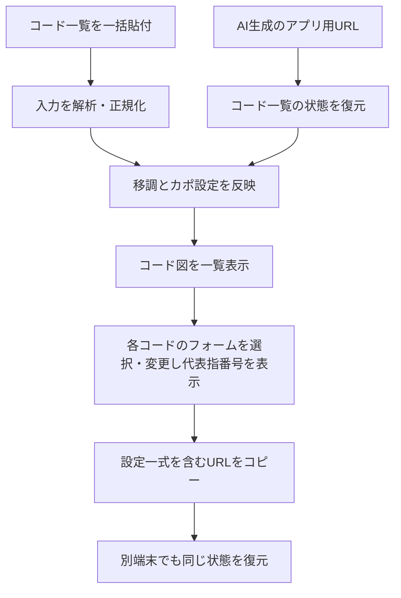

Here is the result of "fetch" for the Page with URL https://app.notion.com/p/3ff69357608b800f9731f2ff3f23f1e3 as of 2026-10-24T12:12:34.338Z:
<page url="https://app.notion.com/p/3ff69357608b800f9731f2ff3f23f1e3" icon="icons/electric-guitar_yellow">
<ancestor-path></ancestor-path>
<properties>
{"title":"\\[開発\\] ギターコード一覧アプリ"}
</properties>
<iconMetadata>{"type":"icon","icon":{"name":"electric-guitar","color":"yellow"}}</iconMetadata>
<content>
<p />

# ギターコード一覧アプリ｜要件定義・開発の起点

<callout icon="🎸" color="blue_bg">
<b>目的：</b> ChordWikiなどの曲別コード譜を見ながらギターを弾く際、その曲で使われるすべてのコードの押さえ方を、好みの運指で一画面にまとめる。完成した一覧は<b>アカウント登録なし・URLだけで保存／復元／共有</b>できるようにする。

<b>作成：</b> 2026-10-21（これまでの会話の要求を整理）。状態：要件整理済み、未実装。確定要件と提案・未決事項は区別する。
</callout>

## 1. 背景と解決したい課題

- ユーザーはギター初級者。好きな楽曲をネットで探し、歌詞＋コード譜を見ながら演奏したい。
- [日本語ChordWiki](https://ja.chordwiki.org/)の楽曲ページには歌詞とコード名が掲載されるが、各コードの押さえ方をまとめて確認しづらい。U-FRETは既知だが、対応楽曲が限られる。
- 別サイトの[Song Sheet Builder](https://chordwiki.com/tools/song-sheet/)を利用するとコード図を並べられる一方、提示されるフォーム／運指が本人に合わないことがあり、個別に変更した状態をリンクとして残したい。
- 曲によっては数十種類のコード、転調、オンコード（分数コード）、テンションを含み、手作業の抽出や取りこぼしがつらい。「サビだけ」ではなく曲全体のコードを網羅したい。
- 現在の実際の練習方法は、<b>日本語ChordWikiの歌詞・コード進行を参照しつつ、別画面のコード図一覧を見る</b>こと。<b>Q-01（2026-10-21）により、アプリはコードダイアグラム一覧に特化し、歌詞・コード進行をアプリ内に表示しない</b>と決定。

## 2. 確定したユーザー要件（Must）

### R-01 曲全体のコードを網羅

- 対象曲の<b>冒頭から最後まで登場するすべてのコード</b>を、重複を除いた一覧にする。サビやAメロだけに限定しない。
- 複雑なコードも省かず、メジャー／マイナー／7th／M7／add9／sus／dim／aug／b5／#11などのテンション、オンコード（例：E/G#、C#m7/F#）を保持する。
- 解釈不能なコードを勝手に落としたり、説明なしに簡略化したりしない。解釈できない場合は元表記を残し、「要確認」「コード図未対応」と明示する。
- 原則として、初出順で表示し、重複するコード名は1つに集約する。異なるコード名・指定ベース音を一方的に同一視しない。
- <b>Q-52確定（2026-10-22、A）：</b> 同じ曲に<code>Db</code>と<code>C#</code>が出現したら、<b>異なる表記のコード名ごとに別々のダイアグラムカード</b>を表示する。初出順での重複排除も入力コード名の表示上の区別を維持する。一方、Q-46に従い同一音高・同一コード種・同一分数ベース音なら、フォームの候補とブラウザに保存した好みは共通化する。別名を勝手に1枚に集約しない。
- <b>Q-14確定（2026-10-21、B）：</b> 初出順を既定とし、コード名の昇順（名称順）に切り替えるUIを提供する。手動での任意並べ替えは不要。表示順を切り替えてもコード名や選択フォームの紐付けが変わらないこと。

### R-02 押さえ方を一覧で視覚的に確認

- 曲に登場するコードについて、<b>標準チューニングの6弦ギター</b>の弦・フレット・押弦位置が分かるコードダイアグラムを一覧表示する（R-08）。
- 歌詞・コード進行はChordWikiなどの元サイトで閲覧し、このアプリには<b>コードダイアグラム一覧のみ</b>を表示する。元の曲ページへ戻る導線を提供する。主な利用端末は<b>PCとタブレット</b>。
- <b>Q-08確定（2026-10-21）：</b> ダイアグラムの表示は右利き用の標準的な向きのみとする（6弦を左、1弦を右に表示）。左利き用への左右反転・切り替え機能は対象外。登録済みの代表指番号とセーハの表示も右利き用として統一する。
- 表示コード名とコード図が対応していること（単に似たフォームを出すだけでは不可）。
- <b>Q-16確定（2026-10-21、C）：</b> 対応デバイスをPC・タブレットに限定する。スマートフォン向け閲覧／編集の専用対応・動作保証はしない（公開URLへのアクセスを技術的に拒否する要件ではない）。
- <b>Q-17確定（2026-10-21、A）：</b> 個々のダイアグラムの音楽情報はコード名・弦とフレット・代表指番号・必要なセーハに絞る。コード構成音の一覧や各弦の発音音名を追加表示しない。カポ・移調等の画面上の必須設定表示は従来どおり維持する。

### R-03 登録済みフォームの選択と代表指番号の表示

- <b>Q-05確定（2026-10-21、選択肢A）：</b> コードごとにサイト側で事前登録したフォーム候補から、好みの押さえ方を選択・切り替えられること。選んだフォームは一覧と共有URLに反映する。
- <b>自由編集は対象外：</b> 6弦分のミュート／開放／フレット番号を任意に入力・編集するフォーム作成UIは実装しない。サイトの候補外の任意フォームをユーザーが作成・URL指定することも初回公開の要件としない。
- <b>Q-04確定を維持：</b> 登録済みの各フォームに、代表指番号および必要なセーハ情報を事前に紐付けて必ず表示する。指番号のユーザー編集・独立したURL保存機能は不要。
- <b>本人向けプリセット：</b> 利用者本人が弾きやすいフォームを既定候補に含め、ログイン不要でサイトに同梱する。プリセット候補や代表運指を追加・修正する場合は、アプリのデータを更新する運用を想定する（具体的な管理方式は設計時に決める）。
- <b>プリセットの候補網羅性（2026-10-21追加希望）：</b> 各コードで一般的に使われる異なる押さえ方を<b>できるだけ幅広く収録</b>する。オープンコード、セーハ、ポジション違い等の実用的な候補を想定し、フォームと代表指番号・必要なセーハ情報をセットで持つ。無数に近い理論的な組合せを完全網羅するのではなく、実用的・正確な登録済み候補の網羅性を品質目標とする。コード種類別の収録基準・候補数・評価用一覧はQ-26とデータ検証で具体化する。
- <b>Q-13改訂（2026-10-21、ユーザーの最新指示）：</b> <b>ブラウザにコード別のお好みフォームを保存し、別の曲にそのコードが出てきた場合は保存済みの好みを自動適用する。</b> アプリで登録済みフォーム候補を選び直せ、選択後の好み設定はブラウザに保持する。優先順位は<b>URLで明示されたフォーム ＞ ブラウザに保存されたフォーム ＞ サイトに同梱された既定プリセット</b>。この変更は従来の「ブラウザに記憶しない」を撤回・上書きする。フォームそのものはQ-05に従って登録済み候補に限定し、指番号は登録済み代表値を使う。
- <b>Q-28／Q-30／Q-37／Q-38／Q-44最新版（2026-10-21）：</b> アプリで自分がフォームを選ぶ操作はブラウザ好みへ自動保存。外部URL・フォーム付き貼付ではブラウザの既存好みとの<b>差分一覧</b>から保存対象を選択して一括確定（Q-37=C）。<b>選択しなかった外部カスタム指定は、当該コードのブラウザ好みがあればそのフォームに、なければサイト初期フォームに戻す</b>（Q-44=A）。外部指定が消えた後も、最終的な押弦位置はQ-32に従いURLへ明示する。元の外部URLを開き直して差分が残れば毎回確認（Q-38=A）。
- <b>Q-49確定（2026-10-22、A）：</b> 外部URLで明示されたフォームが<b>サイト標準と同一</b>で、ブラウザに当該コードの好みが未保存なら、好みへの保存確認を<b>表示しない</b>（通常表示はサイト標準を使い、Q-32に従いURLへ具体的なフォームを明示）。一方、ブラウザにすでに異なる好みが保存済みなら、外部URLで標準フォームが明示されていても、Q-37の差分確認対象に含める。採用しなければQ-44に従い保存済み好みへ戻す。
- <b>未対応コード：</b> 入力されたコードがプリセットにない場合も、コード名を黙って欠落・簡略化せず「フォーム未対応」と明示する。そのコードにはダイアグラムと代表指番号を捏造して表示しない。難しいテンションや分数コードのプリセットを増やすためのデータ整備・受け入れ検証は重要。
- <b>Q-15確定（2026-10-21、A）：</b> 初期フォームデータは一般的なコードを優先して収録する。すべての分数コード・テンションコードにダイアグラムを保証する要件ではない。<b>複雑なコード名を省略・簡略化せず残すR-01は維持</b>する。何を「一般的」に含めるか、初期収録セットは公開前に別途明文化・テストする。
- <b>Q-15の解釈補足：</b> 「一般的なコードを優先」は、<b>各コードに1つのフォームだけで十分という意味ではない</b>。対象とするコードについて、定番の押さえ方を可能な限り幅広く候補収録する。すべての和音名／テンションの対応を保証することとは区別する。
- <b>Q-26決定（2026-10-21、A）：</b> 既存のライセンス確認可能なコードフォームDBを活用し、データの正確性を検証しながら<b>一般的に知られる押さえ方をコードごとに可能な限り幅広く収録</b>する。個別のDB／版の採用、データ統合、最低カバレッジ、分数コード・拡張コードの扱いは検証してから決定する。完全網羅は保証しない。
- <b>Q-59確定（2026-10-22、A）：</b> 初回公開前に<b>必須コード・必須代表フォームの検証用セット</b>を作り、採用するコードDBから用意した各候補について音楽的正確性と代表指番号・セーハを照合する。加えて\*\*実際の練習曲（曲全体のコード、分数・テンション等を含む）\*\*から導出したコード名一覧を照合し、取りこぼし／未対応率を測り、コード図の閲覧と押さえ方選択まで受け入れテストを行う。Q-26の「一般的なフォームを幅広く収録」の合格基準を実測可能にする。<b>必須コード集合・各コード最低候補数・未対応許容数値はデータ調査から策定するが、現時点では未確定</b>。
- <b>Q-18確定（2026-10-21、A）：</b> 未対応コードにはコード名と未対応表示のみを出し、専用の追加要望フォームや報告導線を作らない。
- <b>Q-31・Q-39確定（2026-10-21）：</b> ブラウザ好みをコードごとに一覧表示し、個別削除・全件削除できる（Q-31=A）。<b>削除されたコードが今開いている曲にある場合は、現在表示をサイト既定のフォームへ切り替え、現在の曲のURLも即時更新する（Q-39=B）</b>。URL明示よりも「設定を削除したユーザーの今この画面での操作」を優先してURL自体を書き換えるという例外であり、保存済み共有URLを別環境で開く動作とは区別する。削除しなかったコードは維持する。
- <b>Q-56確定（2026-10-22、B）：</b> 同じ曲に表記の異なる<code>Db</code>／<code>C#</code>が登場した場合は<b>カードは別々に表示する（Q-52）が、同じ音高・コード種・指定ベース音に当たるなら最終的な押さえ方は両カードで統一</b>する（Q-46）。外部URLから同じ音の2コードへ<b>異なるフォームの明示指定があれば競合として確認</b>し、無断で片方を勝たせない。合意したフォームへ両カードの表示とURLをそろえる。解決前の一時表示と競合時の確定／取消処理は設計で定める。
- <b>Q-48互換性（2026-10-21、A）：</b> 過去に正式登録され共有URLで利用されたフォームを通常の候補一覧から廃止・整理する場合も、<b>互換用の登録済みフォームデータとして押弦位置・代表指番号・セーハを保持</b>し、古い共有URLから再現可能にする。互換用フォームは新規の通常候補への表示を必須としないが、URL読込時には登録済み候補として照合する。任意フォーム入力を許可する決定ではない。
- <b>Q-54確定（2026-10-22、A、Q-48の例外）：</b> 過去の登録済みフォームに<b>音楽的な誤り</b>（実際の音や指定ベースの不一致、押弦不可能など）が判明した場合は、互換用データとして内部に記録を残しても<b>誤ったコード図は表示せず、警告する</b>。旧URLからの完全な図の再現はこの場合に限り保証外。黙って他の形へ差し替えることも禁止。誤りと判断する検証基準・発見済み誤登録の移行ポリシーは設計で決める。
- <b>技術設計で検討：</b> 現行と互換用フォームの識別とデータバージョン、フォームの音程・指番号不整合の修正時の互換性、同じ押弦位置のコード別照合を検証する。

### R-04 URLだけで保存・復元・共有

- <b>コード一覧と各コードのカスタマイズ結果を含む状態</b>をURLで保持できる。
- <b>Q-03追記：</b> AI等が生成した本アプリ用URLから、個別コードの好みのフォームを明示的に指定・上書きできること。単なる曲名・コード一覧だけでなく、選択フォームの情報もブラウザに保存済みの状態なしで解釈できること。クエリパラメータ方式はユーザーの希望であり、実際のパラメータ名・エンコード形式／フラグメント採用は技術設計で検証して確定する。
- そのURLをブックマークしたり別端末に送ったりして開くと、<b>同じ曲・同じコード名・同じ押さえ方</b>が復元される。
- 少なくとも曲識別情報／任意サイトの出典URL（指定時）、表示するコード一覧、移調情報、カポ位置、各コードに対して<b>選択した登録済みフォーム</b>を再現できること。<b>Q-05で自由編集フォームは対象外とした。</b> 指番号は登録済みフォームに紐づくサイト側の代表運指データから表示し、ユーザー編集値としてURLに保存しない。プリセット更新後の互換性・代表運指の表示継続性はURL設計で決める。
- <b>フォーム選択・好み保存とURLの優先順位（Q-13／Q-30／Q-37〜Q-39／Q-44）：</b> 通常の選択は<b>URL明示 ＞ ブラウザ保存の好み ＞ サイト既定</b>。外部URL・フォーム付き貼付から取り込んだフォームについては差分を提示し、保存するコードを選んで確定する。<b>不採用の外部指定は、ブラウザ好みがあればそれに、なければサイト既定に戻す（Q-44=A）</b>。その結果のフォームはQ-32に従って全件URLへ書き込む。現在曲の好みを明示削除した場合だけ、該当コードを<b>サイト既定</b>に戻してURLを更新（Q-39=B）。元の外部リンクを再読込した時は差分が残れば再確認する（Q-38=A）。
- <b>Q-55確定（2026-10-22、A）：</b> 外部共有URLを開いた時点では、<b>URLが明示するフォームをそのまま画面上に初期表示</b>する。その後、ブラウザの保存済み好みとの差分を示し、ユーザーが確認・一括選択した<b>不採用の外部指定だけ</b>をブラウザ好み（なければサイト既定）へ戻してURLを更新する（Q-37／Q-38／Q-44）。<b>この一時的なURLどおりの表示と、確認後の確定した表示を区別する。</b> URLを開いただけではローカル好みを変更しない。差分確認の表示中・閉じる操作での状態確定方法は実装設計で扱う。
- URLのコピー操作が分かりやすく、リンクを開くだけで閲覧できること。ログイン／端末内だけの保存に依存しない。
- <b>Q-23／Q-47確定（2026-10-21）：</b> 外部AIや人間が読み書きしやすい<b>クエリパラメータ方式のみ</b>をサポートする（Q-47=A）。圧縮フラグメント・別のURL形式は初回公開の必須要件に含めない。採用するブラウザ／ホスティングの制約と全コード・全フォーム入りURLの実測をもとに<b>上限バイト数を定義</b>し、上限超過では<b>データを黙って切り詰めず、明示的なエラーを表示</b>する。上限超過となる編集を確定させるか・前の有効URLを保持するかは後続で設計する。
- <b>Q-51確定（2026-10-22、A）：</b> フォーム変更・コード再入力等を反映した結果、生成されるクエリURLが<b>実測で定めた許容上限を超える場合は、その編集操作全体の確定を中止</b>する。画面には原因と上限超過のエラーを表示し、<b>最後に確定した有効なコード一覧・フォーム選択・カポ／移調・URLを維持</b>する。表示と共有URLの状態に齟齬を残さず、コードを勝手に削除・短縮しない。
- <b>Q-24／Q-48確定（2026-10-21）：</b> URLで選択するフォームはコード名と<b>6弦のミュート／開放／フレット位置</b>の組で指定し、現行または<b>過去に正式登録した互換用フォーム候補</b>に照合する。過去URLを無効化せず復元するため、廃止フォームの押弦情報・代表指番号・セーハを互換用データとして保持する（Q-48=A）。未知の未登録フォームは自由生成・採用せず警告。例<code>C=x32010</code>は説明用で、フレット10以上の正式なURLエンコードは後続設計で決める。
- <b>Q-10確定（2026-10-21、A）：</b> 曲の保存・再訪手段は共有URLに限定する。アプリ内の「保存曲一覧」「最近開いた曲」「端末内への曲保存」機能は提供しない。ブラウザ自身のブックマークは利用可能。
- <b>Q-10とQ-13の区別：</b> 「曲の保存はURLのみ」は曲一覧・最近の曲履歴を持たない意味。<b>ブラウザにコード別のお好みフォーム設定を保存することは許容し、最新のQ-13要件として採用</b>する。
- <b>Q-32確定（2026-10-21、A）：</b> <b>表示中の対応済み全コード</b>について、URL明示／ブラウザ好み／サイト既定いずれで選んだ場合でも、実際に表示する<b>具体的な登録済みフォームをURLに書き込む</b>。フォーム候補が存在しないコードは名前と未対応状態を維持し、架空のフォーム値を作らない。共有先でも同じフォームを復元できるURLを標準とする。
- <b>Q-55の整合検討（未決、2026-10-22）：</b> Q-04／AC-05は「共有URLを開くとブラウザ好みに依存せず同じフォームを完全復元する」を要求する。一方Q-38は「外部指定をブラウザ好みに保存しないと選んだ場合、現在の曲でも通常フォームへ戻す」と要求する。<b>リンクを開いた直後に原URLの完全状態を表示してから、ユーザーが保存対象を選んだ場合にだけ不採用部分を通常フォームへ置換し新しいURLへ更新する</b>方式なら両立できる。この処理順は設計提案であり、Q-55の回答前に確定しない。URLを開くだけで勝手にブラウザ好みを上書きすることは禁止する。
- <b>Q-19確定（2026-10-21、B）：</b> フォーム選択、入力コード一覧の反映、カポ／移調、入力コードの意味モード、表示順など<b>確定した画面状態が変わるたび</b>ブラウザのアドレスURLも自動更新する。URLコピー機能は従来の要件どおり残す。未確定の編集中テキストでURLを書き換える必要はない。履歴管理（replaceState／pushState等）は技術設計で決める。
- <b>Q-34確定（2026-10-21、C）：</b> <b>別の曲の読み込みはブラウザ履歴に追加</b>し、<b>同じ曲でのフォーム・カポ・移調・並べ替え等の設定変更は現在の履歴を置換</b>する。戻る／進むで別曲間は移動でき、同一曲内の編集履歴は一件ずつ積まない。曲の同一性の判定は後続設計で確定する。

### R-05 アカウント登録を要求しない

- <b>閲覧、編集、URL生成、URLからの復元のすべてにアカウント登録／ログイン不要。</b>
- 課金・会員登録を前提とするクラウド保存方式は採用しない。アカウントなしで利用できることを優先する。

### R-06 入力されたコード一覧と移調・カポを整合

- 参照元サイトは[日本語ChordWiki](https://ja.chordwiki.org/)に限定しない。AI等で正規化された入力コード名に対して、アプリの表示名・フォーム・移調・カポが矛盾しないよう扱う。参照元で移調済みのコードを受け取る場合は二重移調を避ける（ChordWikiの例は検証ケースとして維持）。
- 例：「お願い！シンデレラ」の原譜で Db／Eb／Ab／Fm7 が出る場合、<b>移調−1 ＋ カポ1</b>なら演奏用フォームは C／D／G／Em7 となる。アプリの一覧もその「演奏用コード」で提示する。
- 「実際に鳴るコード（原曲キー）」と「カポを前提に指で押さえる形」を混同しない。設定値と表示結果が明示されること。
- <b>Q-07確定（2026-10-21）：カポ位置はユーザーが手動で指定する。</b> カポ位置の自動提案・弾きやすさに基づくおすすめ順位付けは不要。ただし手動で設定した位置と移調・演奏用コード名・フォーム・実音の整合を取る処理は引き続き必須。入力済みのコードが実音か既に演奏用コードかについては二重移調防止のため別途仕様化する。
- <b>Q-35確定（2026-10-21、A）：</b> 手動カポ位置は<b>0〜12フレットの整数</b>に限定し、0はカポなしとする。範囲外・小数・非数値は有効な設定として採用せず、入力を勝手に別の値に丸めない。
- 日本語ChordWikiの移調済みページを参照した場合も、二重移調やキー不一致が起こらないこと。
- <b>Q-11確定（2026-10-21、C）：</b> 入力するコード名の意味を\*\*「実際に鳴らしたいコード（実音）」または「ギターで押さえるフォーム名（演奏用コード）」から選択\*\*できる。どちらの入力でも、カポ・移調と矛盾なく表示・URL復元できること。モード選択は共有URLの状態に含める。
- <b>Q-36確定（2026-10-21、A）：</b> アプリの「移調＋1／−1」は<b>貼り付けられた入力コードを基準とする追加の半音移調操作</b>。元サイトの移調量を表示するだけの機能ではない。Q-11の実音／フォーム入力モードとの整合、カポ変更時の保持対象（Q-20）、二重移調防止は必須。<b>適用順序は「入力モードのコードにアプリ追加移調→カポによる実音／フォーム変換」を候補として検証し、既存AC-03の例を含む受け入れテストで確定する。</b>
- <b>Q-41／Q-45改訂（2026-10-21、Q-45=Cで確定）：</b> <b>元サイトですでに移調済みかどうかと、その移調量はURL・入力状態で明示可能</b>にする。表示上の移調設定は<b>単一の合計値</b>（例：元サイトで−1、アプリ追加0なら画面では−1）とし、内部では<b>元サイトで適用済みの移調量</b><code>sourceShift</code>と<b>貼り付けたコードへのアプリ追加移調量</b><code>appShift</code>を区別する。画面に表示する合計は<code>sourceShift + appShift</code>。音の計算には、すでに移調済みの入力に<code>sourceShift</code>を二重適用せず、<code>appShift</code>だけを加える。例：元サイト原譜Dbを−1した結果Cを貼付すると、初期表示移調−1でも押さえるコード計算の追加移調は0。UIで表示を0に変えると追加移調+1となり、貼付CはDbとなる（カポ・入力モードの換算は別途）。<b>元サイト側が移調後のコードを表示しない場合</b>には、入力コードの意味モードと適用済み量を申告できる仕組みを維持する。URLパラメータ名・入力モード切替時のリセット・同じキー表記の扱いは後続設計で検証。
- <b>Q-57確定（2026-10-22、A）：</b> 元サイトで<b>既に適用済みの移調量</b>を入力・修正する項目は、<b>「詳細設定」に設ける。通常の画面ではQ-45どおり合計移調量の単一設定</b>を表示。AI生成URLからも元サイトの既適用移調量を指定でき、指定省略時は0（Q-50）。元サイト既適用分を貼り付けコードに二重適用せず、追加移調のみ演算する。
- <b>Q-50確定（2026-10-22、A）：</b> 元サイトで<b>すでに適用した移調量</b>を、アプリの画面でも設定でき、AI生成クエリURLからも指定できるようにする。明示指定がなければ<b>適用済み量は0</b>を既定とする。Q-45の<b>通常の移調表示は合計の単一値</b>とし、元サイト既適用値の入力UIは詳細設定などで提供する設計が可能。追加移調量は内部で区別し、既適用量を入力コードへ二重加算しない。
- <b>Q-20維持／Q-45補足：</b> カポ変更時は実音入力なら実音、フォーム入力なら演奏用フォーム名を保持（Q-20=A）。移調表示はQ-45=Cによって単一の合計値となるが、内部の元サイト適用済み分を二重に加算せず、<b>入力コードに対してアプリの追加移調のみ</b>を適用してからカポ／実音を整合させる。
- <b>Q-21のコード別フォーム参照（2026-10-21）：</b> 移調・カポによって演奏用コードが変化したら、変化後の<b>演奏用コード名</b>に紐づくフォーム選択を参照する（URL明示 ＞ ブラウザ好み ＞ サイト既定）。DからCに変わったとき、D用フォームをそのままCへ流用せず、C用の選択を参照する。<b>「初期プリセットに戻す」という以前の推薦は、Cに好み設定がある場合を無視しており不適切だったため撤回。</b> カポはフォーム図の相対フレット位置と実際のネック位置を区別する。コード名の異名同音正規化と一時的な移調操作の選択保持は後続設計で検証する（ADR-021）。

### R-08 対象楽器とチューニング（Q-06）

- <b>Q-06確定（2026-10-21、選択肢A）：</b> 初回公開は<b>6弦ギター・標準チューニング（6弦から1弦：E–A–D–G–B–E）に限定</b>する。アコースティック／エレキの区別は設けず、一般的な6弦標準チューニングを共通の前提とする。
- <b>対象外：</b> Drop D、半音下げ、オープンチューニング等の変則チューニング、7弦・12弦等の別弦数のギター、ベース、ウクレレ等の他楽器。自動チューニング判定や切り替えUIも作らない。
- <b>既存要件の維持：</b> カポ位置の設定、移調と実音／押さえるフォームの整合（R-06）は引き続き対応する。<b>カポは標準チューニング前提のフレット位置に対するオフセットであり、変則チューニング対応とは別物。</b>
- <b>プリセット：</b> 標準チューニング用にコード名、6弦のフレット位置、代表指番号・セーハを登録する。URLの楽器／チューニング指定の省略値・互換性は技術設計で確定する。

## 3. 入力体験（Q-02・Q-03確定。詳細な貼り付け構文は未決）

### R-07 コード一覧の一括貼り付け・AI生成URLによる入力

- <b>Q-02決定（2026-10-21、選択肢C）：楽曲URLを渡して、そのページから本アプリが自動取得・解析する機能は不要。</b> 初回公開の要件・検証対象から外す。出典URLを保存・元ページへ遷移する機能とは区別する。
- <b>正式な入力経路：</b> <b>基本はChatGPT等のAIまたは外部ツールで正規化済みのコード名一覧を一括貼り付ける方式</b>。コードの収集元はChordWikiに限定せず、任意のコード譜サイト・ユーザー作成の一覧でよい。AIがコード一覧と必要に応じ好みのフォームを組み込んで生成した本アプリ用URLを開く経路も維持する。曲の全コードを毎回1つずつ登録する操作は避ける。
- 出典となる楽曲ページURLは、リンクとしてユーザーが設定・保持できるようにするが、<b>それを入力しただけで曲のコードを取りに行く仕様にはしない。</b>
- <b>Q-03決定（2026-10-21）：</b> 正規化済みコード名一覧の貼り付けを<b>主たる入力形式</b>にする。元サイトのHTML／歌詞混在のコード譜そのものを解析する専用機能は、この回答だけでは必須とはしない。コピペ時の許容区切り文字・別名表記・エラー表示の詳細、および補助的な入力方式の採否は未決。
- <b>Q-25決定（2026-10-21、B）：</b> <b>貼り付ける正規化済みコード一覧の正式な基本文法はカンマ区切りの1行テキストに統一</b>する。例：<code>C,Am7,G,Fmaj7,Bm7b5,E/G#</code>。人が毎回読むのではなくAI等が生成する前提とし、改行なしのコンパクトな入力欄を重視する。空白・改行・角括弧・JSONを別形式として必須対応にはしない。コード名の周囲の空白除去、空要素、全角記号や誤表記、カンマを含む特殊な和音表記等のエラールールは実装設計で定義する。オンコードの<code>/</code>は区切り文字でなくコード名の一部として保持する。
- <b>Q-40確定（2026-10-21、C）：</b> 同じカンマ区切り1行の貼付欄で、コードだけのトークン（<code>Am7</code>）に加えて<b>フォーム指定付きの</b><b><code>コード名@6弦位置</code></b>（例：<code>C@x32010,Am7,G</code>）を受け付ける。コード名リストという単一入力欄の構成は変えず、AIが好みフォーム付きの一覧を作れるようにする。<b>指定できる押弦はQ-05に従い登録済みフォーム候補のみ</b>。複数桁のフレット番号・特殊コード表記のエンコード、未登録フォーム指定時のUIは後続で定義する。
- <b>Q-58確定（2026-10-22、B）：</b> <code>コード名@6弦フォーム</code>の<b>構文は正しいが押弦がそのコードの現行／互換用の登録済み候補と一致しない</b>場合は、入力全体の確定を止めず、そのコード名を一覧に残して\*\*「指定フォーム未対応」等の警告を表示し、該当カードのコード図を描画しない\*\*。他の有効なコード・フォームは表示し、現在の表示結果をURLへ反映できる。ただし元の不正な指定を無断で標準フォームに置き換えてはならず、エラー状態をURLで再現する。<b>Q-33の「構文エラーは再反映中止」とは異なる分類</b>である。
- <b>Q-53確定（2026-10-22、A）：</b> <code>C@x32010</code>のように<b>1桁のフレットを弦ごとに1文字で表せる場合は既存の短い書式</b>を維持し、<b>10フレット以上を含む場合は6弦すべてをコロンで区切る</b>（例：正しいCメジャー形の<code>C@8:10:10:9:8:8</code>）。<code>x</code>はミュート、<code>0</code>は開放弦。<code>C@x:10:12:12:11:10</code>は<b>形式説明用の以前の例だが、実際の音はGマイナーでCではないため、有効なCのフォーム例として採用しない</b>。コード名との音楽的一致とサイト登録済みフォーム照合を必須とする。2つの書式以外を必須対応にしない。
- <b>Q-33（2026-10-21）：</b> 空要素などの不正構文では反映をブロックし、元の有効状態を維持する。未知だが構文上有効なコードは未対応として残す。半角／全角・コード表記の正規化許容範囲は別途設計する。
- <b>Q-12確定（2026-10-21、再回答A）：</b> AI等で正規化されたコード一覧を貼り付けた後、誤字・不足・余分なコードの修正は<b>元の入力テキスト全体を編集して再反映</b>する方式とする。コードカード上の名前変更・コード追加・削除UIは不要。フォーム候補の切り替えは従来どおりカードで行う。変更内容を再反映した時にURLを自動更新する（Q-19）。
- <b>Q-33確定（2026-10-21、A）：</b> カンマ区切り入力に構文エラー（例：<code>C,,Am7,G</code> の空項目）がある場合は<b>入力全体の再反映を中止し、エラーを表示する</b>。途中まで取り込んだ状態にせず、反映前の有効なコード一覧とフォーム選択・URLを維持する。<b>構文は妥当だがプリセットがないコード</b>は別問題であり、従来どおりコード名を残して「フォーム未対応」とする。
- <b>Q-22確定（2026-10-21、A）：</b> コード一覧テキストを修正して再反映しても、<b>引き続き存在する同じ演奏用コード名</b>については選択済みフォームを維持する。削除されたコードの選択の扱い、移調やコード名表記ゆれを伴う入力差分の照合方法は別途設計で明確化する。
- <b>AI向けURLインターフェース（希望・設計課題）：</b> コード一覧に加えてコードごとの<b>登録済みフォーム候補</b>をURLで指定可能にする。外部AIが組み立てられる公開・バージョン付きスキーマが望ましい。<b>Q-05により未登録の任意フォームの指定は対象外。</b> 指番号はユーザー指定せず、サイト側のフォームプリセットから表示する。未知のフォーム指定は黙って別のフォームへ置換せず警告する。パラメータ表現・クエリ長などは後続の技術設計で確定する。
- <b>網羅性の境界：</b> 本アプリが確約するのは、受け取ったコード一覧の中で対応・未対応を含めたコードを黙って欠落させないこと。入力自体に曲後半のコードがなければ、元楽曲との自動照合はできない。Q-03で入力負担と網羅性の検証導線を検討する。
- R-01〜R-06、特にコードごとのカスタムフォーム・移調／カポ整合・URLからの完全復元の要件は維持する。

## 4. 典型的な利用フロー

1. ChordWikiを含む任意のコード譜サイトなどで弾きたい曲を参照し、必要なら移調・カポの設定を決める。
2. AI等で正規化した曲のコード一覧をまとめて貼り付ける。または、外部AIが生成したコード一覧・好みのフォーム指定を含むアプリ用URLを開く。元曲URLは任意の出典リンクとして指定する（元ページの自動取得はしない）。
3. 入力した全コードの重複排除済みダイアグラム一覧が表示される。出典URLが指定されていれば元サイトへ戻れる。
4. 押さえづらいコードについてサイト側に登録済みの別フォーム候補を選び、その代表指番号を確認する。自由フォーム編集・指番号編集はしない。プリセット未対応のコードは明示する。
5. 「リンクをコピー」で現在の状態をURLにする。
6. 後日PC／タブレットでそのURLを開き、同じ一覧と各コードで選択したフォームで練習を再開する。



## 5. 初回公開の受け入れ条件（テスト可能な形）

- <b>AC-01 網羅性：</b> <b>入力された</b>コードについて、対応可能なものは表示し、解釈できないものも「要確認」として残して黙って欠落させない。入力に含まれていないコードは自動で補完できないため、元楽曲全体との照合は入力者または別途用意した正解データで検証する。
- <b>AC-02 正確性：</b> ダイアグラムは弦・フレット、開放弦／ミュート弦、コード名と一致し、<b>登録済みフォームに整合する代表指番号（必要ならセーハ）を必ず表示する。</b> 対応できない複雑なコードは、コード名と「フォーム未対応」を明示し、不正確な図や指番号を表示しない。
- <b>AC-03 移調：</b> 原譜 Db → 移調−1で C、カポ1で実音 Db になるケースを正しく扱い、設定値とコード名を保持する。
- <b>AC-04 フォーム選択：</b> 任意の1コードについて登録済みの別フォーム候補を選ぶと、そのフォームと代表指番号が直ちに表示され、他コードには影響しない。<b>フレット位置を自由編集するUI、指番号単独の編集UIは存在しない。</b>
- <b>AC-05 URL復元：</b> 複数コードについてプリセット候補を選び、カポ・移調を変更した共有URLをシークレットウィンドウ／別端末で開いても同じコード名・選択済みフォーム・設定を復元できる。代表指番号はフォームに紐づくサイト側プリセットから表示する（指番号単独の変更状態は存在しない）。
- <b>AC-06 登録不要：</b> 上記の全操作がログインなしで完結する。
- <b>AC-07 PC・タブレット：</b> 横並びのコード図が読みやすく、タップ・クリックで編集できる。
- <b>AC-08 入力：</b> AI等で正規化済みのコード名一覧を一括貼り付けすると、出典サイトに依存せずコードを解釈・一覧化できる。コード一覧を含むAI生成の本アプリ用URLからも復元できる。<b>楽曲ページURLからの自動取得・抽出は要件としない。</b> 歌詞混在テキスト等を直接解析する機能は必須とはしない（必要性は別途検討）。
- <b>AC-09 共有の再現性：</b> 別端末のブラウザに保存データがない場合でも、共有URL単体で復元できる（ブラウザのlocalStorageだけに依存しない）。
- <b>AC-10 非破壊：</b> 簡易コード化や省略フォームの提案があっても、元のコード情報が失われない。
- <b>AC-11 表示範囲（Q-01）：</b> 曲を読み込んだとき、出現コードのダイアグラム一覧は表示するが、歌詞本文や歌詞に沿ったコード進行の譜面は表示しない。出典URLが指定されていれば元の楽曲ページに遷移できる。共有URLの復元に歌詞本文を必要としない。
- <b>AC-12 入力経路（Q-02）：</b> 出典として任意サイトの曲ページURLを設定しても外部ページの自動取得は実施しない。正規化済みコード名一覧の一括貼り付けで一覧を作成でき、外部AIが生成した仕様準拠のアプリ用URLを開くと、そのコード一覧を復元できる。
- <b>AC-13 好みのフォーム指定URL（Q-03/Q-05）：</b> 仕様に従ったアプリ用URLで、コードごとに異なる<b>登録済みフォーム候補</b>を指定すると別ブラウザでも同じフォームと代表指番号を復元できる。指番号自体のURL指定と任意の未登録フォームのURL指定は不要。未知の候補指定には警告し、別の押さえ方へ黙って置換しない。
- <b>AC-14 代表指番号と個人プリセット（Q-04/Q-05）：</b> サイトに登録された各フォーム候補には、押弦位置と一致する代表指番号・必要なセーハ情報が存在し、一覧・フォーム選択後に表示される。本人が好む初期フォームがプリセットとして用意され、ログインなしで利用できる。指番号編集UIは存在せず、未対応コードは誤った指番号を捏造しない。
- <b>AC-15 プリセット限定（Q-05）：</b> フォーム変更操作で登録済み候補だけを選べる。各弦の押弦位置を新規作成・編集する操作はない。プリセットにないコードを入力しても元のコード名を欠落させず「フォーム未対応」と表示する。URLで存在しないフォームを指定した場合も安全に通知し、黙って異なる候補を採用しない。
- <b>AC-16 対象楽器・標準チューニング（Q-06）：</b> 6弦から1弦がE–A–D–G–B–Eとなる6弦ギター用の登録済みフォーム・代表指番号を表示する。変則チューニング／別弦数／別楽器の選択UIはなく、対応すると誤認させない。カポ位置・移調の処理は標準チューニングを前提として動作し、実音と押さえるコード名が矛盾しない（AC-03とも照合）。
- <b>AC-17 カポ手動設定（Q-07／Q-35改訂）：</b> <b>整数0〜12フレット</b>の手動指定を受け付け、0はカポなし。設定値が画面と共有URLへ反映・復元される。−1／13／小数／数字以外は有効なカポ値として採用しない。自動カポ提案は提供しない。実音とフォーム名の整合をAC-03と照合する。
- <b>AC-18 右利き用ダイアグラムのみ（Q-08）：</b> コード図は6弦が左、1弦が右の標準的な右利き用表示とし、押弦位置・代表指番号・セーハの描画がプリセットと一致する。左利き用表示への切り替え、左右反転オプションおよびそのURL保存項目は存在しない。
- <b>AC-19 印刷専用機能を設けない（Q-09）：</b> 印刷ボタン、専用の紙面向けレイアウト、独自のPDF生成・ダウンロード機能を提供しない。ユーザーが利用するブラウザの標準印刷・PDF保存操作は妨げないが、ブラウザやプリンターごとの出力品質は受け入れ対象外。コード図一覧の通常画面表示を優先する。
- <b>AC-20 URLだけの曲保存（Q-10）：</b> 編集済みURLを別ブラウザで開いて同じ曲状態を復元できる。アプリ独自の「保存曲一覧」「最近の曲」「曲を保存」UIやブラウザ内の曲コレクションは存在しない。
- <b>AC-21 入力コードの意味を選択（Q-11）：</b> 「実音」と「演奏用フォーム名」を選択でき、同じコード名でもモードとカポ設定に対応した表示が得られる。例：実音Db＋カポ1→Cフォーム、フォームC＋カポ1→実音Db。モード・カポ・変換に必要な状態をURLから復元でき、二重移調を防ぐ（変換や移調時の保持規則は後続で詳細化）。
- <b>AC-22 入力テキストの一括再編集（Q-12再確定）：</b> 表示後もコード一覧の入力テキストに戻り、例「C Am G」を「C Am7 F G」に修正・再反映するとコード集合・順序・未対応コード表示が更新され、確定後のURLも同期する。コードカードからのコード名編集・追加・削除UIは存在しない。同じコード名に紐づくフォーム選択の維持・リセット規則はQ-22で定義する。
- <b>AC-23 外部フォームとの差分保存・URLと好みの優先順位（Q-13／Q-30／Q-37／Q-38）：</b> (1) URLで明示したフォームはブラウザ好みより優先し、候補の正しさを照合する。(2) 外部URL／フォーム付きテキストの受取時に未保存または異なるコード別フォームを検出して、差分一覧で保存候補を提示する。(3) ユーザーが保存対象に選んだコードのみブラウザ好みを更新する。(4) <b>選択されなかった外部カスタム指定を現在の曲からも除外し、通常フォームへ戻す</b>。最終的なフォームはURLに明示する。<b>Q-44=Aで解決：ブラウザ保存済み好みがあればそれ、なければサイト既定フォームに戻す。</b>(5) ユーザーがアプリのフォーム候補を直接選び直す操作では、確認なく好みに保存する。(6) 再度元の外部URLを開き、依然として保存済み好みと異なる指定があれば毎回差分確認する。(7) 正規化された完全URLは好みのない別ブラウザでも同じフォームを復元できる。
- <b>AC-24 並べ替え（Q-14）：</b> 初出順とコード名昇順を切り替えられ、どちらも重複コードが正確に1件ずつ現れる。順序を切り替えても選択フォームは保持され、現在の表示順は共有URLから復元できる。任意のドラッグ並べ替えはない。
- <b>AC-25 初期フォームの収録と非破壊（Q-15）：</b> 公開前に定めた一般的なコードの検証用セットで登録済みフォームと代表指番号を表示できる。未収録の分数・テンション・その他のコードは元表記を保持し、ダイアグラムを捏造せず「フォーム未対応」と表示する。全種類のコードの図示までは要求しない。
- <b>AC-30 登録済みフォームの候補網羅性（2026-10-21追加）：</b> 初期公開用に定義したコード別の必須候補セットを満たし、同じコードでも代表的なオープンフォーム・セーハ・フレット位置の違う登録済み候補（該当する場合）から選び直せる。すべての候補で押弦音とコード名（分数コードのベース音を含む）・代表指番号・セーハが整合し、データ不正・重複を検査できる。具体的なコード種類・最低候補数はQ-26／データ調査で決定する。「理論上すべてのフォーム」を受け入れ条件とはしない。
- <b>AC-26 PC・タブレット対象（Q-16）：</b> 公開前に確定するPC・タブレットの対象ブラウザ・画面幅で閲覧・フォーム選択・URL共有／復元ができる。スマホ専用UIとスマホ動作の受け入れテストは対象外とし、端末判定による閲覧拒否は要件としない。
- <b>AC-27 コード図の情報範囲（Q-17）：</b> コード名、押弦位置、開放／ミュート、代表指番号、必要なセーハのみをダイアグラム内の音楽情報として表示する。構成音リストや各弦の音名は表示しない。カポ位置・移調等の必須設定表示は引き続き行う。
- <b>AC-28 未対応コードの警告（Q-18）：</b> 入力中にプリセット未収録コードがあっても名称と未対応状態を表示し、他のコードの表示を妨げない。未対応フォームの要望フォームや送信機能は設けない。
- <b>AC-29 URL自動更新・履歴（Q-19／Q-34）：</b> 反映済みコード一覧、フォーム選択、カポ、移調、入力コードの意味モード、表示順が有効に変化するとブラウザURLへ同期し、別端末で復元できる。<b>別曲の読み込みは履歴に新規エントリを追加、同じ曲の設定変更は現在の履歴を置換</b>する。戻る／進むでは別曲の状態へ戻れるが、同じ曲の1操作ごとには履歴を増やさない。確定前の編集中テキストではURLを更新しない。
- <b>AC-31 好みの自動適用時もURLを同期（2026-10-21追加）：</b> 好みが保存されているブラウザで、フォーム指定のないコード一覧を新しく読み込むと、ブラウザ好みを適用した直後のURLにそのコードの具体的なフォーム選択が入る。フォームが明示された共有URLを開く場合、ローカル好みがその選択を上書きしない。ブラウザの好みを持たない端末でも、生成済みの完全なURLなら同じフォームを再現できる。
- <b>AC-38 カンマ区切りコード一覧（Q-25）：</b> <code>C,Am7,G,Fmaj7,Bm7b5,E/G#</code> を一括入力すると、スラッシュを分数コードの一部として維持し、各入力コードを重複排除して一覧へ反映する。主要入力形式はカンマ区切りの1行であり、その他の区切り・JSON等は必須ではない。空要素・未知コード・構文エラーを黙って落とさない（詳細なエラー動作は後続設計）。
- <b>AC-39 既存DB活用とデータ検証（Q-26）：</b> 公開前に出典とライセンスを記録した既存フォームDB由来の候補を評価し、採用候補はコード構成音、分数コードのベース音、各弦の押弦位置、代表指番号、セーハ、重複を検証する。初期収録コード・代表フォーム候補の検証用一覧を作成し、Q-15の一般コード優先方針およびAC-30の複数フォーム表示を満たす。特定の未検証DBを事前に採用済みと扱わない。
- <b>AC-40 外部候補の選択的保存（Q-28／Q-30／Q-37／Q-38）：</b> アプリ内で手動選択したフォームは確認なしでコード別好みへ保存する。一方、外部URL／フォーム指定付き貼付で未保存または保存済みと異なるフォームが複数到着した場合、<b>差分一覧を表示して保存したいコードを個別に選べ、選択分を一括保存</b>できる。<b>未選択の外部カスタム指定は現在曲から除外して通常フォームへ戻し、最終フォームをURLへ反映</b>する。同じ元URLを開くたびに差分があれば確認する。保存済みと同じ値しかない場合は確認しない。確認前に暫定的な画面表示をするかどうかはUI設計で決める。
- <b>AC-41 好み適用・完全URL（Q-29／Q-32）：</b> フォーム省略のコードにはブラウザの好み、なければサイト既定を適用し、<b>表示可能な全コードについて採用した具体的フォームをURLに即時明示</b>する。元URLで明示指定されたフォームはブラウザ好みより優先し、そこで採用したフォームもそのままURLに保持する。フォーム未対応コードは名前・未対応状態を残し架空のフォーム指定を作らない。生成されたURLを好みのない別ブラウザで開いても同じフォームを復元できる。
- <b>AC-42 Q-30／Q-37／Q-38の複数フォーム保存テスト：</b> 保存済みCフォームと異なるC指定・未保存のAm7指定などを外部URL／フォーム付きテキストから受信すると、差分一覧で各コードを選択できる。選択されたフォームのみ好みへ一括登録し、<b>未選択の外部指定をURLから除外して通常フォームに戻す</b>。同じ未採用外部URLを後から再度開けば、まだ差分があるため再確認される。ユーザーが通常のフォームUIを操作した場合はダイアログを出さず保存する。最終表示フォームをURLへ明示する。
- <b>AC-43 好み一覧・個別削除・全削除（Q-31／Q-39）：</b> ブラウザ保存済みのコード名・フォーム一覧を表示し、1コードだけ削除または全件削除できる。<b>現在の曲に削除対象のコードがあれば直ちにそのコードをサイト既定フォームに戻し、曲URL内のフォーム指定もサイト既定値へ更新</b>する。現在の曲に関係のない好み削除は他のコード表示に影響しない。後日、異なる曲でそのコードを読む場合もURLの明示指定がない限りサイト初期フォームとなる。全削除の誤操作防止は未決。
- <b>AC-44 全登録済みフォームのURL明示・旧URL互換（Q-32／Q-48）：</b> サイト既定・ブラウザ好み・URL指定のいずれに由来しても、現在表示する対応済み全コードの具体的な6弦位置をクエリに明示する。別環境で同じフォームを復元する。<b>Q-48に従い、現行候補から廃止した形でも、過去に登録された互換用のフォームデータが存在すれば古いURLを同じ形と代表指番号で再現する。</b> 互換用にもない未知の形は黙って別形に置換しない。未対応コードは名前を保持し架空の形を作らない。
- <b>AC-45 Q-33構文エラーは再反映を中止：</b> <code>C,,Am7,G</code> の空項目等、無効なカンマ区切り文字列を再反映しようとするとエラーを表示し、直前の有効な一覧・フォーム選択・URLを維持する。部分的に正常なコードだけを反映しない。一方、構文は正しい未登録コードは一覧内に名前と未対応表示を残す。
- <b>AC-49 Q-40同一貼付欄のフォーム付き構文：</b> <code>C@x32010,Am7,G</code>をコード一覧の<b>同じカンマ区切り1行入力欄</b>で受け付ける。Cの登録済み<code>x32010</code>フォームを選択し、Am7とGはURL明示・ブラウザ好み・サイト既定から補完できる。コード名だけの<code>C,Am7,G</code>も従来通り有効。未登録・文法不正なフォーム指定は勝手にフォームを新規生成せず安全にエラーまたは未対応の状態を示す（後続で詳細規則を決める）。
- <b>AC-50 Q-44 不採用の外部フォームのフォールバック：</b> ブラウザにCの保存済みフォームBがあり、外部URLでCのフォームAを受け取って差分一覧で不採用にした場合、Cは<b>保存済みBに戻り、最終URLにもBを明示</b>する。好みが未保存なら<b>サイト既定のCフォーム</b>に戻し、その位置をURLへ明示する。外部Aはどちらの場合もブラウザ好みに保存されず、曲と最終URLの指定から除外される。同じ元URLを再び開き差分が残る場合はQ-38どおり再確認される。
- <b>AC-51 Q-45 単一移調表示と適用済み区別：</b> 入力のCが「元サイトで−1移調済み」とURL等で指定された場合、移調UIは<b>−1</b>、内部のソース既適用値は−1、アプリ追加移調は0とする。<b>入力Cに再度−1を加えない</b>。UIで合計移調を0に変更すればアプリ追加移調が+1となり入力CをDb相当へ移調する。URLから、入力コード・入力解釈モード・ソース既適用量・追加移調量・画面上の合計移調量の関係が完全復元できる。元サイトが原譜のみ表示する場合も誤った二重移調をしない。カポ換算はAC-03／AC-21と照合する。
- <b>AC-52 Q-46 異名同音でのフォーム／好み共有：</b> DbとC#を同じコード種・同じ指定ベース音条件で入力した場合、共通化可能な登録済みフォーム候補とブラウザ好みを双方で利用できる。各コードの表示は元のDb／C#表記のまま。Dbmaj7とC#7などコード種が異なるもの、Db/FとC#/G#など指定ベース音が異なるものを勝手に同一視しない。共有した好みの変更・削除やURL明示値は正しいコード名のまま復元できる。
- <b>AC-53 Q-47 クエリURL長上限：</b> 50〜60コードなど十分な規模の実データで、URLを<b>UTF-8でパーセントエンコードしたバイト長</b>として測定し、採用するホスティング・ブラウザで安全に利用できる最大長を設定・公開する。<b>クエリ以外の圧縮／フラグメント形式を必須にしない</b>。上限を超えるURLは明確なエラーと対処案を提示し、コード・フォーム・設定を黙って削除したり、部分的なURLを正常な共有URLとして発行したりしない。長過ぎる編集の確定状態／URL同期待ちの具体的なUXは後続設計で定義する。
- <b>AC-54 Q-48 互換用フォームの過去URL復元（Q-54例外あり）：</b> 正しく登録されていたCのフォームAを現行選択候補から廃止しても、弦位置・代表指番号・セーハを保持した互換用プリセットによって旧URLの同じ図を復元する。現行の新規候補にAを表示する義務はない。過去に登録されていない任意フォームURLは不正として警告する。<b>ただしQ-54により、Aにコード構成音・指定ベースなど音楽的な誤登録が発覚した場合は、当該旧URLの図の完全再現を例外として行わず、AC-60に従い誤った図を非表示にして警告する。</b> 無断で他フォームに代替しない。
- <b>AC-55 Q-49 標準フォームと保存確認の条件：</b> 未保存のコードCに、サイト標準と同じフォームを明示した外部URLを開いても、ブラウザ好みへの保存確認を表示しない。Cにサイト標準と異なる好みBが保存済みで外部URLに標準Aが明示されている場合は、差分一覧でAを保存するか確認する。Aを不採用ならQ-44に従ってBを表示し、最終URLにもBを明示する。他人のURLを開いただけで好みを無断変更しない。
- <b>AC-56 Q-50 元サイト適用済み移調量の入力：</b> 元サイト移調の適用済み値を画面上から設定でき、AI生成クエリURLからも同じ値を設定・復元できる。省略時の値は0。画面で主に表示する移調値はQ-45どおり<b>適用済みと追加分の合計1つ</b>で、元サイトで既に移調された入力に適用済み分を再加算しない。例：移調済みC、適用済み−1、追加0の初期表示は−1でCを再移調しない。
- <b>AC-57 Q-51 URL長超過時の原子的な編集拒否：</b> URL全体の生成結果が実測上限より長くなるコード追加・フォーム変更・カポ／移調変更等は、エラーを表示してその操作全体の確定を中止する。<b>最後の有効な一覧・フォーム・表示設定・アドレスURLを全て維持</b>し、半端なデータ・長すぎる不完全URL・共有できない確定表示状態を残さない。
- <b>AC-58 Q-52 異名同音カードは別表示で好みを共有：</b> 同じ曲の入力に<code>Db,C#</code>が含まれる場合、同一音高でもコード名の表示を維持して<b>DbとC#の2つのコード図カード</b>を出す。共通化できる候補・ブラウザ保存好みは両方で利用できる。別の表記のカードが消えたり、片方の名称に勝手に書き換わらない。フォーム選択状態を異名同音の両カードで同期するか、URLで個別指定が異なる場合の解決順は後続設計で確定する。
- <b>AC-59 Q-53 2桁以上のフレットの明示区切り：</b> <code>C@x32010</code>のような1桁の押弦表記と、<code>C@8:10:10:9:8:8</code>のような6弦全てのコロン区切り表記を正しくパースする。後者はCメジャーの構成音と一致するフォーム例。<b>以前の設問中の</b><b><code>C@x:10:12:12:11:10</code></b><b>はGm相当で、Cフォームとしては不正</b>と検出・拒否する。10以上のフレットが別弦へ誤って分割されない。URLから同じフォーム・代表指番号を復元でき、登録済み候補との照合も維持する。
- <b>AC-60 Q-54 音楽的な誤登録フォームは描画しない：</b> 旧URLが参照する互換用フォームにコード構成音・指定ベース・実演可能性等の重大な誤りが判明した場合、<b>不正フォームのダイアグラムを描画せず、元コード名と理由を説明する警告を表示する</b>。別の候補へ黙って置換しない。正しい他のコードは通常表示し、Q-48の旧URL完全復元はそのフォームに限り例外として扱う。互換用データの履歴・誤登録としての状態は管理する。
- <b>AC-61 Q-55 URL表示後の外部好み保存確認：</b> 異なる好みが保存されたブラウザで有効な外部共有URLを開くと、最初に<b>元URLで指定された正しい押弦フォームをそのまま画面に表示</b>する。差分確認ではURL指定値と保存済み好みを比較し、ユーザーが保存対象にしなかったコードだけをQ-44の通常フォームへ変更してURLも更新する。確認で保存対象としたコードのみブラウザ好みを更新する。開いただけの時点では好みを変更しない。URL初期プレビューと確定後の正規化URLを区別し、最終状態は共有URLだけで復元できる。
- <b>AC-62 Q-56 異名同音カードのフォーム統一とURL競合：</b> 同じ曲にDbとC#を同時に含む場合、<b>2枚のコード図カードを表示する</b>が、同じ音高・コード種・指定ベース音の正規化キーを使い<b>最終押弦フォームを一致させる</b>。外部URLでそれぞれ異なる<b>登録済み</b>フォームが明示された場合は競合として明示し、<b>どちらかを自動優先せずユーザーに確認</b>する。確定時は両カードとブラウザのクエリURLのフォーム値を整合させる。解決前は競合を識別可能なプレビュー状態として扱い、矛盾した表示を正常な確定状態にしない。好みのブラウザ保存ルールはQ-30/Q-37を維持する。
- <b>AC-63 Q-57 元サイト適用済み移調の詳細設定：</b> 詳細設定から<code>sourceShift</code>相当の値を設定・変更でき、AI生成URLからも省略時0で同じ値を復元できる。通常画面ではQ-45どおり<b>元サイト既適用量＋アプリ追加移調量の単一合計値</b>を示す。元サイトから既に移調された入力コードへは既適用量を再適用せず、アプリの追加移調値のみ計算する。
- <b>AC-64 Q-58 構文は有効でも未登録の指定フォームは警告：</b> たとえば<code>C@8:10:10:9:8:8</code>と文法上読めても、そのフォームがCの現行／互換用候補に未登録の場合は<b>Cというコード名を残し、指定フォーム未対応の警告を表示してCのコード図だけを描画しない</b>。他の有効なコード図は表示し、編集はURLの長さ等に問題がなければ確定・共有可能。未登録フォームの指定をサイト標準フォームへ黙って置換・ブラウザ好みに保存しない。URLに未登録フォームの指定とその未対応状態を再現可能な情報を保持する。<b>構文不正（不足要素、非数値等）はQ-33に従い入力全体の再反映を中止</b>する。故障ではなくコード名の登録がない場合も、従来どおり未対応表示を維持する。
- <b>AC-65 Q-59 必須フォーム検証セットと練習曲による品質ゲート：</b> 公開判定前に、主に一般的なコード群と分数・テンションの代表コードについて、<b>必須コード名／最低フォーム候補／正しい構成音・指定ベース音／開放・ミュート／フレット位置／代表指番号／セーハ</b>を明記した検証データセットを用意する。採用する外部DBの版・ライセンス・変換結果を記録する。さらに複数の実練習曲（曲全体を含み、転調・分数コード・未対応コードも含む）で、<b>入力コードの無欠落・未対応警告・フォーム選択・移調／カポ／ブラウザ好み・URL完全復元</b>を検証する。収録範囲と数値の合格基準はDB調査後に事前定義し、データ未検証のままリリース完了とはしない。
- <b>AC-46 Q-34ブラウザ履歴：</b> ある曲Aを開き、その後別の曲Bをアプリで読み込むと履歴に新たな項目を作り、戻る操作で曲Aの状態に復帰できる。曲B内でフォームを切り替えたりカポを設定したりしても同一曲のブラウザ履歴エントリを置換し、戻る操作で毎回の編集操作へは戻らない。
- <b>AC-47 Q-35カポ範囲：</b> カポ0〜12の各整数値を受け付け、0をカポなしとして画面・共有URLで完全復元できる。−1、13、数値以外、小数値を有効値として受け付けず、勝手な丸め・切り詰めは行わない。
- <b>AC-48 Q-36追加半音移調：</b> コード名一覧を貼り付けたのちアプリの移調量を+1／−1半音すると入力コード基準で和音が半音ずつ変化し、0に戻すと入力時の基準へ戻せる。実音入力・フォーム入力の両モードで、カポとの実音／フォーム整合・二重移調防止を確認する。<b>既存AC-03「入力Db、移調−1、カポ1でCフォーム／実音Db」はフォーム名入力モードの検証例として扱い</b>、実音入力モードとの差分もテストする。
- <b>AC-32 カポ変更時の保持規則（Q-20）：</b> 実音入力Db／カポ0からカポ1に変えた場合は実音Dbを維持してCフォームとなる。フォーム名入力C／カポ0からカポ1に変えた場合はCフォームを維持し、実音がDbに変化する。入力解釈モードおよびカポを含むURLの保存・復元が成り立つ。独立した移調値との関係は別途追加テストを定義する。
- <b>AC-33 移調後コードのフォーム参照（Q-21）：</b> 表示すべき演奏用コードがDからCに変わると、Cに対するURL指定／ブラウザ好み／サイト既定の順に登録済みフォームを選ぶ。D用の物理的な押弦形状をそのままCに誤適用しない。カポ1のCフォームの図は標準チューニングでのカポ相対の押さえ方として扱い、実際の発音はDbとなる。明示指定済みのCフォームを無視してサイト初期値へ戻さない。
- <b>AC-34 テキスト再反映時の選択維持（Q-22）：</b> 例えばCをフォームBに選んだ状態で「C Am」を「C Am F」に変更し再反映したとき、Cは引き続きフォームB、Amの既存選択も保持され、新たなFはURL明示／ブラウザ好み／サイトプリセットで決まる。削除コードは一覧から除外され、共有URLは現在のコード集合と表示状態を復元できる。
- <b>AC-35 クエリURLの復元と長さ制限（Q-23／Q-47）：</b> 公開した仕様に従って人間やAIが<b>クエリパラメータだけ</b>で入力コード一覧、移調、カポ、フォーム選択等を指定でき、アプリで完全復元できる。フォーム選択変更でURLが自動更新される。50〜60コード入りURLのエンコード後バイト長を実測した上限を定義する。<b>上限超過はエラーとして扱い、コード・フォーム・設定を切り落として部分的に有効なURLを作らない。</b> 圧縮フラグメントURLは必須にしない。
- <b>AC-36 6弦位置による登録済みフォーム指定（Q-24）：</b> 6弦の状態を含むフォーム指定（例：C=x32010）を受け取ると、Cの登録済み候補と照合してフォーム・代表指番号を復元する。未登録の位置／別コード名と不整合なフォームは無断採用せず警告する。10フレット以上・カポ相対の位置も正式スキーマで安全に区別できる。
- <b>AC-37 対応ブラウザ（Q-27）：</b> PC上のChrome／Edge／macOS SafariおよびiPad Safariの現行サポート対象版で、コード入力・フォーム切り替え・ブラウザ好み保存／自動適用・URL更新／完全復元・カポ／移調の主要操作を検証する。対象版と最低画面幅をリリース前に明記する。Firefoxやスマホ専用テストは必須としない。
- <b>AC-66 公開ホスティングと単一本番環境（ADR-060）：</b> 公開先がCloudflare Workers Static Assetsであり、Cloudflare管理下の<code>chords.kani3camp.com</code>でHTTPSアクセスできる。ログイン不要で、正しいクエリURLへの直接アクセス・再読込・別ブラウザからの完全復元が可能。常設環境は本番のみで、ステージングを作らない。GitHub ActionsのPR品質ゲートを通った変更を<code>main</code>へマージし、Cloudflare Workers Buildsが本番へ自動デプロイする。独自ドメイン設定時は既存DNSとの競合・証明書・Workersルーティングを確認し、スマホ対応など未合意の要件を増やさない。

## 6. 非機能要件・設計上の注意

- <b>プライバシー／運用（2026-10-24確定）：</b> ログイン・登録不要。ユーザーの曲状態は共有URLへ、コード別の好みだけはブラウザストレージへ保持する。Cloudflare Workers Static Assetsで静的SPAを配信し、初回公開ではアプリ用API Worker・サーバー側DB・認証を設けない。これはADR-060で採用済みの実装方針。
- <b>フォームのブラウザ別保存（Q-13／Q-28／Q-29／Q-30／Q-31）：</b> 曲の保存履歴や曲一覧は持たず、コード別のお好みフォームをブラウザ内に保存する。<b>アプリ内でフォームを手動選択すると確認なく好みを保存</b>。<b>URL遷移／フォーム指定を含む貼付入力により未保存・異なる指定が入ったときはYes/No確認後にのみ好みを登録・上書き</b>。好みの保存済み一覧の表示・コード別削除・全削除機能は必須（Q-31）。フォーム表示はURL明示 ＞ ブラウザ好み ＞ サイト既定、採用結果はURLへ即時反映。保存方式はlocalStorage等を実装時に選ぶ。
- <b>対応楽器の固定（Q-06）：</b> 6弦ギター／標準チューニングを前提にフォームと代表指番号を管理・描画する。変則チューニングや他楽器向けの一般化は要件外。カポ・移調は別の機能として整合する設計にする。
- <b>URL長：</b> 20〜60種類以上のコードと選択フォームをクエリに入れるため長くなり得る。ユーザーはAIも読み書きしやすいクエリURLを希望（Q-23）。バージョン付きのデータ形式、長さ上限、将来互換性と破損検知を設計し、<b>Q-25のカンマ区切り表記をURLに載せる際には適切なエンコードを行う。</b> 圧縮URLは必須要件ではない。
- <b>Q-43調査とQ-47／Q-51の決定（2026-10-22更新）：</b> URL長の全環境共通上限はなく、[RFC 9110](https://www.rfc-editor.org/rfc/rfc9110.html)は8000オクテット以上のURI対応を推奨。[CloudFront](https://docs.aws.amazon.com/AmazonCloudFront/latest/DeveloperGuide/cloudfront-limits.html)はURL最大8192バイト、[Cloudflare](https://developers.cloudflare.com/support/troubleshooting/http-status-codes/4xx-client-error/error-414/)は32KB超で414と記載。Q-47=Aにより<b>クエリURLのみ</b>、採用環境で実測して最大長を決定し、超過時はエラー。<b>Q-51=Aにより超過した編集を確定せず、直前の正常な一覧・設定・URLを維持する</b>。実際のバイト上限値は実装環境が定まってから測定して決定し、無断データ省略は禁止。
- <b>URL自動同期（Q-19）：</b> 変更された状態をブラウザアドレスへ反映する。技術設計ではURLの長さ、入力途中と確定時の区別、ブラウザ履歴・戻る／進む、URLエラー時の安全な復元と個別フォーム選択の保持を検証する。大量の履歴を不要に増やさないことを優先（手法は未確定）。
- <b>URL状態とフォームプリセット（Q-45〜Q-48で更新）：</b> 楽曲タイトル・出典URL（指定時）、正規化された入力コード一覧、<b>元サイトで適用済みの移調量／アプリ追加移調量（画面は合計の単一値）</b>、実音／フォームの入力モード、カポ位置、表示順、<b>対応済み全コードについての具体的な6弦位置によるフォーム指定</b>、URL仕様バージョンを共有クエリに含め完全復元する。フォームプリセットはサイトに保持し、<b>廃止フォームの過去URL互換性を維持するため登録済み旧フォームと代表指番号・セーハをアーカイブ</b>する。データの正式な符号化と旧URLのバージョン互換設計は後続で確定。未登録の任意フォームと指番号の自由編集は対象外。
- <b>コードの解釈：</b> 異名同音（Db/C#）、分数コード、拡張・変化和音、表記揺れ、コード譜に含まれる N.C. などを明確に処理。難しい和音を勝手に通常のメジャーコードへ置換しない。
- <b>Q-42／Q-46確定（2026-10-21、Q-46=A）：</b> <code>Db</code>と<code>C#</code>など、<b>ルート音高・コード種・分数コードの指定ベース音高がすべて等しい</b>場合は、フォーム候補とブラウザに保存するコード別の好みを<b>共通化する</b>。元サイトの表示コード名・分数ベースの綴りはそのまま維持し、無断でDbをC#へ改名しない。内部の好み参照キーは12平均律の音高クラス等で正規化し、<b>同じ音高でもコード種や指定ベースが異なる和音は統合しない</b>。共有フォームがそれぞれの表記で正しい構成音・指定ベース音を満たすか登録データと照合する。保存済み好みの個別削除・URL明示フォーム・表記変更時の整合も両表記で検証する。
- <b>外部サイト連携：</b> 日本語ChordWikiの楽曲URLからの自動取得・スクレイピングは<b>Q-02で対象外</b>と決定。元ページへのリンク表示は維持し、ユーザー自身が貼り付けたデータの取扱い・著作権・URL内データの安全性は別途設計する。
- <b>UX：</b> コードが大量の曲でも一覧を見渡せること。編集済みかどうか、未対応コードがあるか、現在のカポ・移調設定が分かること。<b>カポ位置は自分で設定できるが、おすすめカポ位置の表示・自動選定は行わない（Q-07）。</b> <b>Q-08：右利き用のコード図に限定し、左右反転スイッチ・左利き用レイアウト設定は設けない。</b> <b>Q-09：印刷ボタンや専用の印刷向けレイアウトは実装しない。</b>
- <b>採用・対象外機能の最新整理（Q-10〜Q-19／Q-30／Q-31）：</b> 曲一覧／閲覧履歴・個別コードの名前追加削除UI・スマホ専用対応・構成音表示・追加フォーム申請UIは対象外。コード別のブラウザ好み保存・保存済み好みの一覧表示と個別削除／全削除は採用。手動フォーム選択の好み保存は自動、外部指定からの好み保存だけ確認が必要。
- <b>実装基盤（2026-10-24更新）：</b> GitHubリポジトリは [kani3camp/chords](https://github.com/kani3camp/chords) と確定。ホスティングはCloudflare Workers Static Assets、公開用ドメインはCloudflare管理の<code>kani3camp.com</code>配下と確定。具体的なサブドメインラベルは未決。アプリの技術スタックは第12章を実装用設計ベースラインとして扱う。
- <b>Q-27確定（2026-10-21、A）：</b> PCのChrome・Edge・macOS SafariとiPad Safariをサポート対象ブラウザにする。各ブラウザでフォーム候補切替、コード入力、カポ、ローカル好み保存、クエリURLの自動更新と完全復元を受け入れテストする。対応する最低ブラウザ版・OS版・画面幅は実装前に決める。

## 7. 検証用の実例・参照元

- [お願い！シンデレラ（日本語ChordWiki、移調−1）](https://ja.chordwiki.org/wiki.cgi?c=view&key=-1&symbol=&t=%E3%81%8A%E9%A1%98%E3%81%84%EF%BC%81%E3%82%B7%E3%83%B3%E3%83%87%E3%83%AC%E3%83%A9)：原譜と移調後の表示を照合する主要テスト曲。以前の会話では「全21種類」と整理したが、<b>実装時に改めて原譜との全数照合が必要</b>。
- [夕映えプレゼント](https://ja.chordwiki.org/wiki/%E5%A4%95%E6%98%A0%E3%81%88%E3%83%97%E3%83%AC%E3%82%BC%E3%83%B3%E3%83%88)：コードが多数、転調・複雑なテンション・分数コードあり。以前の会話では約60種類として扱ったが、これも要再検証。網羅性と長いURLのストレステストに使う。
- [風色メロディ](https://ja.chordwiki.org/wiki/%E9%A2%A8%E8%89%B2%E3%83%A1%E3%83%AD%E3%83%87%E3%82%A3)、[流星群](https://ja.chordwiki.org/wiki/%E6%B5%81%E6%98%9F%E7%BE%A4)：当初の「出現コードだけを視覚的にまとめる」要望で挙がった曲。
- [シンデレラガールズ楽曲タグ](https://ja.chordwiki.org/tag/%E3%82%A2%E3%82%A4%E3%83%89%E3%83%AB%E3%83%9E%E3%82%B9%E3%82%BF%E3%83%BC+%E3%82%B7%E3%83%B3%E3%83%87%E3%83%AC%E3%83%A9%E3%82%AC%E3%83%BC%E3%83%AB%E3%82%BA)：多数の曲を横断して動作検証するときの候補。
- <b>重要な区別：</b> [ja.chordwiki.org](https://ja.chordwiki.org/)（歌詞・コード譜）と[chordwiki.comのSong Sheet Builder](https://chordwiki.com/tools/song-sheet/)（コード図生成）は別ドメイン。名前が似ているだけで、同一サービスであると仮定しない。
- 参考として会話で比較した既存ツール：[Guitarmonizer](https://www.fineincrements.com/guitarmonizer)、[Lyric Chord](https://lyric-chord.com/)、[Guitar Scribble](https://guitarscribble.com/chord-chart-maker)。具体的な提供機能や制限は、技術選定時に再確認する。

## 8. 初回公開方針・参照製品との比較・要件ヒアリング（2026-10-21更新）

### 8.1 確定事項（ユーザーの明示指示）

- <b>リリースは1段階のみ。</b> 初回一般公開に必要な機能を決めてから、一度に公開する。以前の「P0/MVP→P1」の段階的機能公開案は採用しない。開発中の内部マイルストーンやテスト公開の要否は別途設計する。
- <b>機能の参照対象：</b> [chordwiki.com Song Sheet Builder](https://chordwiki.com/tools/song-sheet/)を基本機能のベンチマークとする。ただし個々の機能をどこまで採用するかは、この後の要件ヒアリングで確定し、推測で「完全同等」と決めない。
- <b>独自価値の中心：</b> コードごとにサイトに登録された複数の押さえ方（フォーム）から好みのものを選択し、代表指番号とともに表示して、選択をURL共有・復元すること。<b>Q-04/Q-05の決定により指番号編集・フォーム自由編集は要件から除外。</b> R-01〜R-07のその他の要求は維持する。
- <b>公開アプリの独自性：</b> 機能の考え方を参考にしつつ、コード、画像、文章、ブランド、視覚表現を独立して制作し、素材・ライブラリの権利とライセンスを確認する。見た目を変更するだけで他の権利問題がなくなると断定しない。
- <b>役割分担（2026-10-24更新）：</b> ビジュアルデザインはClaude Design担当。ユーザーが制作した[「ギターコード一覧｜練習ワークスペース」Artifact](https://claude.ai/chat/1eac386c-aa62-4893-b52d-b6a6c94ef241?artifact=35c7675d-9688-48c5-95b1-5147e9a77245)を実装時の主要なデザイン参照とする（アクセス・保存上の留意点は第12.8章）。画面構成・情報アーキテクチャ・機能の振る舞い・URL／ルーティング設計・データ構造と検証の正本は引き続き本Notion。
- <b>Q-01確定（2026-10-21）：</b> コードダイアグラム一覧特化を選択。歌詞と歌詞付きコード進行の表示は初回公開に含めない（8.6のADR-001参照）。
- <b>Q-02確定（2026-10-21）：</b> 楽曲ページURLからの自動抽出は不要。コード一覧の一括貼り付けとAI生成のアプリ用URLを正式入力経路とする（8.7のADR-002参照）。
- <b>Q-03確定（2026-10-21）：</b> AI等で正規化済みのコード一覧を主入力とする。出典元はChordWikiに限定しない。コードごとの好みの押さえ方をURLで指定することを希望。クエリ文字列は第一候補だが詳細な符号化方式は未決（8.8のADR-003参照）。
- <b>Q-04確定（2026-10-21）：</b> 指番号は表示するがユーザー編集はしない。代表指番号とセーハの情報を事前にフォーム候補ごとにサイト側へ持たせる。本人用の初期フォームプリセットを提供する（ADR-004）。
- <b>Q-05確定（2026-10-21）：</b> フォーム変更は登録済み候補の選択のみとし、ユーザーが任意フォームを作成・編集する機能は不要（ADR-005）。
- <b>Q-06確定（2026-10-21）：</b> 初回公開は6弦ギター／標準チューニングE–A–D–G–B–Eのみ対応。変則チューニング／他弦数／他楽器は対象外とする。既存のカポ・移調要件は維持（ADR-006）。
- <b>Q-07確定（2026-10-21）：</b> カポ位置は手動指定のみ。自動提案・弾きやすさを基準とする自動選定は不要。ただし移調・演奏用フォーム・実音との整合とURL完全復元は必須（ADR-007）。
- <b>Q-08確定（2026-10-21）：</b> 右利き用のコードダイアグラム表示のみ対応。左利き用の反転表示・切り替え設定は初回公開の対象外（ADR-008）。
- <b>Q-09確定（2026-10-21）：</b> 専用の印刷機能は不要。ブラウザ標準の印刷機能に委ねる。アプリ内の印刷ボタンや専用印刷レイアウトは実装しない（ADR-009）。

### 8.2 Song Sheet Builderの確認できた基準機能（2026-10-21調査、採用範囲は未決）

- 曲名とコード／歌詞の貼り付け（コードを歌詞行の上に並べる方式、歌詞内に \[G\] のように埋め込む方式）、分数コードと多くのコード種類の入力。
- コード／歌詞の譜面表示、出現コードの重複排除・初出順のダイアグラム一覧、調の表示、移調。
- カポの提案／設定、左利き向けの表示、印刷、端末内の曲保存、歌曲全体を含む共有リンク、登録不要。
- ギター標準チューニングとウクレレ標準チューニングが説明されている。各楽器の採用範囲や表示UIの厳密な機能同等性は未確認。
- <b>参照先で未確認・本アプリで追加したい点：</b> 個々のコードのフォームを選択／変更し、その選択を曲単位の共有URLから完全復元する。<b>指番号はQ-04でフォームごとの事前登録済み代表運指を表示し、指番号編集は不要と決定。</b>
- 調査元：[Song Sheet Builder](https://chordwiki.com/tools/song-sheet/)／[Qiita：OpenSpec＋grill-with-docs](https://qiita.com/resound/items/b742f4afe06c2446ad6e)。

### 8.3 ヒアリングと決定の進め方（採用方針）

- 参考Qiita記事にならい、<b>実装前に未決事項を明示し、回答・判断理由・受け入れ条件をこのNotionへ記録</b>する。非自明な意思決定はADRとして残す。
- <b>質問形式の更新（2026-10-21、ユーザー希望）：</b> 以前の「1問ずつ」から、複数の独立した設問を<b>一括で選択・回答できる形式</b>へ切り替える。選択肢はタップ操作で選べるようにし、<b>未回答は保留</b>として扱い、既定値を本人の決定と誤認しない。矛盾する回答がある場合は設計を確定する前に整理する。
- <b>自由記述欄：</b> 各設問に任意の補足入力欄を用意する。選択肢と一緒に送信でき、選択肢を選ばず自由記述だけ提出することも可能にする。記述が選択肢と矛盾していたら勝手に確定しない。
- <b>回答UIの追記（2026-10-21、ユーザー希望）：</b> 一括選択フォームの<b>設問ごとに任意の自由記述欄</b>を用意し、選択肢と共に追加条件・例外・補足を回答できるようにする。選択肢を未選択でも自由記述だけ送れる。選択肢と記述内容が衝突する場合、記述を無視したり選択肢を機械的に確定したりせず、意図を整理して判断する。
- 質問の一括回答後に、初回公開の機能表、ユーザーフロー、非機能要件と受け入れテストを確定する。GitHubリポジトリ指定後は必要に応じてOpenSpecを採用し、仕様とIssue／PRを対応付ける。現段階でツール導入や実装開始が済んだとはしない。

### 8.4 確定・未決事項（2026-10-21最新）

- <b>Q-01〜Q-19：</b> 既存ADR-001〜ADR-019に記録。<b>Q-13は最新指示で改訂</b>し、ブラウザに好みフォームを保存・別曲へ自動適用する。現在の曲に採用したフォームをURLへ即時反映する。優先順位は<b>URL明示 ＞ ブラウザ保存の好み ＞ サイト既定</b>。過去の「ブラウザに記憶しない」は撤回（ADR-013改訂・AC-23／AC-31）。
- <b>Q-20=A 確定：</b> カポ変更時は入力モードに従い、実音入力なら実音、フォーム入力ならフォームを保持（ADR-020）。
- <b>Q-21 自由記述から方針確定：</b> 最終的な演奏用コード名に紐づくフォーム選択（URL ＞ ブラウザ好み ＞ サイト既定）を使用する。以前の初期プリセットへの無条件リセット案は撤回（ADR-021）。
- <b>Q-22=A 確定：</b> コード一覧のテキスト再反映後も、引き続き存在する同じ演奏用コード名のフォーム選択を維持する（ADR-022）。
- <b>Q-23=A 確定：</b> AI・人間が読みやすいクエリパラメータ中心（ADR-023）。
- <b>Q-24=B 確定：</b> 6弦の押弦位置をURLで指定し、サイト側に登録されたフォームだけを受け付ける（ADR-024）。
- <b>Q-27=A 確定：</b> PC Chrome／Edge／Mac Safari／iPad Safariが対象（ADR-027）。
- <b>Q-25=B 確定（2026-10-21）：</b> 貼り付けコード名一覧は<b>カンマ区切りの1行</b>に統一。例：<code>C,Am7,G,Fmaj7,E/G#</code>。AI出力をそのままコンパクトに貼る想定。空白・改行・JSON等の別形式を必須にしない。細かなエラー処理は未決（ADR-025／AC-38）。
- <b>Q-26=A 確定（2026-10-21）：</b> 既存フォームDBを基礎に、ライセンス・コード構成音・分数ベース音・押弦位置・指番号・セーハを検証して、定番の押さえ方を幅広く収録。実際に採用するDBと版、最低カバレッジは未決（ADR-026／AC-39）。
- <b>Q-28はQ-30で改訂（2026-10-21）：</b> 外部URLやフォーム指定付き貼付入力で未保存／異なるフォームを受け取ったときは好み保存を確認しYesなら保存。一方で、<b>自分がアプリのフォーム選択UIで選んだ場合は確認なしで即時保存</b>する（ADR-028／ADR-030、AC-40／42）。
- <b>Q-29=A 確定（2026-10-21）：</b> URLでフォーム未指定のコードにはブラウザの好みを適用し、適用結果をURLへ即時反映（ADR-013改訂、AC-41）。
- <b>Q-30〜Q-36 すべて決定（2026-10-21）：</b> Q-30＝外部指定の場合のみ好み保存のYes確認、アプリ内手動選択は自動保存。Q-31=A 保存済み好みの一覧／個別・全削除。Q-32=A サイト既定も含め全コードのフォームをURL明示。Q-33=A 不正構文では全体再反映中止。Q-34=C 別曲は履歴追加・同曲設定変更は置換。Q-35=A カポ0〜12。Q-36=A 貼付コード基準で半音の追加移調。ADR-030〜036、AC-42〜48参照。
- <b>Q-37〜Q-40 確定（2026-10-21）：</b> Q-37=Cで外部差分を一覧表示し、ブラウザの好みに保存するコードを選んで一括確定。Q-38=Aで未採用フォームは現在曲からも除外し、元URLを再び開いたら差分がある限り毎回確認。Q-39=Bでブラウザ好み削除時は現在曲もサイト既定へ切り替えURL更新。Q-40=Cで同じカンマ区切り欄に<code>C@x32010,Am7,G</code>形式を許す。ADR-037〜040、AC-23／40／42／43／49に反映。
- <b>Q-41〜Q-43の検討結果をQ-45〜Q-47で確定：</b> Q-45=C（元サイトで移調済みの値とアプリ追加移調は内部で分離、画面は合計の単一値）。Q-46=A（Db/C#など同音高・同コード種・同分数ベース音なら好みとフォーム候補を共有、表示名は維持）。Q-47=A（クエリURL形式のみ、実測バイト上限を超えたらデータを切り捨てずエラー）。ADR-045〜047、AC-51〜53に記録。
- <b>Q-44〜Q-48 全問確定（2026-10-21）：</b> Q-44=A（不採用外部フォームはブラウザ好み／なければサイト既定へ戻す）、Q-45=C（UIは単一移調量、内部はサイト既適用と追加分を区別）、Q-46=A（異名同音の好み共有）、Q-47=A（クエリのみ・長さ上限エラー）、Q-48=A（互換用フォームを残して過去URL復元）。ADR-044〜048、AC-50〜54に記録。
- <b>Q-49〜Q-54 全問確定（2026-10-22）：</b> Q-49=A（サイト既定と同じ外部指定でブラウザ好み未保存なら保存確認不要、保存済み好みと異なる場合は確認）、Q-50=A（元サイト適用済み移調は画面とURLの両方で設定・省略時0）、Q-51=A（URL長超過時は編集をロールバックし最後の有効状態を保持）、Q-52=A（Db/C#は別カード、好みは共有）、Q-53=A（10フレット以上は6弦コロン区切り）、Q-54=A（音楽的に誤った旧フォームは表示せず警告、Q-48の例外）。ADR-049〜054／AC-55〜60を採用済み。
- <b>Q-53設問の誤記訂正：</b> <code>C@x:10:12:12:11:10</code>は音の構成がGmでCではない。有効なハイポジションのC例は<code>C@8:10:10:9:8:8</code>。形式は採用するが誤った形をCとして登録・表示してはならない。
- <b>Q-55〜Q-59 全問確定（2026-10-22）：</b> Q-55=A（外部URLを初期表示して差分確認後、不採用分のみ通常フォームへ変更）、Q-56=B（Db/C#は別カードだが最終フォームを統一し、URL上の競合は要確認）、Q-57=A（元サイト適用済み移調量は詳細設定で入力）、Q-58=B（構文上正しい未登録フォーム指定はコード名と警告を残し、図だけ非表示）、Q-59=A（必須コード・代表フォームの検証セットと練習曲で公開判定）。ADR-055〜059／AC-61〜65に記録。これ以上のユーザー向け細かな機能質問は原則増やさず、次はURLスキーマ、データモデル、テスト、実装設計を具体化する。

### 8.5 公開前の権利・依存関係に関する注意

- [日本語ChordWikiの利用規約](https://ja.chordwiki.org/TermOfUse.html)では、歌詞の著作権は権利者に帰属し、サイトの許諾の下での表示が他サイトへの転載許諾を意味するわけではない。またコード譜ソース等の権利について別途定めがある。歌詞やソースの無断収集・保存・再配布を前提にしない。Q-02により本アプリによる自動取得は採用しないが、ユーザーがコピーして貼り付ける形式や共有URLに含める情報の権利・利用条件はなお確認する。
- <b>Q-10〜Q-19の確定対象外：</b> 左利き表示、専用印刷、曲の端末内保存（曲履歴／曲一覧）、自由フォーム編集、Q-12の個別コードカードからの追加・削除・名称修正、自由並べ替え、スマホ対応保証、構成音表示、未対応フォーム申請UI。<b>「ブラウザで個人的なフォーム選択を記憶しない」は最新Q-13で撤回。</b> ブラウザには曲一覧でなくコード別の好み設定だけを保存する。
- 従来対象外としたアカウント機能、フル歌詞の転載、音源同期、大規模楽曲DB等は、現時点では自動採用しない。<b>歌詞表示はQ-01で不採用を確定</b>（歌詞・コードを一括貼付した場合の内部処理方法は別途検討）。

### 8.6 ADR-001 コード図一覧への特化（2026-10-21、採用済み）

- <b>決定：</b> Song Sheet Builderの歌詞付き譜面表示は踏襲しない。本アプリは、元サイトの楽曲ページを参照しながら使う<b>重複排除済みのコードダイアグラム一覧</b>に特化する。
- <b>選択肢：</b> A＝歌詞＋コード進行も表示、B＝コード図一覧のみ、C＝切り替え式で両方表示。ユーザーがBを明示選択。
- <b>主な理由と効果：</b> 既存の利用方法に合致し、運指変更・URL完全復元を中心価値として設計できる。歌詞の転載や大容量の共有URLに依存しない。
- <b>トレードオフ：</b> 歌詞とコード進行を本アプリ単体で演奏用に表示できない。元サイトへの明確なリンクとPC／タブレットの並列閲覧を重視する。
- <b>実装への含意：</b> 一覧の表示、コード編集、移調・カポ表示、出典へのリンクを中心にサイト構造を設計。歌詞を一括貼付の入力として受けるか、その処理方法・保存方針は未決であり、歌詞表示の不採用から自動的に禁止とはしない。
- <b>検証：</b> AC-11で一覧表示と元サイトへの遷移、および共有URLからの歌詞データ不要の復元を確認する。

### 8.7 ADR-002 楽曲URLからの自動抽出を採用しない（2026-10-21、採用済み）

- <b>決定：</b> 曲ページURLを入力して本アプリがページを取得・解析する機能は実装しない。ユーザーが用意したコード名一覧の一括貼り付け、およびChatGPT等がコード情報を含む本アプリ用URLを生成する方式を正式な入力経路として設計する。
- <b>選択肢：</b> A＝自動抽出を初回公開の必須条件、B＝自動抽出を優先しつつ代替も許容、C＝自動抽出は不要。ユーザーがCを明示選択。
- <b>利点：</b> 公開時に外部サイトの可用性、CORS、HTML変更、アクセス制限、サーバーによる取得処理へ依存しない設計が可能。静的Webアプリで成立する可能性が高いが、技術方式自体は未確定。
- <b>トレードオフ：</b> 元曲の全コードを取りそろえる責任は入力元に残り、アプリは入力にないコードを自動検出できない。曲全体の網羅性というR-01を満たすには、入力されたすべてのコードを取りこぼさない仕組みと、入力元との照合方法の検討が必要。
- <b>Q-03による更新：</b> 主入力はAI等で正規化済みのコード名一覧に確定し、出典サイトは問わない。歌詞混在テキストや個別サイト形式を直接解析する機能は必須にしない。出典URLのリンク保持は維持し、自動取得しない。正確な貼り付け構文や補助的な入力形式は引き続き未決。
- <b>検証：</b> AC-01、AC-08、AC-12。AI生成URLはアプリ仕様に従う形式であることを検証し、未知・不正なデータに対して安全に失敗できるよう別途設計する。

### 8.8 ADR-003 正規化コード一覧とURLでの好みのフォーム指定（2026-10-21、部分採用）

- <b>ユーザーが決定した入力方針：</b> コード譜サイトのHTMLや歌詞本文を本アプリが読み取るのではなく、基本的にAI等で正規化済みのコード一覧を貼り付けて利用する。元のコード譜サイトはChordWikiに限定せず、サイト固有の記法に依存しない。
- <b>ユーザーの追加希望：</b> コードごとに好みの押さえ方が異なるので、AIが生成するリンクでもコード別フォームをURLパラメータから指定できるようにする。これはR-03/R-04の目的を具体化するものとして採用し、AC-13で検証する。
- <b>設計時の注意：</b> <code>?</code>から始まるクエリパラメータでの指定を第一候補とするが、長いURL、エンコーディング、サーバーログへの記録、互換性等に応じて<code>#</code>以降のフラグメント方式も比較検討する。<b>どちらを正式採用するか、パラメータ名、データ形式、圧縮方式は未決。</b>
- <b>形式上の必要性（設計提案、未決）：</b> 単にデータベース内の候補IDだけに依存すると候補一覧の変更後に同じ押さえ方を復元できない可能性がある。コード名と各弦の状態（ミュート／開放／フレット番号）を自己完結的に記述できる方式を優先的に検討する。<b>Q-04で指番号／セーハのユーザー編集とURL個別指定は不要と確定。</b> 代表指番号はサイト側のフォームデータへ持つ（ADR-004）。
- <b>トレードオフ：</b> AIによるURL生成の容易さ・人間による可読性と、圧縮率・URL長・完全復元性のバランスを取る。URLを構成する外部入力は妥当性検証し、不正な入力で崩れないこと。
- <b>未決／非採用とはしない機能：</b> 歌詞混在の譜面や別サイト独自の入力形式を直接貼り付ける補助機能は、現回答のみで全面禁止とは確定せず、現時点で必須とはしない。

### 8.9 ADR-004 フォーム側に代表指番号を保持し、指番号編集を実装しない（2026-10-21、採用済み）

- <b>ユーザーの確定判断：</b> 指番号そのものを編集する機能も要件も不要。ただし、コードダイアグラムを表示するときは、各フォームに対応する<b>代表的な指番号を必ず示したい</b>。事前にサイト側のフォームプリセットへ代表指番号・必要なセーハ情報を持たせる。初期プリセットは本人向けの好みの押さえ方を優先して用意する。
- <b>意味の区別：</b> フォーム＝ミュート／開放を含む6弦の押弦位置、代表運指＝そのフォームに対してサイトが採用した指番号・セーハ。同じフォームに複数の自然な指使いがあり得るが、UIで選ぶのはフォームであり、運指の選択・編集ではない。
- <b>データ責務：</b> 登録済みフォーム候補には「6弦の配置＋代表指番号（必要なセーハ含む）」がそろっていることを必須にする。コードごとの初期候補は本人の好みを優先。サイト公開・アカウント不要・共有URLからのフォーム復元は維持する。
- <b>URL方針：</b> フォームの選択・変更を共有URLに保存し、代表指番号はフォームからサイト側データに基づき解決する。指番号だけのカスタム保存・編集はしない。将来プリセット変更後の運指再現性・バージョン管理は別途検討する。
- <b>Q-05で解消：</b> ユーザーは登録済みフォームの選択のみを希望し、任意フォームの手動作成・編集を不要と確定。登録済みの候補には代表指番号を付与し、未登録のコードは無理に図示せず未対応表示する（ADR-005）。
- <b>検証：</b> AC-02・AC-04・AC-05・AC-13・AC-14。指番号が登録済みフォームの押弦位置・セーハと整合し、フォームを変えると対応する代表指番号へ変わる。指番号の変更UIは存在しない。未登録の押さえ方へ根拠のない指番号を自動付与しない。

### 8.10 ADR-005 登録済みフォーム候補からの選択に限定（2026-10-21、採用済み）

- <b>決定：</b> Q-05の選択肢Aを採用。利用者はコードごとの登録済みのフォーム候補を選択する。弦・フレット位置を自由に作成・編集する機能、登録外の任意フォームをURLで指定する機能は不要。
- <b>決定の影響：</b> これまでR-03で要求されていた「候補が合わなければ手動指定できる」は今回の明示指示によって廃止。サイトに登録されている候補からのみ選択することで、各フォームの代表指番号・セーハ情報を確実に紐付けられる。
- <b>トレードオフ：</b> 候補にないフォームを利用者自身では追加できない。好みのフォームや複雑なコードの必要候補は、事前データ整備または運営者によるプリセット更新で対応する。プリセットにないコードは名前を保持し「フォーム未対応」と表示して黙って落とさない。
- <b>URL要件：</b> コードごとのフォーム選択はURLで復元する。候補の識別IDと弦・フレット状態のどちらを記録するかは、AIによるURL生成容易性と将来のプリセット変更互換性の観点で後続の設計で決定。未登録の候補指定は警告し、勝手に別のフォームに置き換えない。
- <b>受け入れ条件：</b> AC-04、AC-05、AC-13、AC-14、AC-15。

### 8.11 ADR-006 6弦ギター／標準チューニングのみ対応（2026-10-21、採用済み）

- <b>ユーザーの決定：</b> Q-06の選択肢Aを採用。対象は6弦ギター、標準チューニング（6弦から順にE–A–D–G–B–E）に限定する。アコースティック／エレキの区分による別仕様は設けない。
- <b>対象外：</b> 変則チューニング（半音下げ、Drop D、オープンチューニングなど）、弦数の異なるギター、ウクレレやベース等の他楽器。設定画面にもその選択UIを設けない。
- <b>維持する既存要件：</b> 移調とカポの整合（R-06／AC-03）およびフォーム別の指番号・セーハ表示は維持。カポ装着で実音が変わっても、押弦形状は標準チューニングの相対的フレット位置を前提とする。
- <b>判断理由：</b> 主な利用目的に集中し、異なる弦数・チューニングに必要なフォーム・代表指番号データの増大、誤表示、URL仕様の複雑化を避ける。
- <b>受け入れテスト：</b> AC-16。標準チューニングの6弦用フォームと代表指番号が一致し、変則チューニング・他楽器を選択できず、標準チューニングのカポ・移調表示が一致する。
- <b>Q-07で確定：</b> カポは手動設定のみで、自動提案を搭載しない（ADR-007）。URLのバージョンとチューニング省略値の表現は技術設計で決める。

### 8.12 ADR-007 カポ位置は手動設定のみ（2026-10-21、採用済み）

- <b>決定：</b> Q-07の選択肢Aを採用。カポ位置はユーザーが手動で選ぶ。アプリはおすすめカポ位置の自動提案、フォームの弾きやすさの採点・おすすめ順表示、カポ位置の自動選定を行わない。
- <b>維持する要件：</b> カポ位置の変更・表示・URL保存／復元、移調値と演奏用フォームの整合、原曲キーで実際に鳴るコードとの整合はR-06／R-04で引き続き必須とする。
- <b>理由・効果：</b> AI等で正規化したコード名と必要な移調・カポ情報を指定する使用方法に適合し、自動最適化の複雑な仕様・演奏容易性の主観的採点を避けられる。
- <b>トレードオフ：</b> 最適なカポ位置の発見は利用者または外部AIに委ねる。アプリは手動指定が正しく反映されることに専念する。
- <b>非決定事項：</b> カポの選択UIと入力可能範囲、入力コードが実音か演奏用フォームか、カポを変更した際の移調・フォーム候補の更新方法、既に移調された入力の扱いは後続の質問・設計で定義する。手動設定は自動的な整合計算を不要とする意味ではない。
- <b>受け入れ条件：</b> AC-03、AC-05、AC-17。

### 8.13 ADR-008 右利き用コードダイアグラムのみ（2026-10-21、採用済み）

- <b>決定：</b> Q-08の選択肢Aを採用。標準的な右利き用のコードダイアグラム表示のみ対応し、左利き用への左右反転・切り替え機能を実装しない。
- <b>仕様への影響：</b> コード図は6弦が左、1弦が右の通常配置で固定し、登録済みプリセットの代表指番号と必要なセーハ表示もこの配置に対応させる。左利き表示に関する設定項目や共有URLの状態データは設けない。
- <b>理由・トレードオフ：</b> 主たる利用者に必要な基本体験に集中でき、運指と描画の検証範囲を減らせる。他方、左利き向け反転図を必要とする利用者はその表示を利用できない。
- <b>受け入れ条件：</b> AC-18。表示方向と代表運指の整合性を確認し、UIと共有URL形式に左利き表示設定が存在しないことを検証する。

### 8.14 ADR-009 印刷専用機能を実装しない（2026-10-21、採用済み）

- <b>決定：</b> Q-09は選択肢A。アプリ内の印刷ボタン、印刷向けレイアウト、独自PDF生成／ダウンロード機能は不要。印刷したい場合はブラウザ標準の印刷・PDF保存操作を利用する。
- <b>理由：</b> 主要な使用方法はPC・タブレットでのコード図一覧の閲覧とURL保存・共有であり、印刷専用体験より画面上のコード表示とフォーム選択を優先する。
- <b>トレードオフ：</b> 印刷時の改ページや余白などをアプリ側で最適化・保証しない。ブラウザ標準の印刷は妨げないが、印刷結果を専用の受け入れ条件にはしない。
- <b>受け入れ条件：</b> AC-19。独自の印刷ボタンと専用レイアウトがなく、閲覧と共有URL復元が成立することを検証する。
- <b>進め方の希望（更新）：</b> 選択肢をタップして回答できる形式を維持しつつ、ユーザーの2026-10-21の指示により<b>複数設問をまとめて選択・送信する方式</b>に切り替える。未回答の設問は保留として扱う。

### 8.15 ADR-010 曲の保存は共有URLのみ（2026-10-21、採用済み）

- <b>決定：</b> Q-10=A。アプリが曲を保存するのではなく、コード一覧と選択フォーム・設定を含む共有URLを唯一の保存・再訪手段とする。ブラウザ内の最近の曲、保存済み曲の一覧、曲の個別保存操作は作らない。
- <b>理由／トレードオフ：</b> ログイン不要・外部DB不要の簡素な構造に合致する。一方、過去の曲の管理はブックマークやURL保管など利用者側に委ねられ、アプリ内の曲一覧は利用できない。
- <b>検証：</b> AC-20／AC-09。URLだけで別環境に復元でき、保存曲一覧や自動履歴が存在しない。

### 8.16 ADR-011 入力コードの意味を2モードから選べる（2026-10-21、採用済み）

- <b>決定：</b> Q-11=C。貼り付けたコード一覧を「実音のコード名」か「カポを踏まえた演奏用フォーム名」かを入力時に選べるようにする。選択値はURLで保存・復元する。
- <b>理由／トレードオフ：</b> AI・外部サイトによって既に移調済みのコードを受け取る場合も対応でき、二重移調を避ける入り口になる。ただし単一モードより計算・説明が複雑になる。
- <b>重要な未決：</b> カポ変更時に実音／フォームのどちらを保持するか、独立した「移調」操作の基準と適用順、既存のフォーム選択の扱い。<b>これらをQ-11の回答だけから勝手に確定しない。</b> Q-20以降で決定し、AC-03／AC-21に落とす。
- <b>検証：</b> AC-21。実音Db・カポ1→Cフォーム、フォームC・カポ1→実音Dbのようにモード差を識別でき、共有URLから復元される。

### 8.17 ADR-012 入力後はテキスト全体を修正して再反映（2026-10-21、採用済み）

- <b>変更履歴：</b> 初回Q-12=Aの質問意図が不明瞭だったため一度保留し、具体例で再確認した結果、<b>再回答もA</b>。これを正式決定とする。
- <b>決定：</b> 「C Am G」を貼って表示した後、Fが足りない・AmをAm7に変更したい場合は、コード一覧入力欄の元テキストを修正して<b>再反映</b>する。ダイアグラムカード上にコード名の修正、コードの新規追加、削除ボタンを設けない。
- <b>維持する別操作：</b> 登録済み候補のフォーム切り替えはコードカード上で行う。再反映後の一覧変更はQ-19のURL自動同期対象。
- <b>理由・トレードオフ：</b> 主入力をAI正規化テキストに統一し、修正経路の二重化を避ける。1コードのみの変更でも入力テキストに戻る必要がある。
- <b>残る仕様課題：</b> 同じコード名のフォーム選択を入力テキスト再反映後も維持するか、候補の識別と入力テキストにおける表記揺れをどう扱うかはQ-22等で確認する。
- <b>受け入れ条件：</b> AC-22。再反映後のコード一覧・URLが更新され、コードカードにはコード名の編集・追加・削除機能がない。

### 8.18 ADR-013 コード別の好みをブラウザへ保存し、URL指定を最優先（2026-10-21、改訂採用）

- <b>変更履歴：</b> 初回Q-13=Aを質問不明瞭として保留。その後「ブラウザには記憶せずURL指定、なければサイト既定値」と一度確定したが、<b>2026-10-21の最新のユーザー指示「お好みフォームはブラウザに保存して、他の曲をお好み指定なしで入力したときに自動で適用したい（urlにも即時反映）」により上書き・撤回。</b> 設計とテストでは常に本改訂を優先する。
- <b>決定：</b> 登録済みフォームから選択し直せるUIを維持し、ユーザーのコード別好みフォームを同じブラウザに保存する。別の曲で同じフォーム名のコードが登場しURLに個別指定がない場合はその好みを自動適用し、ブラウザアドレスURLにも即時反映する。
- <b>優先順位：</b> <b>(1) URLに明示した登録済みフォーム → (2) ブラウザ保存のコード別フォーム → (3) サイト同梱の初期プリセット。</b>
- <b>Q-10との区別：</b> 曲履歴・曲一覧の保存はしない。ブラウザに保存するのはコード名に紐づく好みのフォーム設定だけ。
- <b>Q-28をQ-30で改訂：</b> 外部URL・フォーム指定付き貼付入力から受け取ったフォームがブラウザ好みと未一致の場合だけYes／No確認し、Yesで登録・更新する。<b>アプリ内のフォームを自分で選び直した場合は確認せず即時保存する。</b> Noでも現在の曲のフォーム・URLは有効に保つ。
- <b>Q-29 追加決定：</b> URLにフォームの明示指定がなければブラウザの好みを適用し、<b>適用したフォームをURLに即時反映する</b>。URLで明示されたフォームがあるコードではURLが最優先。
- <b>Q-19／共有URLとの整合：</b> 好みを使って曲を生成したら、選んだフォームをURLへ書き込むことで他端末でも同じ状態を再現できるようにする。URLでの明示設定は、その端末に保存済みの好みで上書きしてはいけない。
- <b>重要な未決（URL完全復元との関係）：</b> 一部フォーム指定が欠けた「テンプレートURL」はブラウザの好みによって初回表示が変わり得る。共有するURLは選択済みフォームを全件明示した完全なURLに正規化する必要がある。単に他者のURLを開いただけで保存済みの自分の好みを変更するか、好み保存の契機（アプリ上で明示的にフォームを選んだ時など）は後続の質問で定義する。
- <b>プリセット収録との整合：</b> 対象は事前登録済みフォーム候補のみ。代表指番号・セーハはサイトのデータから表示し、任意フレット入力・指番号編集機能は不要。
- <b>トレードオフ：</b> 複数曲で同じ押さえ方を使う手間を減らせる一方、端末間でブラウザ好み自体は同期されない。選択済みフォーム入りの共有URLによる再現を重視する。
- <b>受け入れ条件：</b> AC-23、AC-31、AC-40〜42。外部指定の好み保存には確認が必要、アプリ内手動選択は確認なし保存、現在の曲のURL同期・別端末での完全復元は維持。

### 8.19 ADR-014 初出順／名前順の切り替え（2026-10-21、採用済み）

- <b>決定：</b> Q-14=B。重複コードを集約し、初出順（既定）とコード名昇順の表示順を切り替えられるようにする。ドラッグなどでの任意並べ替えは不要。
- <b>理由／トレードオフ：</b> 曲の登場順を追いたい場合と、コード名から探したい場合の両方に対応。ソート状態も共有URLに反映する。コード名の自然順（#／♭、異名同音、大小文字）は実装時に基準を決める。
- <b>検証：</b> AC-24。切り替えても同じコード集合とフォーム選択を保ち、順序がURLから再現される。

### 8.20 ADR-015 一般的なコードを優先収録（2026-10-21、採用済み）

- <b>決定：</b> Q-15=A。初回公開時の登録フォームは一般的なコードを優先し、すべての分数コード・テンションコードの図をあらかじめ網羅することは求めない。
- <b>理由／トレードオフ：</b> 代表指番号の正確性を犠牲にして大量のフォームを用意するより、よく使うフォームの品質を高める。一方、複雑なコードに図がない場合がある。
- <b>R-01との整合：</b> 対応外でも入力されたコード名を欠落・簡略化せず「フォーム未対応」として残す。<b>入力コードの網羅性と、図を用意したコードの網羅性は別の要件。</b>
- <b>検証／未決：</b> AC-25。一般的なコードの具体的な基準セットと分数コード等の優先度はQ-26を受けて定義し、検証可能な一覧を作る。

### 8.21 ADR-016 PC・タブレットのみをサポート（2026-10-21、採用済み）

- <b>決定：</b> Q-16=C。対象端末はPC・タブレットのみ。スマホ向けの専用閲覧・編集対応は不要。
- <b>理由／トレードオフ：</b> 歌詞サイトとコード図を横に並べる主用途へ適した画面幅・操作設計に集中できる。スマホでの快適な利用は保証しない。
- <b>注意：</b> Webサイトを公開する以上、スマホからアクセスされる可能性はあるが、意図的な閲覧拒否や端末ブロックまでは要求しない。
- <b>検証／未決：</b> AC-26。PC・タブレットの最低サポートブラウザ／画面幅はQ-27などで確定する。

### 8.22 ADR-017 コード図の情報は代表指番号まで（2026-10-21、採用済み）

- <b>決定：</b> Q-17=A。各コードカードの音楽情報はコード名、押弦位置、開放／ミュート、代表指番号、必要なセーハに絞る。コード構成音や各弦の音名は表示しない。
- <b>理由／トレードオフ：</b> コードを見ながらすぐ弾ける一覧に集中できる一方、コード理論の学習支援や押弦ごとの音名確認はできない。カポ・移調など操作上の情報は別途画面に表示する。
- <b>検証：</b> AC-27。プリセットどおりの図と代表指番号が表示され、追加の構成音や発音音名は表示されない。

### 8.23 ADR-018 未対応コードは名前と警告のみ（2026-10-21、採用済み）

- <b>決定：</b> Q-18=A。未登録のコード名を元のまま保持して、未対応と明示する。フォーム追加リクエスト／報告機能は作らない。
- <b>理由／トレードオフ：</b> ユーザーからの収集用バックエンドや運用窓口を増やさず、問題のあるコードを発見できる。ユーザーはアプリ内から追加を要求できない。
- <b>検証：</b> AC-28。未対応と表示して他のコードの表示は継続し、申請UIがない。

### 8.24 ADR-019 確定した編集内容をブラウザURLに自動反映（2026-10-21、採用済み）

- <b>決定：</b> Q-19=B。適用済みコード一覧、フォーム選択、カポ・移調、入力解釈モード、表示順など保存対象の状態が変わるたびブラウザアドレスの共有URLを自動更新する。「リンクをコピー」ボタンは従来どおり残す。
- <b>理由／トレードオフ：</b> 明示的な保存ボタンを押し忘れてもアドレスの共有で再現できる。一方、長いURL生成、ブラウザ履歴、編集途中の不正データによる状態破壊を設計で防止する必要がある。
- <b>解釈：</b> コード入力欄に一文字入力するたびでなく、<b>再反映／確定した操作</b>を共有URLへ反映する。テキストの未確定編集中の扱いと履歴更新方式は別途設計する。
- <b>検証：</b> AC-29。編集のたびに有効な最新URLになり、別ブラウザ・ブラウザ更新で同じ状態が復元される。URLの長さ上限・履歴・戻る／進むは後続設計で決める。

### 8.25 ADR-020 カポ変更は入力モードのコードを保持（2026-10-21、採用済み）

- <b>決定：</b> Q20=A。実音モードなら実音を維持してフォームを再計算し、フォームモードならフォームを維持して実音を再計算する。独立した移調操作の意味・計算順序は別途設計する。
- <b>検証：</b> AC-32。

### 8.26 ADR-021 移調後の演奏用コードでフォームを参照（2026-10-21、基本方針採用）

- <b>回答：</b> Q21は選択肢なしの自由記述。移調やカポ調整後に演奏用コードがCになるならCの設定を参照する、という意図を採用。
- <b>決定：</b> 変換後の演奏用コード名をキーに、URL明示 ＞ ブラウザ好み ＞ サイト既定でフォームを選択。移調前の別コードの物理的な形をそのまま流用しない。
- <b>訂正：</b> 以前の「必ず初期プリセットへ戻す」提案は、新しいコードに紐づく好みの選択を無視するため撤回。カポ上の押弦はカポ相対のフレットとして扱い、ネック上の絶対フレット番号と区別する。
- <b>未決：</b> 一時移調から戻る際の選択履歴、異名同音、非収録コードの扱い。
- <b>検証：</b> AC-33。

### 8.27 ADR-022 再反映後も同名コードの選択を維持（2026-10-21、採用済み）

- <b>決定：</b> Q22=A。入力テキスト全体の再反映で存在し続ける同じ演奏用コード名については、選択済みフォームを維持する。新しく増えたコードはURL明示／ブラウザ好み／サイト既定から選択する。
- <b>検証：</b> AC-34。

### 8.28 ADR-023 人間・AIが読めるクエリURL（2026-10-21、採用済み）

- <b>決定：</b> Q23=A。コード一覧・フォームを含む状態をクエリパラメータ中心で表す。圧縮フラグメントや二重形式対応は必須ではない。
- <b>留意：</b> URL長、ログ／共有時の露出、過去リンク互換性は検証が必要。
- <b>検証：</b> AC-35。

### 8.29 ADR-024 フォームURL指定に6弦位置を使用（2026-10-21、採用済み）

- <b>決定：</b> Q24=B。コード名と6弦の位置（ミュート／開放／フレット）の組でフォームを指定し、登録済み候補と照合して採用する。C=x32010は説明用で、正式なURLスキーマは未決。
- <b>留意：</b> 10フレット以上の複数桁、カポ相対位置、分数コードの指定ベース音に対応する表現・照合を設計する。未登録フォームを生成する機能ではない。
- <b>検証：</b> AC-36。

### 8.30 ADR-027 対応ブラウザの範囲（2026-10-21、採用済み）

- <b>決定：</b> Q27=A。PCのChrome、Edge、macOS Safari、iPad Safariを正式サポートする。Firefox対応は必須にしない。
- <b>未決：</b> 最低OS／ブラウザ版、Androidタブレットを対象とするか、最低画面幅。
- <b>検証：</b> AC-37。

### 8.31 フォーム候補データの調査課題（2026-10-21、収録目標数は未決）

- <b>ユーザー希望：</b> 各コードについて一般的な複数の押さえ方をできるだけ網羅し、アプリ上で選び直せるようにする。
- <b>候補調査：</b> [tombatossals/chords-db](https://github.com/tombatossals/chords-db)はMITライセンスで複数フォームのフレット位置・指番号・セーハを含む。採用は未決。取り込み前に音楽理論との一致、分数コードのベース音、指番号・セーハ、重複を検証する。
- <b>対象範囲：</b> 一般に知られた実用的なオープンコード・セーハ・異ポジション等を優先する。理論的に成立するあらゆるコード名・省略音・運指の組合せは完全網羅しない。Q-26の具体的な基準セットは未決。
- <b>Q-26最新決定（A）：</b> 既存DBを使う開発方式は確定。正式採用するデータ元・バージョン・最低カバレッジは、音名と指番号を検証して決める。候補の[tombatossals/chords-db](https://github.com/tombatossals/chords-db)はMITライセンスで、READMEには未収録コードもあると記載。

### 8.32 ADR-025 貼り付けコード一覧をカンマ区切り一行に統一（2026-10-21、採用済み）

- <b>決定：</b> Q-25=B。正規化済みコード名の貼り付けは、カンマで区切った1行のテキストを正式形式とする。例：<code>C,Am7,G,Fmaj7,Bm7b5,E/G#</code>。改行、空白のみの区切り、角括弧形式、JSON形式を別入力形式としてサポートすることは必須でない。
- <b>理由：</b> 人間がコード文字列を長時間読むことは少なく、AI等の出力をコンパクトに貼り付け、画面レイアウトを省スペース化したいという希望に合う。
- <b>補足：</b> カンマはコードとコードの区切りで、オンコードのスラッシュはコード名の一部。要素の前後空白、不正記法、空要素等の具体的な処理方法は後続設計で決め、黙ってコードを欠落させない。
- <b>検証：</b> AC-38。入力内容を正しく重複排除して一覧とURLへ反映し、未対応コードは元の表記を残して警告する。

### 8.33 ADR-026 既存フォームDBを検証して幅広く収録（2026-10-21、採用済み）

- <b>決定：</b> Q-26=A。既存のオープンソース等のコードフォームDBを評価・活用し、一般に使われる複数の押さえ方を幅広く収録する。フォーム・代表指番号・セーハを照合し、自由編集でなく登録済み候補として提示する。
- <b>検証方針：</b> 出典と利用許諾、構成音・分数コードの指定ベース音、押弦位置、代表指番号、セーハ、重複、10フレット以上とURL表現を確認する。MIT等のライセンス表示・著作権条件を守る。
- <b>対象の区別：</b> 一般的なコードの多くの実用フォームを目指すが、理論上すべての和音名・省略音・転回形・運指を完全に収録することは保証しない。未収録コードは元名のまま未対応と明示する。
- <b>未決：</b> 具体的な採用DB、版、収録範囲、1コードあたりの必要な候補数、データ更新方式。候補DBが存在するだけでは採用や動作確認が完了したとは扱わない。
- <b>検証：</b> AC-30およびAC-39。

### 8.34 ADR-028 外部入力の好み保存は確認し、手動選択は自動保存（2026-10-21、Q-30で改訂採用）

- <b>決定履歴：</b> Q-28の自由記述「ユーザーにきく。yesなら保存」は当初、好みの保存全般に適用する仕様として整理した。<b>Q-30の最新の明示指示により、その対象をフォーム指定付き貼付入力・URLでの外部からの指定に限定し、本人がアプリ上で手動選択した場合は確認なしで保存する仕様へ改訂</b>した。
- <b>Q-30の決定（選択肢未回答、自由記述から採用）：</b> (1) アプリ内のフォーム選択操作で候補を選んだ場合は、ブラウザのコード別好みを<b>確認ダイアログなしで即時登録／更新</b>。(2) フォーム指定を伴う貼付入力、またはURLから遷移してきて、指定フォームが<b>ブラウザに未保存か保存済みと異なる場合のみ、好みとして保存するか尋ねる</b>。(3) <b>Q-38で上書き：</b> 差分一覧で保存対象に選ばれなかった外部フォームは現在曲からも取り消し、通常フォームへ戻す。最終フォームはQ-32に従ってURLへ明示。<b>Q-44=Aにより、ブラウザ保存済み好み、なければサイト既定フォームへ戻す。</b>(4) 保存済み好みと同じフォームを受け取った場合は尋ねない。
- <b>Q-19との整合：</b> 現在の曲のフォーム選択・URL更新は保存確認と独立して実行する。<b>Q-38の最新指示では、外部の指定フォームを好みに保存する対象から外した場合、今の曲からもその外部指定を取り除く。</b> 採用した通常フォームはQ-32に従ってURLへ明示する。
- <b>例外・未決：</b> <b>Q-37〜Q-40で決定済み：</b> 複数差分は選択式の一覧から一括保存し、保存しなかった外部カスタム指定は現行曲から除外する。同じ元URLを開くたび差分が残れば再確認し、貼付形式は<code>C@x32010,Am7,G</code>を受け付ける。通常フォームの参照先と細かな文法は未決。
- <b>検証：</b> AC-23／AC-40、後続の複数コード入力UIの受け入れ条件。

### 8.35 ADR-029 全表示フォームのURL明示と好みの即時反映（2026-10-21、Q-32で拡張採用）

- <b>Q-29決定：</b> URLで指定のないコードにはブラウザ好み、なければサイトの初期プリセットを選択し、適用結果をブラウザのクエリURLに即時反映する。URLで明示されたフォームが最優先。
- <b>Q-32決定（A）：</b> <b>対応済みの表示中の全コード</b>について、ブラウザ好みだけでなく<b>サイト初期プリセットのフォームまで含め、最終的に選ばれた登録済みフォームをURLに明示</b>する。共有URLを別のブラウザで開いても元と同じフォームを表示でき、将来のプリセット初期値の変更によって変わらないようにする。
- <b>未対応のコード：</b> 該当するフォームがプリセットに存在しない場合は元のコード名と未対応情報を保持し、架空のフォーム値を追加しない。
- <b>Q-28／Q-30との区別：</b> ローカル好みを参照することやURLを更新することは、ブラウザに好みを保存する行為ではない。好みの保存タイミングはADR-028の改訂ルールに従う。
- <b>未決：</b> URL全体の正式パラメータ形式、長さ上限とエラー、登録済みフォームデータの廃止・変更時の復元互換性。フォーム指定済みの全コードをURLに含む方針はQ-32で確定済み。
- <b>検証：</b> AC-09、AC-29、AC-41、AC-44。

### 8.36 ADR-030 外部指定は確認・手動選択は自動保存（2026-10-21、採用済み）

- <b>Q-30（自由記述）：</b> 自分がフォーム選択UIで選んだ場合は確認せずブラウザの好みに即時保存。外部URL／フォーム指定付き貼付データによる指定は、好みが未保存または異なる場合だけ保存確認する。
- <b>Q-28との関係：</b> 以前の「どの好み保存にもYesが必須」はQ-30の最新回答で上書き。<b>Q-38による最新変更：</b> 外部差分から保存対象に選ばなかったフォームは、ブラウザ好みに保存しないだけでなく、現在の曲への上書きも取り消す。採用した通常フォームをURLへ明示する。
- <b>未決：</b> 複数の差分フォームの確認をまとめるか、Noの再提示タイミング、フォーム指定付き貼付入力の文法。
- <b>検証：</b> AC-23、AC-40、AC-42。

### 8.37 ADR-031 保存済み好みの一覧・個別削除・全削除（2026-10-21、採用済み）

- <b>Q-31=A：</b> コード別のお好みを一覧表示し、個別削除・全削除を実装する。曲履歴・保存曲一覧は不要。
- <b>影響：</b> 好み削除後、次の曲ではURL明示があれば優先し、なければサイト既定を適用。<b>Q-39=Bによる改訂：</b> 好みを削除した場合は、今の曲の該当コードもサイト既定フォームに戻し、現在のURLも即時更新する。古い共有URLそのものは変更されない。
- <b>未決：</b> 全削除の確認と管理画面の表示方法。
- <b>検証：</b> AC-43。

### 8.38 ADR-032 全フォームをURLへ明示（2026-10-21、採用済み）

- <b>Q-32=A：</b> サイト既定を含め、対応済みの全表示コードについて最終的な押弦位置をURLへ明示する。ブラウザ好みや将来の初期値変更によらず共有状態を再現する。
- <b>例外：</b> 未対応コードはコード名と未対応表示を残し、架空のフォームを追加しない。
- <b>Q-48で解消（A）：</b> 廃止した登録済みフォームの押弦位置・指番号・セーハは互換データとして残し、古いURLを復元する。<b>Q-47決定：</b> クエリ形式のみを採用し、実測で定めた最大バイト長を超えたらエラー。長さの具体的数値と不正編集時の画面状態は引き続き未決。
- <b>検証：</b> AC-44。

### 8.39 ADR-033 入力構文エラーは再反映を全体中止（2026-10-21、採用済み）

- <b>Q-33=A：</b> <code>C,,Am7,G</code> などカンマ区切り構文にエラーがあれば、再反映を中止してエラーを表示し、直前の有効なコード一覧・フォーム選択・URLを維持する。部分成功にはしない。
- <b>区別：</b> 正しいコード名だがデータにフォームがない場合は、R-01に従い名称と未対応表示を保持する。
- <b>未決：</b> 末尾カンマ、空白・全角、表記揺れ、N.C.等の構文判定規則。
- <b>検証：</b> AC-45。

### 8.40 ADR-034 別の曲は履歴追加・同じ曲の編集は置換（2026-10-21、採用済み）

- <b>Q-34=C：</b> 新しく別曲を読み込んだ場合は履歴に追加し、同じ曲でのフォーム・カポ・移調等の編集は現在の履歴を置換する。
- <b>利点：</b> 戻る／進むで曲間を移動できる一方、同じ曲のフォーム編集ごとに大量の履歴が増えない。
- <b>未決：</b> 曲の同一性の判定、外部URLナビゲーションとブラウザ履歴復元時の状態同期。
- <b>検証：</b> AC-29、AC-46。

### 8.41 ADR-035 カポの手動入力は0〜12フレット（2026-10-21、採用済み）

- <b>Q-35=A：</b> カポ設定値は整数0〜12に限定し、0はカポなし。範囲外・小数・非数値を有効な値として受け入れない。
- <b>利点：</b> 標準的なギターの用途に合わせ、表示・フォーム計算と入力検証の範囲を明確にする。
- <b>未決：</b> カポと高フレットフォームの組み合わせで、実機のネックの端を超えた場合の表示／警告、操作UI。
- <b>検証：</b> AC-17、AC-47。

### 8.42 ADR-036 貼り付けコードを基準に追加で半音移調（2026-10-21、採用済み）

- <b>Q-36=A：</b> アプリ内の移調±1は貼り付け済みコード一覧を基準とする追加の半音移調。元サイトで移調された量を記録するだけの機能ではない。
- <b>実音／フォーム入力の区別：</b> フォーム名入力Dbを−1ならCフォーム、カポ1で実音Db。実音入力Dbを−1なら実音C、カポ1でBフォームとなる。それぞれ入力解釈モードを混同せず計算する。
- <b>未決：</b> 入力モード→追加移調→カポ換算の演算順序を正式仕様に固定するか、元サイトの移調量を別フィールドで扱うか、異名同音／分数コードの移調とURL内のフォーム指定の扱い。
- <b>検証：</b> AC-03、AC-21、AC-32、AC-48。

### 8.43 ADR-037 外部フォーム差分を選んで一括保存（2026-10-21、採用済み）

- <b>Q-37=C：</b> 外部URL／フォーム付き貼り付けでブラウザ好みと異なるコードが複数あれば、<b>差分一覧と選択チェックを提示し、保存するコードを選んで一括確定</b>できる。本人がアプリ内で直接フォーム選択する操作では確認不要というQ-30は維持する。
- <b>理由：</b> 外部AIが指定した押さえ方を、無条件にブラウザの既定に書き込むことを防ぎ、複数件でも確認が煩雑になりにくい。
- <b>検証：</b> AC-40、AC-42。未選択フォームの曲への適用はQ-38の決定に従う。

### 8.44 ADR-038 再閲覧時も差分確認し、不採用の外部上書きを解消（2026-10-21、採用済み・詳細一部保留）

- <b>Q-38=A：</b> 元の外部URLを再度開いた場合は、保存済み好みと異なる指定が残る限り毎回確認する。Noの回答を恒久的な拒否設定として記憶する機能は採用しない。
- <b>Q-38自由記述：</b> 保存対象として選ばれなかった外部のカスタムフォームは、<b>現在の曲での適用とURL上の外部上書きも取り消して通常フォームへ戻す</b>。これはQ-30時点の「好みの保存を断ってもその曲には外部フォームを表示し続ける」を明示的に変更する。
- <b>Q-32との整合：</b> 外部の上書きを取り消しても、最終的な通常フォーム（既定フォーム）の押弦位置はURLへ明示するため、厳密にはフォームパラメータを無条件で空にしない。
- <b>Q-44で解消（A）：</b> 不採用の外部フォームは、当該コードのブラウザ保存済み好みがあればそれへ、なければサイト初期フォームへ戻す。最終的なフォームはQ-32どおりURLに書き込む。
- <b>検証：</b> AC-23、AC-40、AC-42。

### 8.45 ADR-039 好み削除時の曲表示とURL更新（2026-10-21、採用済み）

- <b>Q-39=B：</b> 保存済みのコード別好みを削除すると、今表示中の曲でもサイト既定フォームに切り替え、URLを更新する。これは通常のURL優先順位よりも、ユーザーによる明示的な削除操作を優先する例外。
- <b>検証：</b> AC-43。

### 8.46 ADR-040 同じ貼付欄でフォームを任意指定（2026-10-21、採用済み）

- <b>Q-40=C：</b> カンマ区切り1行のコード一覧で、通常の<code>Am7</code>と、フォーム指定を含む<code>C@x32010</code>を混在できる。例：<code>C@x32010,Am7,G</code>。
- <b>制約：</b> 指定可能なのはコード名と一致する登録済みフォームのみ。フレット10以上の正式な符号化、未知フォームや不正書式の扱いは今後検証。
- <b>検証：</b> AC-38、AC-49。

### 8.47 Q-41 元サイトで移調済みの入力（Q-45で表示方針採用、詳細一部未決）

- <b>自由記述で示された目的：</b> 元サイトが原譜しか表示しない場合と、移調後のコードを表示する場合の双方で使いやすくする。URL／パラメータで「入力は既に移調−1済み」と指定でき、画面上で移調−1を示したい。
- <b>設計候補：</b> ソース側の適用済み移調量（例<code>sourceTranspose=-1</code>）と、貼付コードに対するアプリ追加移調量（初期0）を別管理する。表示上は合計−1と説明できるが、入力済みコードへ−1を重ねて再適用しない。
- <b>Q-45=Cにより表示方針は決定（2026-10-21）：</b> UIでは単一の合計移調量を表示し、内部で元サイト適用済み分とアプリ追加移調分を区別する。入力コードへの追加演算はアプリ追加分のみで、ソース分は二重適用しない。<b>未決：</b> パラメータ名、モードとカポを含む詳細演算、初期値入力UI、元サイトの申告値が誤っている場合。AC-51とADR-045参照。

### 8.48 Q-42 異名同音フォームの共有（Q-46で基本動作採用、詳細設計未決）

- <b>Q-46=Aにより確定（2026-10-21）：</b> DbとC#など、ルート音高・コード種・分数コードの指定ベース音高が一致する場合は、登録済みフォーム候補とブラウザ好み設定を共通化する。コード名の表示は元サイトの表記を残す。異なる音・コード種・ベースは統合しない。正規化用内部キー・古い保存好みの移行・削除UIの詳しい動作は技術設計で定める。ADR-046／AC-52参照。

### 8.49 ADR-044 不採用の外部フォームはブラウザ好みを優先して戻す（2026-10-21、採用済み）

- <b>決定：</b> Q-44=A。外部URL・フォーム付き貼付で提示されたフォームを差分一覧から採用しなかったとき、当該コードにブラウザ保存済みの好みがあれば<b>そのフォーム</b>へ、なければ<b>サイト既定フォーム</b>へ戻す。
- <b>Q-38との整合：</b> 不採用にした外部フォームの押弦位置は画面と最終URLから消す。しかしQ-32を維持し、代わりに実際に表示するブラウザ好み／サイト既定のフォームを最終URLに明示して完全復元させる。
- <b>例：</b> Cのブラウザ好みBが保存済みで、外部URLでフォームAを提示され不採用ならCはBを採用。好みがなければCのサイト既定を採用する。いずれもブラウザの好みは不採用のAで変更されない。
- <b>検証：</b> AC-50、AC-23、AC-42。

### 8.50 ADR-045 元サイト適用済み移調とアプリ追加移調を内部で分離（2026-10-21、採用済み）

- <b>決定：</b> Q-45=C。<b>ユーザーには移調の単一設定値を表示</b>するが、内部で元サイトからの<b>適用済み移調量</b>とアプリ内の<b>追加移調量</b>を区別する。画面表示の合計は両者の和。
- <b>二重移調防止：</b> 元サイトで−1移調後のCを貼り付け、適用済み−1を申告した場合、アプリ追加量0ならCを再度移調しない。UI表示は−1。単一UIを0に変えたら、追加移調を+1として入力CをDb相当にする。いずれもカポ・実音／フォーム入力モードと矛盾させない。
- <b>既存決定との整合：</b> Q-36の「貼り付けコードを基準に追加半音移調」は維持。ソースでの移調量は、すでに反映された入力コードの由来・画面表示のためのデータであり、再計算で二重加算してはならない。
- <b>未決：</b> 実際のURLキー、原譜と移調後データを併記する形式、変更時のUIラベルや切替操作、アプリ起動時の移調量の検証。技術設計とテストで確定する。
- <b>検証：</b> AC-51、AC-48、AC-03、AC-21。

### 8.51 ADR-046 異名同音は同じ音高・コード種・ベース音なら好みも共有（2026-10-21、採用済み）

- <b>決定：</b> Q-46=A。コードのルート音高・種類・指定ベース音高が等しければ、たとえばDbとC#など異名同音のコードで<b>フォーム候補もブラウザ保存のお好みフォームも共通化</b>する。
- <b>表示と参照を分離：</b> ユーザーの入力／出典元のコード名は勝手に改名しない。内部の検索キーを音高とコード品質・ベース音に基づいて共通化し、同じ弦位置の登録済みフォームを参照する。
- <b>誤統合防止：</b> Dbmaj7とC#7のような種類違い、同じルートでも分数ベースの音高が異なるものは共通化しない。異名同音でも登録フォームの音楽的整合を照合し、未登録候補を自動生成しない。
- <b>未決：</b> 完全な内部コード名正規化・同じ音高の異表記と分数コードの詳細・好み削除UIの同義語表示。
- <b>検証：</b> AC-52、AC-39、AC-23。

### 8.52 ADR-047 共有URLはクエリのみ、上限超過時はエラー（2026-10-21、採用済み）

- <b>決定：</b> Q-47=A。AI／人間が読みやすい<b>クエリパラメータのみ</b>で状態を表現し、別の圧縮フラグメント方式への自動切替は実装しない。
- <b>上限：</b> 50〜60コードを含む全フォーム指定の実URLを採用するブラウザ・ホスティングで測定し、<b>エンコード後のバイト数</b>で安全な最大長を設定する。最大値そのものは実測後に確定する。URL全体に共通する普遍的な上限値があるとは扱わない。
- <b>エラー：</b> 上限を超えた場合、警告を表示し、コード・フォーム・カポ・移調等を<b>黙って削らない</b>。不完全なURLを有効な共有リンクとして扱わない。編集の確定／ロールバックとURL表示の仕様は後続で確認する。
- <b>既存Q-23／Q-32との整合：</b> クエリURLの可読性、全コードのフォーム明示、完全復元性を維持する。
- <b>検証：</b> AC-53、AC-35、AC-44。

### 8.53 ADR-048 廃止フォームを互換用プリセットとして保持（2026-10-21、採用済み）

- <b>決定：</b> Q-48=A。一般向けフォーム候補を更新・廃止する場合も、<b>過去にサイトへ正式登録されたフォーム</b>は互換用データとして残し、古い共有URLを引き続き解釈・復元できるようにする。
- <b>データ保持：</b> コード名と6弦の押弦位置、代表指番号・セーハを一体で保持し、過去のURLから同じ図と代表指番号を復元する。新規の通常候補として選択可能にする必要はない。
- <b>Q-54の明示的例外（2026-10-22）：</b> 過去に登録したフォームでも、実音・指定ベース・音楽的な構成が誤っていた場合は、過去URLの忠実な図示を行わず警告する。互換用の履歴情報は残してよいが、間違った押さえ方を利用者に提示してはいけない（ADR-054／AC-60）。
- <b>Q-05／Q-24との整合：</b> 互換用も「過去登録されたフォーム」に当たる。ユーザーが新しい任意押弦を生成・編集できるわけではない。未登録のフォームURLを安易に登録済み扱いせず警告する。
- <b>未決：</b> プリセットバージョン管理、矛盾・誤登録データを修正する場合の公開・互換方針、コード名の別名との照合方式。
- <b>検証：</b> AC-54、AC-15、AC-44。

### 8.54 ADR-049 外部URLのサイト標準フォームは必要時のみ好み保存確認（2026-10-22、採用済み）

- <b>決定：</b> Q-49=A。外部URLに明示された押弦がサイト標準と同じで、かつブラウザに保存済みの個人好みが<b>ない</b>場合は好み保存の確認を出さない。新たに好み設定を作る必要がないため。
- <b>例外：</b> ブラウザに異なるフォームを好みとして保存済みの場合は、外部URLの標準フォームも差分とみなし、Q-37の一覧で保存対象にするか確認する。不採用ならQ-44に従い保存済み好みへ戻す。
- <b>理由：</b> Q-32によりサイト標準のフォームも共有URLへ全件書き込むため、その都度好み保存を尋ねると不要な確認が大量に発生する。
- <b>検証：</b> AC-55、AC-23、AC-42。

### 8.55 ADR-050 元サイトの既適用移調量を画面とAI生成URLから設定（2026-10-22、採用済み）

- <b>決定：</b> Q-50=A。元サイトで既に移調されたコード一覧かどうかを表す<b>適用済み移調量を画面・AI生成クエリURLの双方から指定</b>でき、省略時は0を使用する。
- <b>Q-45／Q-36との整合：</b> 画面の通常移調値は既適用量＋アプリ追加量の単一表示とし、入力済みコードへ既適用量を再適用しない。貼付後の追加移調操作はQ-36に従う。入力解釈モード・カポ計算も整合させる。
- <b>未決：</b> 既適用移調を設定するUIの配置、URLパラメータ名、表示合計値を変更した時の内部差分、異なる元サイトで移調量が不明な場合の説明。Q-50でソース別自動スクレイピングを追加したわけではない。
- <b>検証：</b> AC-56、AC-51、AC-48。

### 8.56 ADR-051 URL長超過時は編集を確定せず直前の有効状態を維持（2026-10-22、採用済み）

- <b>決定：</b> Q-51=A。現在の編集操作が、Q-47で実測して決めたURL上限を超える場合、<b>その編集全体を確定せず、直前の有効な一覧・フォーム・設定・URLをそのまま維持</b>し、理由を示すエラーを表示する。
- <b>理由：</b> Q-19のURL自動更新とQ-32の全フォーム明示・URL完全復元を維持するには、「画面だけ新しいがURLは古い」という不整合を発生させない必要がある。
- <b>未決：</b> 採用ホスティングと実URLの測定後に定めるバイト上限値、超過時の入力欄のドラフト状態を残すかどうか。成功扱いの部分反映や削除によるURL短縮は禁止。
- <b>検証：</b> AC-57、AC-53、AC-29。

### 8.57 ADR-052 異名同音でも元のコード名ごとに別カード表示（2026-10-22、採用済み）

- <b>決定：</b> Q-52=A。同一曲に<code>Db</code>と<code>C#</code>があれば、<b>2枚のコード図カード</b>としてそれぞれ表示する。コード名の一覧は元表記の初出順／名前順を維持する。
- <b>Q-46との整合：</b> 同一音高・コード種・分数ベース音なら、ブラウザの好みと登録済みフォーム候補は共通化する。しかし<b>カードの表示は統合しない</b>。フォームが共通でも異名同音の名前を勝手に削除・変更しない。
- <b>未決：</b> 同じ曲で異名同音ごとにURLフォームを明示していて、異なるフォーム選択が衝突したときの動作、片方でフォームを変えた場合にもう片方の表示を即時連動させるか。
- <b>検証：</b> AC-58、AC-52、AC-24。

### 8.58 ADR-053 複数桁フレットはコロン区切りで表現（2026-10-22、採用済み）

- <b>決定：</b> Q-53=A。フレット番号が各弦1桁なら既存の簡潔な6文字表記（例<code>C@x32010</code>）を使える。<b>10フレット以上の数字を含む場合は6弦から1弦まで全6要素をコロンで区切る</b>（例<code>C@8:10:10:9:8:8</code>）。ミュートは<code>x</code>、開放弦は<code>0</code>を使う。URLに使用する際はクエリ用に適切にエンコードする。
- <b>設問例の音楽的訂正：</b> 設問にあった<code>C@x:10:12:12:11:10</code>の押弦音は<b>G・D・G・B♭・DでGm</b>となるため、Cコードとして<b>不正</b>。記法の選択だけ採用し、この押弦をCの登録候補にはしない。正しいハイポジションCの例は<code>C@8:10:10:9:8:8</code>（C・G・C・E・G・C）。
- <b>Q-24／Q-05との整合：</b> 表記可能だから任意フォームを登録できるのではなく、押弦は必ずコード名と一致する<b>現行または互換用の登録済み候補</b>に照合する。異常な数値・欠落要素・別コードの構成音は安全に拒否・警告する。
- <b>検証：</b> AC-59、AC-36、AC-49。

### 8.59 ADR-054 音楽的に誤った旧フォームは描画せず警告する（2026-10-22、採用済み）

- <b>決定：</b> Q-54=A。Q-48では古い登録フォームを互換用データとして維持するが、<b>コード構成音や指定ベースの不一致など重大な音楽的誤りが発覚したフォームは、過去URLからであっても図を表示せず警告</b>する。
- <b>Q-48との例外関係：</b> 互換性のため誤登録の履歴を保持することと、誤った押さえ方をユーザーへ表示することは別。<b>旧URLの完全な図・指番号復元をこの場合だけ例外として緩和</b>する。エラーを黙って正常フォームへ置換することも禁止する。コード名や他の正しいコードは残す。
- <b>理由：</b> 誤った押弦を初心者に提示しない品質・安全性を、過去URLの完全一致より優先する。
- <b>未決：</b> 誤り判定の客観基準、修正された正しいフォームへの誘導UI、互換データの状態フラグとテスト。
- <b>検証：</b> AC-60、AC-54（例外追記）、AC-15。

### 8.60 ADR-055 共有URLを先に復元表示してから差分確認（2026-10-22、採用済み）

- <b>Q-55=A：</b> URLで指定された登録済みフォームを初めにそのまま表示し、続いてブラウザ好みとの差分を確認する。確認後に不採用となったフォームだけQ-44の通常フォームへ戻し、URLを再生成する。
- <b>整合性：</b> 初回のURL表示はQ-04／AC-05の完全復元。確認後の変更はユーザーによる新しい選択結果（Q-38）として扱い、開いただけでは好みを変更しない。
- <b>例外／未決：</b> Q-56の異名同音URL競合は一時的プレビューで示してから解決する。確認のキャンセル時の表示・URL確定方法は実装設計で決める。
- <b>検証：</b> AC-61。

### 8.61 ADR-056 異名同音は別カード・最終フォームを統一（2026-10-22、採用済み）

- <b>Q-56=B：</b> DbとC#等は別カードで表示するQ-52を維持しつつ、同じ音高・コード種・指定ベース音なら最終的な押弦フォームを2カード間で統一する。
- <b>URL競合：</b> 両表記に異なる登録済みフォームがURLで明示されたら競合として確認する。無断で先勝ち／後勝ちにせず、選択後に双方の表示とクエリURLを同期する。
- <b>Q-55の初期表示との整合：</b> 元URLどおりの内容は確認用のプレビューとして提示できるが、互いに異なるフォームを正常な確定状態にしない。確認を中断した場合はユーザーの最後の有効状態を保持する方針を設計で検証する。
- <b>検証：</b> AC-62、AC-58。

### 8.62 ADR-057 元サイト適用済み移調を詳細設定から入力（2026-10-22、採用済み）

- <b>Q-57=A：</b> 元サイトで適用済みの移調量を変更できる入力欄を「詳細設定」に設ける。通常画面ではQ-45の単一の合計移調表示を維持する。
- <b>URL・処理：</b> Q-50に従いAI生成URLでも元サイト適用済み値を指定でき、省略は0。ソースの移調を貼付コードへ再適用せず、アプリ追加分のみ計算する。
- <b>検証：</b> AC-63、AC-51、AC-56。

### 8.63 ADR-058 フォーム指定は構文有効でも候補未登録なら図を出さない（2026-10-22、採用済み）

- <b>Q-58=B：</b> 押弦指定の構文自体が正しくても、該当コードの現行／互換用の登録済みフォームに一致しない場合はコード名を残して「指定フォーム未対応」を表示し、そのカードの図は非表示。他のコード・正しい図は表示を継続する。
- <b>Q-33との差異：</b> カンマ列や6弦の構文そのものが不正なら入力全体を反映しない。一方、正しく構文解析できるが候補未登録という場合は入力全体を拒否しない。
- <b>非破壊：</b> 標準フォームへの暗黙変更も好みへの自動保存も行わず、問題の指定を共有URLから再現できる。Q-51のURL長エラーは別に適用する。
- <b>検証：</b> AC-64、AC-15、AC-45。

### 8.64 ADR-059 必須コード・代表フォームと練習曲で公開品質を検証（2026-10-22、採用済み）

- <b>Q-59=A：</b> 必須コード・代表フォームを明示した検証セットを作り、実際に弾く曲のコード一覧を使って入力網羅性・登録フォームの音程・指番号・セーハ・URL復元を公開前に確認する。
- <b>Q-26との整合：</b> 外部コードDBをそのまま完全で正確とみなさない。ライセンス・収録データの実音・分数ベース音・候補重複・不正旧フォーム等を検査する。
- <b>未決の数値：</b> 必須コードの具体的なリストとコード別最低フォーム数、練習曲ごとの未対応率の合格値は、DBを実際に調査し検証セットを策定してから確定する。まだデータ整備・テスト完了ではない。
- <b>検証：</b> AC-65、AC-30、AC-39、AC-01。

### 8.65 ADR-060 Cloudflare Workers Static Assets・サブドメイン公開・単一本番環境（2026-10-24、採用済み）

- <b>決定（ユーザー指示）：</b> Webアプリの配信先は<b>Cloudflare Workers Static Assets</b>。非商用で個人利用を主とするが、インターネット上には一般公開する。所有済みの<code>kani3camp.com</code>をCloudflareで管理しており、その<b>サブドメイン</b>をアプリ公開URLに用いる。<b>本番環境のみ</b>を用意し、常設のstaging/development環境は作成しない。無料枠での運用を基本とし、不要な有料サービスを導入しない。
- <b>公開URL（2026-10-24、ユーザー確定）：</b> <code>https://chords.kani3camp.com</code>。Cloudflare WorkerのCustom Domainとして紐付ける。既存DNS（特に同名CNAME）との競合を公開設定前に確認する。ドメイン名の確定はDNS設定・HTTPSアクセス・公開完了を意味しない。
- <b>技術方針（既存第12章と整合）：</b> React＋Vite等で静的にビルドした<code>dist/</code>を配信。初回公開ではWorkerのリクエスト処理用スクリプトを持たず、API・DB・ログインを追加しない。URLの完全状態復元・ユーザー好みのブラウザ保存・曲URLからの自動抽出なし（ADR-002）を維持する。
- <b>CI/CDの実装方針（2026-10-24更新）：</b> <b>CIはGitHub Actions</b>でPRの型・lint・単体・カタログ品質・URL互換・E2Eを検証し、合格を<code>main</code>マージ前のゲートとする。<b>CDはCloudflare Workers BuildsのGitHub標準連携</b>とし、<code>main</code>へのpushでViteビルド後に自動デプロイする。GitHub ActionsからWranglerで二重デプロイせず、Cloudflare APIトークンをGitHub Actionsのデプロイ用secretとして置かない。Workers Builds内部のデプロイコマンドではWranglerを使用する。PRから本番に自動デプロイしない。Preview buildsは初期OFFを推奨する（常設staging不要という要件とは区別する）。[Cloudflare CI/CD](https://developers.cloudflare.com/workers/ci-cd/)／[Workers Builds](https://developers.cloudflare.com/workers/ci-cd/builds/configuration/)参照。
- <b>ドメイン設定：</b> Cloudflare WorkerのCustom Domainを使用する。<code>chords.kani3camp.com</code>を設定し、Cloudflare側でDNSとHTTPS証明書を作成する。既存のCNAMEや同名ホストと競合しないことを事前確認する。[Cloudflare Custom Domains公式](https://developers.cloudflare.com/workers/configuration/routing/custom-domains/)を参照する。
- <b>課金・制約：</b> Cloudflareの静的アセット要求は無料かつ無制限（Workerスクリプト呼び出しは別）。Freeプランの容量・ファイル数・ビルド上限に収まることをリリース時に確認する。追加の課金プランは別途判断する。[Static Assets Billing公式](https://developers.cloudflare.com/workers/static-assets/billing-and-limitations/)。
- <b>採用理由と留意点：</b> 非商用・個人向けで低費用、既存Cloudflare管理ドメインと統合でき、サーバー運用も不要。反面、公開アプリなので共有URLの安全性、公開アセット内に秘密情報を埋め込まないこと、ブラウザ差異の動作検証は必要。
- <b>実装状況（2026-10-24確認）：</b> [kani3camp/chords](https://github.com/kani3camp/chords)は作成済みで、デフォルトブランチは<code>main</code>。現時点でリポジトリは空（ソース／テスト／CI未配置）。本ADRの記録はアプリの実装・Cloudflare接続・公開の完了を意味しない。
- <b>検証：</b> AC-66に加えてAC-05・AC-09・AC-35・AC-53の共有URL完全復元と長さの実測、および既存のリリース品質ゲートを満たすこと。

## 9. GitHubとNotionでの今後の開発ルール

- このNotionページを<b>要求・意思決定・未決事項の記録場所</b>として使う。
- GitHubを<b>実装コード、Issue、PR、テスト、リリースの管理場所</b>として使う。リポジトリは [kani3camp/chords](https://github.com/kani3camp/chords) に確定（2026-10-24時点で空、未実装）。
- 実装時は本ページの要件ID（R-01〜08）と受け入れ条件（AC-01〜65、AC-23／40／42はQ-37・Q-38でも改訂済み）をIssue／PRから参照できるようにする。完了判定はコードの存在でなく、受け入れ条件の検証結果に基づく。
- 機能仕様が変わったらNotionを更新し、該当IssueやPRと相互リンクする。会話中のアイデアは、正式採用まで「提案／未決」として扱う。
- <b>未決事項（実装設計で扱う）：</b> 正式なクエリパラメータ名とバージョン、初回URLプレビューで異名同音の競合が生じた場合の確認・キャンセル、移調合計値とソース適用済み量の詳細演算、コード表記の正規化と分数コード、未登録フォーム指定・不正入力の状態のURL再現、長さの実測上限、過去の互換プリセット・誤登録の判定、保存済みフォームDBの採用と品質検証セットの具体値、対応ブラウザ最低版／画面幅、<b>決定済みサブドメインのCloudflare接続・DNS競合確認</b>。ホスティング、GitHubリポジトリ、公開サブドメインはADR-060で確定。Q-55〜Q-59は全問確定済み。

## 10. 実装開始時の最初の確認項目

- [ ] テスト曲「お願い！シンデレラ」の原譜・移調−1表示を元に正解コード一覧を別途作り、一括貼り付け後に欠落がないことを照合する。アプリによるページ自動取得を前提としない。
- [ ] <b>6弦ギター／標準チューニングE–A–D–G–B–E</b>を前提に、標準コードに加え難しいテンション・分数コードのフォームを確認する。登録済みの全フォーム候補に弦・フレット・代表指番号・必要なセーハの情報が正しくそろうようデータを検証する。
- [ ] 1コードの<b>登録済み候補からの別フォーム選択</b>、代表指番号付きプリセットとURL復元を最小プロトタイプで検証する。自由フォーム編集はQ-05で対象外と決定。
- [ ] 50〜60種類規模のコード一覧と<b>登録済みフォーム選択</b>を、ブラウザURLの自動更新・別ブラウザでの再現・戻る／進むとともに確認し、URL長の制限とエラー表示を検証する。
- [ ] 登録済みコードについて一般的に知られた異なるフォームを十分に用意できるか、既存データのライセンス・コード構成音・分数コードの指定ベース音・指番号・セーハを比較検証する。
- [ ] Q-25で決定したカンマ区切り一行入力とスラッシュコードを解析し、Q-33に従い構文エラー時は一覧・URLを維持して再反映を中止する。未知だが構文上有効なコードは未対応として保持する。
- [ ] 実音／フォーム入力の両モード（Q-11）で、カポの保持対象（Q-20）、0〜12の範囲（Q-35）、入力コードを基準とする半音追加移調（Q-36）、最終演奏用コードによるフォーム参照（Q-21）を結合して検証する。
- [ ] <b>登録済みフォームの指定</b>を含むAI生成URLについて、50〜60コード規模で可読性・URL長・完全復元を検証する。クエリ形式とフラグメント形式を比較する。未知の候補IDなどの不正指定で、フォームを黙って置換せずエラー表示できることも検証する。
- [x] GitHubリポジトリ [kani3camp/chords](https://github.com/kani3camp/chords) を指定・現状確認（2026-10-24、空のリポジトリ）。
- [ ] GitHubに要件ID付きIssueと実装／受け入れテストを落とし込み、Cloudflare Workers Static Assetsとの連携を設定する。公開URLは<code>https://chords.kani3camp.com</code>と確定。CloudflareのWorkers Builds Git連携・Custom Domain設定・DNS競合確認・実測を行う。

## 11. URL・データモデル・実装設計ドラフト（2026-10-22、検討履歴・第12章が現行の実装用ベースライン）

<b>ステータス：設計ドラフト。</b> Q-01〜Q-59の明示的な採用要件とAC-01〜65を満たすための実装案。<b>この章のパラメータ名、内部型名、モジュール構成はユーザー確定事項ではなく設計提案</b>とし、GitHubリポジトリ・正式なデータセットを確認して実装する際に確定する。本文の採用済みADRと矛盾する場合はADRを優先して差分を解消する。

### 11.1 バージョン付きURLスキーマ v1（提案）

- <b>URLの基本：</b> アプリの同一オリジンのルートに<code>?v=1&...</code>という<b>クエリパラメータだけ</b>を使う（Q-23／Q-47）。登録不要、サーバー側の曲保存不要、URLだけで表示状態を復元。ブラウザのアドレスも確定状態へ同期する。
- <b><code>v</code></b><b>：</b> URL形式のバージョン。初期案は<code>1</code>。未知のバージョンでは推測パースせずエラー。
- <b><code>codes</code></b><b>（必須）：</b> カンマ区切りの元入力コード名（初出順）を保持。任意の<code>@6弦位置</code>注釈を認める。例：<code>C@x32010,Am7@x02010,G@320003</code>（Q-25／Q-40／Q-53）。<b>現在表示している対応済み全コードの選択フォームを注釈で明示</b>し、サイト既定も省略しない（Q-32）。未対応コードや未登録の明示フォームは元のコード名・元の指定と警告を保持して、図を捏造しない（Q-58）。
- <b><code>mode</code></b><b>：</b> 入力コードの解釈を<code>shape</code>（押さえるフォーム名）または<code>sound</code>（実音）から指定する（Q-11）。未指定時の正式初期モードは実装時に明文化する必要がある。
- <b><code>capo</code></b><b>：</b> 0〜12の整数、0はカポなし。省略時は0とする（Q-35）。
- <b><code>sourceShift</code></b><b>：</b> 元サイトで<b>既に適用済み</b>の半音移調量。省略時0（Q-45／Q-50／Q-57）。この値を入力コードへもう一度適用しない。
- <b><code>shift</code></b><b>：</b> 貼り付けられたコードに対する<b>アプリ内の追加移調量</b>。初期0。画面の主な移調設定値は<code>sourceShift + shift</code>の<b>単一表示</b>（Q-36／Q-45）。
- <b><code>sort</code></b><b>：</b> <code>first</code>（初出順）または<code>name</code>（コード名称順）。初出順は元の<code>codes</code>の順序を維持する。表示のソートが変わってもフォーム指定を失わない（Q-14）。
- <b><code>title</code></b><b>／</b><b><code>src</code></b><b>：</b> 任意の曲タイトル／任意の出典コード譜URL。元サイトからの自動取得はしない（Q-02）。出典URLをクエリに含むため適切にエンコードし、過剰な長さや外部リンクの安全性を検証する。
- <b>概念例（このまま貼り付ける実在サービスURLではない）：</b> <code>?v=1&codes=C@x32010,Am7@x02010,G@320003&mode=shape&capo=0&sourceShift=-1&shift=0&sort=first</code>。画面に示す移調値は−1だが、既に移調後の入力Cを再び−1しない。
- <b>実際のクエリ生成：</b> <code>URL</code>/<code>URLSearchParams</code>に<b>未エンコードの値</b>を渡し、シリアライズを1回だけ行う。<code>#</code>、<code>@</code>、コロン、カンマ等を適切にパーセントエンコードする。二重エンコード、異名同音の無断改名、未対応コードの欠落を防ぐ。[MDN URLSearchParams](https://developer.mozilla.org/en-US/docs/Web/API/URLSearchParams)参照。
- <b>押弦表記：</b> 6弦→1弦の順で、ミュート<code>x</code>、開放<code>0</code>。すべて1桁のフレットなら6文字連結（<code>x32010</code>）。<b>10フレット以上を含めば全6弦をコロン区切り</b>（<code>8:10:10:9:8:8</code>）。短い書式を無理に長さ10以上へ拡張しない。登録済みの押弦候補との照合が必要。
- <b><code>@</code></b><b>注釈の意味：</b> <code>codes</code>に記録するコードは元入力の表記のまま保存する。注釈の押弦位置は<b>カポ・元サイト移調量・アプリ追加移調・入力解釈モードを適用して導出した最終演奏用フォーム</b>に対して検証する。例えば<code>mode=sound&capo=1&codes=Db@x32010</code>は、実音Dbに対してカポ1のCフォーム<code>x32010</code>を示すことができる。Dbという入力表記は維持する。
- <b>URL長：</b> 採用ブラウザ／ホスティングを含め、完成したURLのエンコード後バイト長で最大値を定める。超過する編集では<b>変更全体を確定せず最後の有効な一覧・URLを維持</b>（Q-47／Q-51）。圧縮形式には自動切替しない。
- <b>未決の技術詳細：</b> 正式な各パラメータ名、未指定<code>mode</code>の初期値、追加移調値の有効範囲、音楽的に有効だが未登録の押弦指定のURL内保持形式、将来バージョンの移行方法。これらを未回答のユーザー要件として質問し続けるのではなく、実装設計・テストで確定する。

### 11.2 ドメインデータモデル（提案）

- <b><code>InputChord</code></b><b>：</b> <code>rawSymbol: string</code>（入力元の表記。<code>Db</code>や<code>C#</code>を保持）、<code>parsedSymbol</code>（root／quality／optional bass）、<code>requestedFrets?: [Fret × 6]</code>、<code>firstAppearanceIndex</code>、<code>requestedSource: pasted|url|none</code>。<b>表示カードは元表記で別々</b>に作る（Q-52）。同一表記の重複は初出のみ残す（R-01）。
- <b><code>ChordIdentity</code></b><b>：</b> <code>rootPitchClass</code>（0〜11）、<code>canonicalQualityId</code>、<code>bassPitchClass?: number</code>。異名同音でも、この3要素が一致するときだけ同じ押さえ方の好みキーとして扱う（Q-46）。<code>Db</code>と<code>C#</code>は同一キーだが、<code>Dbmaj7</code>と<code>C#7</code>は異なる。分数ベース音の違いも区別する。
- <b><code>SongState</code></b><b>：</b> <code>schemaVersion=1</code>、<code>title?</code>、<code>sourceUrl?</code>、<code>inputMode: shape|sound</code>、<code>sourceShift</code>、<code>additionalShift</code>、<code>capo: 0..12</code>、<code>sort: first|name</code>、<code>inputChords: InputChord[]</code>、各演奏用コードに対する選択フォーム／明示指定・警告状態を保持する。<b>画面上の移調表示は</b><b><code>sourceShift + additionalShift</code></b>。入力モード・ソース移調情報が変わっても、入力元のコード名を勝手に上書きしない。
- <b><code>DerivedChordCard</code></b><b>：</b> <code>displaySymbol</code>（元入力の名前）、<code>playingChordIdentity</code>（演奏用の最終キー）、<code>resolvedFrets?</code>、<code>resolutionSource: explicit|browserPreference|siteDefault|none</code>、<code>status: ready|unsupportedChord|unsupportedVoicing|invalidLegacy|conflict</code>。<b>フォームに問題があるカードだけ図を隠し、他のカードは表示</b>する（Q-58／Q-54）。Db/C#など2枚のカードは同一<code>playingChordIdentity</code>で最終フォームを共通にする（Q-56）。
- <b><code>VoicingPreset</code></b><b>：</b> <code>chordIdentity</code>、<code>frets: [x|0|1..N × 6]</code>（6弦から1弦の順）、<code>fingers: [null|1..4 × 6]</code>、<code>barres[]</code>、<code>relativeFret</code>、<code>status: active|legacy|invalid</code>、<code>provenance</code>、<code>verifiedAt?</code>。相対フレットは<b>カポ位置より上のネックの絶対位置と区別</b>する。代表指番号はフォームデータの属性で、ユーザーの自由入力ではない。誤登録フォームは<code>invalid</code>として図示禁止、<code>legacy</code>は旧URL用に保持。
- <b><code>BrowserPreference</code></b><b>：</b> <code>ChordIdentity</code>ごとに<code>frets</code>を保存する。ブラウザ保存領域には<b>曲履歴・楽曲の入力テキストを保存しない</b>（Q-10）。ローカルの保存・削除はQ-30／Q-31／Q-39に従う。異名同音は同一キーへ統合し、バージョン付きのフォーマットと破損時の安全なリカバリーを用意する。
- <b><code>ExternalImportPreview</code></b><b>（一時状態）：</b> 原URLから復元したフォーム、<code>conflicts[]</code>（異名同音の相反する明示指定）、<code>preferenceDiffs[]</code>（URL等から持ち込んだ保存済み好みとの差分）、<code>proposedSelections</code>、<code>pendingConfirmation</code>。<b>URLから開いただけではローカル好みを変更しない</b>。原URLどおりの一時表示と、Q-37／Q-38の確定後に正規化した状態を区別する。
- <b><code>CommittedState</code></b><b>：</b> <code>SongState</code>と、検証に合格した<code>canonicalUrl</code>、および対応するブラウザ履歴の位置を一体で保持する。URL長超過や構文エラーでは<b>全体をコミットせず直前の有効状態を維持</b>する（Q-33／Q-51）。
- <b>形式不正と候補未登録の区別：</b> カンマの空要素／6弦の要素数不一致等は<code>syntaxError</code>として全体反映中止。構文が正しいがそのコードの登録済みフォームに一致しない場合は<code>unsupportedVoicing</code>として対象カードのみ警告・図非表示。<b>未登録の指定値を失わずURLから同じ警告を再現</b>する。登録済みでも音楽的に誤った旧フォームは<code>invalidLegacy</code>で描画を禁止する。
- <b>音楽的な正規化：</b> 各弦の開放MIDI音高をE2/A2/D3/G3/B3/E4として、フレット値（必要に応じカポ）から実音を検証する。分数コードは<b>最低に鳴る音の音高クラスが指定ベース音と合うか</b>を確認し、構成音の省略を認める和音ではコード種別に許容規則を明示する。コード構成音／指番号／セーハは<b>DBに収録されているだけでは正確とみなさない</b>。

### 11.3 状態遷移・検証処理フロー（提案）

1. <b>URLまたは貼付テキストを解析。</b> <code>URLSearchParams</code>でパラメータを一度だけデコード。<code>codes</code>をカンマで区切り、<code>コード名@押弦位置</code>の有無を認識。不正構文・異常な数値・未知のURLスキーマは安全に拒否。未知のコード名／構文有効な未登録押弦はコード自体を落とさず警告へ分岐。
2. <b>元サイト移調量と追加移調を区別。</b> <code>sourceShift</code>は入力へ既適用のメタ情報、<code>additionalShift</code>だけを貼付コードへ計算。<code>mode=sound</code>なら「演奏用フォーム＝実音コード＋追加移調−カポ」、<code>mode=shape</code>なら「演奏用フォーム＝入力フォーム＋追加移調」「実音＝フォーム＋カポ」。ルート音・分数ベース音をともに変換する（Q-11／Q-20／Q-36／Q-45）。
3. <b>コード同一性・フォーム照合。</b> 表示コード名は保持し、最終的な演奏用コードから<code>ChordIdentity</code>を生成。現行／互換用の登録フォームを照合し、明示指定→ブラウザ好み→サイト既定の優先順位で選択する。ただし<b>Q-49のサイト既定と同じ外部指定には不要な好み保存確認を出さない</b>。
4. <b>外部URLの初期表示と差分確認。</b> URLのフォームをまずそのままプレビュー（Q-55）。異名同音に複数の明示指定が衝突すればその競合を示し、解決なしで確定状態にしない（Q-56）。保存済み好みとの差分からブラウザに保存するコードを個別選択（Q-37）。不採用の外部指定はブラウザ好み／サイト既定へ戻す（Q-38／Q-44）。初回プレビューと確認後の状態を明示的に区別する。
5. <b>URL正規化。</b> 登録済みフォームがある<b>全表示カードに具体的なフォーム位置を明示</b>（Q-32）。構文有効な未登録押弦は元指定を保持して<code>unsupportedVoicing</code>を復元できるようにする。原コードの異名同音表記、出典リンク、入力モード、カポ、移調量を保存する。新曲読み込みは<code>history.pushState</code>、同曲の有効な設定変更は<code>history.replaceState</code>、戻る／進むでは<code>popstate</code>から再同期する（Q-34）。[MDN History API](https://developer.mozilla.org/en-US/docs/Web/API/History_API/Working_with_the_History_API)参照。
6. <b>原子的にコミット。</b> 新しい画面状態とエンコード済みURL全体のバイト長を事前計算。<b>構文エラー・URL長超過・未解決の同一キー競合では確定せず直前の有効状態を維持</b>。構文有効な未登録フォームの場合は対象図のみ非表示で、残る画面を確定できる（Q-58）。成功した状態のみURL・表示を同期する。ブラウザ好みの書き込みはQ-30／Q-37でユーザーが保存対象にした分だけ行う。
7. <b>保存失敗にも対応。</b> <code>localStorage</code>等が使用不可・保存容量超過の場合、好みが保存されたと誤表示しない。URLによる現在曲の共有は可能な限り維持し、「好みはこの端末に保存できなかった」と明示する。[MDN Web Storage](https://developer.mozilla.org/en-US/docs/Web/API/Web_Storage_API/Using_the_Web_Storage_API)参照。
8. <b>候補データ更新時。</b> <code>active</code>フォームは通常候補に表示、<code>legacy</code>フォームは旧URL照合用に保持。<code>invalid</code>となったフォームは旧URLでも図を描かず警告（Q-48／Q-54）。データセット・URLの互換テストをCIに含める。

### 11.4 受け入れテストの具体的シナリオ（設計案・コード未実行）

- <b>T-01 曲全体・表記保持（AC-01／08／24）：</b> 正規化した1曲分のコードを全て投入し、サビ以外で初登場するコード・複雑な分数コード・未対応コードを含めて入力から黙って欠落しない。同じ表記の重複は初出順で1件に集約、Db/C#は別カード。
- <b>T-02 2入力モードとカポ（AC-03／21／32）：</b> <code>mode=sound, codes=Db, capo=1</code>はCフォームで実音Db。<code>mode=shape, codes=C, capo=1</code>はCフォームで実音Db。カポ変更時はsoundモードで実音維持、shapeモードでフォーム名維持。分数コードではルート音とベース音をともに換算する。
- <b>T-03 移調済み入力と合計値（AC-48／51／56／63）：</b> 元サイトで−1移調済みのCを貼付。<code>sourceShift=-1, shift=0</code>で画面移調−1、入力C自体には追加移調しない。画面設定を0へ変更すると追加移調+1となりDb相当を計算する。元サイト既適用値は詳細設定・AI URLから指定できる。
- <b>T-04 正常な押弦入力（AC-38／49／59）：</b> <code>C@x32010,Am7,G</code>を1行で受け付ける。高フレット<code>C@8:10:10:9:8:8</code>も読み込み、1桁／複数桁の境界を間違えずCの構成音を確認する。
- <b>T-05 文法不正は全体中止（AC-45）：</b> <code>C,,Am7</code>、弦が7要素ある形式、非数値フレット等は反映を停止。直前の有効なコード一覧・選択フォーム・URL・ブラウザ好みを維持し、エラーを表示する。
- <b>T-06 文法は正しい未登録押弦（AC-64／15）：</b> 6弦位置の構文としては正しいが、Cの候補に登録されていない形を指定。Cのカードには名前と「指定フォーム未対応」を表示し図を描かず、Am7等の正常なカードは表示。元の明示指定と警告はURLから再現する。サイト既定へ黙って置換しない。
- <b>T-07 サイト標準指定の確認抑制（AC-55）：</b> 外部URLのC指定がサイト標準と同じで、ブラウザ好みが未保存なら保存確認不要。ブラウザに異なる好みがあれば差分確認へ進む。
- <b>T-08 外部URLプレビューと選択保存（AC-61／42／50）：</b> ブラウザにCの好みBがある状態で外部URLのC=Aを開くと、初めにAを表示。差分で保存対象からCを除外するとBへ戻り、最終URLもBになる。保存対象として選べばAがブラウザ好みとなり、URLもAで確定。元URLの再訪時はまだ差分があれば毎回確認する。
- <b>T-09 自分でフォーム選択・削除（AC-40／43）：</b> アプリの候補UIでCを手動変更した場合は確認なくブラウザ好みへ保存し、URL更新。好み一覧でCを削除すると今の曲のCカードとURLはサイト標準へ変更し、他のコードは維持。
- <b>T-10 Db/C#の別カード・統一フォーム（AC-58／62）：</b> 同じ曲の<code>Db,C#</code>は別々のカードに表示しつつ、フォーム選択は同じ位置に統一。外部URLで相反するフォームを両方に指定した場合は競合を提示し、選択前に無断で片方を採用した確定状態にしない。確定後、両カードとURLを統一する。
- <b>T-11 URL完全復元（AC-05／35／44／61）：</b> 選択フォーム・カポ・ソース移調・追加移調・表示順・出典リンクを含む生成済みURLをシークレット／別ブラウザで開き、確定状態が復元される。外部から渡ったフォームの保存確認はローカル好みを無断で変えない。
- <b>T-12 クエリURL長と履歴（AC-53／57／46）：</b> 50〜60コード規模の実データでURLを計測。上限超過となる編集を拒否し、元の一覧・URLにロールバック。別曲ロードは履歴に追加、同曲フォーム・移調・カポ設定の変更は履歴置換。
- <b>T-13 廃止／不正フォーム（AC-54／60）：</b> 過去に正式登録され音楽的に正しい旧フォームは互換用プリセットで旧URLから同じ図と指番号を復元。音程・ベース音が誤っていた登録データは旧URLでも図を隠して警告。未知の未登録フォームを自由作成扱いしない。
- <b>T-14 演奏用コード名とフォーム整合（AC-33）：</b> 入力の実音・フォーム名、カポ／移調から導いた<b>最終演奏用コード</b>をキーに候補を参照し、移調前の別コードのフレット位置を誤流用しない。
- <b>T-15 必須データ検証（AC-39／65）：</b> コードごとに音高・構成音・最低ベース音・押弦位置・代表指番号・セーハ・ライセンスを検証。練習曲で全コード網羅性、代表フォーム候補のカバレッジ、未対応件数、共有URLを検証する。<b>必須コード名と数値合格ラインはデータ調査後に先に確定し、その後で公開合否を判断</b>する。
- <b>T-16 ブラウザ互換（AC-26／37）：</b> Chrome／Edge（PC）、Safari（Mac）、Safari（iPad）の対象バージョンと画面幅を定義して、コード一覧・フォーム選択・Web Storage・URL同期・戻る／進む・外部URL差分確認を通しで検証する。

### 11.5 最初に作る実装単位・依存関係（提案、全て未実装）

1. <b>仕様パーサー／URLエンジン：</b> <code>parseChordTokens</code>、<code>parseFretPattern</code>、<code>readUrlState</code>、<code>writeCanonicalUrl</code>、<code>assertUrlLength</code>を分離。Q-25／40／53／58とAC-38／49／59／64を先に単体テスト可能にする。文法解析と「そのコードに候補が登録済みか」の判定は別モジュール。
2. <b>音楽理論・コード同一性：</b> 音高クラス、コード種と分数ベース音の正規化、実音／フォーム入力モード、元サイト既適用移調と追加移調、カポ0〜12を関数化。Db/C#が別表示で同じ内部キーになることをテスト（AC-21／32／48／51／52／58／62）。
3. <b>プリセットDB取り込み：</b> 出典とライセンスを明記したデータをビルド時に取り込み、押弦実音・指番号・セーハ・重複をバリデーション。現行・旧互換用・音楽的な無効データを区別する。検証した静的JSONとして配布する（AC-14／30／39／54／60／65）。
4. <b>曲状態とローカル好み：</b> URLから復元した表示用の一時プレビュー、外部フォーム差分、異名同音競合、ブラウザの好み保存・削除、確定済みURL状態を明確に分離する。表示結果とURLの原子的更新を実装（AC-23／40〜44／50／55／57／61／62）。
5. <b>コード図UI・画面構成：</b> PC／タブレット向けのコード図一覧、代表指番号・セーハ、登録候補の切替、詳細設定の元サイト移調、一覧の初出順／名前順、保存済み好み一覧・削除、エラー・競合確認。SVG等でコード図を描き、ユーザーが指番号やフレットを自由編集するUIは設けない。
6. <b>結合テスト・リリース判定：</b> 単体テスト・ブラウザE2E・iPad実機でT-01〜T-16を実施し、固定した検証用コードセット・練習曲の期待結果と比較する。URLの長さ・過去リンク・ライセンス表示・読みやすさ・アクセシビリティを確認。GitHubリポジトリが指定されたらIssue／PRにR／AC／Tの対応番号を付ける。

<b>実装開始前の未確定な事実：</b> GitHubリポジトリはまだ指定されていない。採用するコードDBの版・変換結果、URLバイト長の安全上限、対象ブラウザの最低バージョン、実機での表示確認は未実施。この草案・受け入れテスト一覧を、完成済みコードや検証済み機能として扱わない。

### 11.6 技術アーキテクチャ案と品質ガード（未採用の提案）

- <b>第一候補：</b> TypeScriptを中心とした静的なWebアプリ。UIはReact＋Vite等、コードダイアグラムはSVG、検証済みフォームは静的JSONで配信、利用者のコード別好みは<code>localStorage</code>等に保存。<b>アカウント、ログイン、サーバー側の曲DB、元サイトのスクレイピングは設けない</b>。小規模な個人運用と低ランニングコストを重視する。正式なフレームワーク・ホスティング・依存バージョンはGitHubリポジトリ指定後に決定。
- <b>UI境界：</b> <code>ChordListInput</code>（カンマ区切り／フォーム指定付き一括入力）、<code>ChordGrid</code>（コード図カードと候補変更）、<code>CapoTransposeControls</code>（合計移調＋カポ）、<code>AdvancedSettings</code>（元サイト適用済み移調）、<code>PreferenceManager</code>（保存済み一覧・個別削除・全削除）、<code>ExternalVoicingReview</code>（外部との差分選択・異名同音競合）、<code>ErrorNotice</code>（構文・未登録フォーム・URL長・誤登録）に責務分割する。視覚デザインの確定は既存プロジェクトのClaude Design担当という既定の役割を尊重し、画面構成の要件・振る舞いをこのNotionで管理する。
- <b>ドメインロジックをUIから分離：</b> <code>chord-parser</code>、<code>pitch-normalizer</code>、<code>transpose-and-capo</code>、<code>voicing-catalog</code>、<code>url-state</code>、<code>user-preferences</code>、<code>transition-validator</code>を疎結合にし、すべて入出力を明示した関数でテストする。コード名を勝手に簡略化しない。
- <b>永続化：</b> URLには曲の完全な確定状態、ブラウザストレージにはコード別の好みだけを保存する。両者を混在させない。ストレージ破損・容量超過・プライベートモードでの使用不能は例外処理し、<b>表示・共有にブラウザストレージが必須にならない</b>ようにする。
- <b>履歴：</b> 曲を読み込んだ場合のみ<code>pushState</code>、同じ曲の確定した状態変更と初回URLの正規化には<code>replaceState</code>、戻る／進むは<code>popstate</code>でURLを読み直す。ブラウザ履歴をコード選択の回数だけ増やさない。
- <b>原子的更新：</b> 入力パース→最終演奏用コードへの変換→フォーム照合→競合確認→URL生成・最大長検証→表示／履歴をコミット、の順を基本とする。ブラウザ好みの更新は有効な最終状態が確定し、Q-30・Q-37が許可する選択があるときだけ行う。URL長超過で最後の有効状態が残ることを優先する。
- <b>テスト基盤（候補）：</b> TypeScriptユニットテスト（Vitest等）＋Chromium/WebKitのE2E（Playwright等）＋<b>Mac SafariとiPad Safariの実環境確認</b>。WebKit自動テストだけでSafari実機を検証済みとみなさない。候補DBの構成音／ベース音／指番号／セーハのデータ検証をCIへ組み込む。
- <b>セキュリティ・配信：</b> <code>src</code>は外部URLのリンクとして取り扱い、アプリから自動取得しない。すべてのURLクエリ・入力コード名・タイトルを不信頼データとして解釈し、HTMLとして直接差し込まない。クエリはアクセスログやリファラーに残り得るため、共有URLに個人情報等を入れない設計・説明を行う。クエリ最大バイト長とホスティング制約を検証する。
- <b>ギター特有の検証：</b> 指番号の実行可能性、セーハの範囲・相対フレット表示、カポ12＋高ポジション時の実機物理フレット不足の検知、分数コードの最低音確認を含む。単純なルート音一致での誤フォーム表示を防ぐ。

### 11.7 決定済みと未確定の区別、実装開始の条件

- <b>仕様決定済み：</b> Q-01〜Q-59のうちユーザーが選択・自由記述で採用を明示した事項と、それに対応するADR・AC。特に今回のADR-055〜059とAC-61〜65は確定要件。
- <b>実装案として提案中：</b> 本章のURLパラメータの名前と省略値、内部データ型、コードUIのコンポーネント分割、具体的なフレームワークとテストライブラリ、競合確認の詳細な画面遷移。これらはユーザーが未選択の新しい仕様を勝手に確定したものではない。
- <b>実データ検証が必要：</b> 既存DBの候補のバージョン・利用ライセンスと変更履歴、必須コードセット・候補数・正確性の合格基準。Q-59は<b>検証する方針</b>を決めただけで、検証セットの完成やフォームDBの網羅性達成ではない。
- <b>配信先確定後に計測：</b> 完全クエリURLの最大バイト長、ブラウザ履歴・Safari/iPad Safariの互換性、最低サポートOS／画面幅。ユーザーがURLで全フォームを保持する要件は緩和しない。
- <b>GitHubリポジトリ確定後（2026-10-24補足）：</b> [kani3camp/chords](https://github.com/kani3camp/chords)の現在の実体は空。既存コードがあると推測せず、設計ベースラインに沿って必要な実装とR／ADR／AC／TのIssue・受け入れテスト連携を進める。
- <b>現状：</b> Q-55〜Q-59のADR・ACとURL／ドメイン／テスト／実装設計ドラフトは本Notionに記録したが、アプリの実装、ビルド、実端末での動作確認、CIの実行、リリースは<b>未着手・未検証</b>。次の作業は本章の草案をGitHubの実装状態と突き合わせ、形式・テストケース・DB検証をコード化すること。

## 12. 現行実装用ベースライン v1（2026-10-24、設計具体化・コード未実装）

<b>位置づけ：</b> Q-01〜Q-59の採用要件とADR-001〜060／AC-01〜66に整合させた<b>実装引き継ぎ用の技術設計</b>。第11章はそれ以前の設計ドラフトとして参照し、本章で異なる技術表現を明示的に採る場合は<b>本章を優先</b>する。ただし、ユーザー承認済みの機能要件を技術判断で緩和するものではない。GitHubリポジトリは [kani3camp/chords](https://github.com/kani3camp/chords) に確定（2026-10-24時点で空）。実装・試験・公開が済んだことは意味しない。

### 12.1 技術選定と配信方式（実装用設計判断）

- <b>フロントエンド：</b> TypeScript（strict）＋React＋Vite。画面とギター音楽理論の計算コードを分離する。曲はブラウザURLだけで持ち、サーバーに楽曲や個人アカウントを保存しない。Node.jsは<b>24系LTSを開発・CIの初期候補</b>にする（2026-10-24時点で24系はLTS。[Node.js Release Working Group](https://github.com/nodejs/Release)）。pnpmは<code>packageManager</code>とlockfileで同一バージョンを固定。正確なnpmパッケージのバージョンはリポジトリ作成時に適切な安定版へ固定し、根拠なく数値を推測しない。
- <b>コード音楽理論：</b> [Tonal.js](https://github.com/tonaljs/tonal)の<code>@tonaljs/chord</code>、<code>@tonaljs/note</code>、必要に応じ<code>@tonaljs/chord-type</code>を採用候補とする。コード名の解析・半音移調・コード構成音の抽出に利用できる。ただし<b>読み取れない複雑なコードを無断簡略化せず元表記・未対応状態を残す</b>。Tonalが受け付けた構文も分数ベースや省略音の正しさは独自バリデーターで再検証する。[Chord API](https://github.com/tonaljs/tonal/blob/main/packages/chord/README.md)参照。
- <b>フォーム候補：</b> [tombatossals/chords-db](https://github.com/tombatossals/chords-db)をデータソース候補の一つとし、採用は<b>検証・ライセンス表示・データ変換の結果を見て決定</b>する。READMEには<code>frets</code>、<code>fingers</code>、<code>barres</code>、<code>capo</code>があり、未収録コードもあると記載。[chords-db README](https://github.com/tombatossals/chords-db/blob/master/README.md)／[MITライセンス](https://github.com/tombatossals/chords-db/blob/master/LICENSE)参照。利用する場合はソースコミットSHAと著作権表示・ライセンスをリポジトリ内へ保存し、<b>ビルド時変換した独自形式の静的データのみ</b>を本番配信する。
- <b>描画：</b> 6弦×フレットの押弦図を<b>SVG</b>で描画する。6弦を左、1弦を右に固定。押弦位置・開放／ミュート・代表指番号・セーハ・開始フレット番号をプリセットのデータから描く。指番号編集と任意のフォーム描画は不可。キーボード操作可能な候補一覧を付ける。
- <b>好み保存：</b> localStorageを初期候補。ブラウザの好みは<b>コード音高・コード種・分数ベース音の正規化キーごと</b>に保存する。曲・閲覧履歴を保存しない。ブラウザ保存不可の場合は失敗を説明し、URLを使う閲覧／共有機能は維持する。
- <b>配信（2026-10-24に採用確定）：</b> [Cloudflare Workers Static Assets](https://developers.cloudflare.com/workers/static-assets/)を正式採用し、React/Viteの<code>dist/</code>を配信する。API Workerは作成せず、<code>assets.directory="./dist"</code>、SPA fallbackは<code>not_found_handling="single-page-application"</code>、<code>run_worker_first</code>は使わない。本番環境のみを維持し、GitHub <code>main</code>から配信する。CloudflareのCustom Domainで<b><code>https://chords.kani3camp.com</code></b>に一般公開（2026-10-24ユーザー確定、接続は未実施）。DNSと証明書はCustom Domain作成時にCloudflareで発行され、既存CNAMEがあれば衝突確認が必要。静的アセットのリクエストは無料かつ無制限、Workerスクリプト呼び出しは別。[料金・制限](https://developers.cloudflare.com/workers/static-assets/billing-and-limitations/)／[Custom Domains](https://developers.cloudflare.com/workers/configuration/routing/custom-domains/)参照。
- <b>テスト：</b> Vitest（単体・フォーム検証）＋Playwright（Chromium／Edge／WebKitのE2E）＋<b>Mac Safari／iPad Safari実機での確認</b>。PlaywrightのWebKitはSafari本体と同一ではないため、WebKit E2EだけでSafari実機確認済みとは呼ばない。[Playwright browsers](https://playwright.dev/docs/browsers)参照。
- <b>責務を置かない機能：</b> フォームの自由編集、コード譜サイトのHTML取得、ログイン、クラウドDB、曲履歴、印刷専用UI、スマホ専用対応、歌詞とコード進行の表示、コード構成音の追加表示は作らない（対応する既存ADRを維持）。

### 12.2 公開クエリURLの正式な設計ベースライン

<b>設計上の決定：</b> 第11章では<code>codes</code>に押弦位置を直接埋め込む草案だったが、<b>移調したときに元コードと最終演奏用コードが別になる</b>こと、<b>Db/C#が別カードでもフォームは同一</b>であることから、<b><code>codes</code></b><b>（元入力名）と</b><b><code>forms</code></b><b>（最終演奏用コードをキーにした押弦指定）を分離する方式</b>へ設計を修正する。これによりQ-21／Q-22／Q-32／Q-40／Q-52／Q-56の整合が取りやすい。<code>コード名@押弦</code>は<b>貼付欄に入力可能な簡易構文</b>として引き続きサポートし、正規化すると<code>codes</code>と<code>forms</code>に分離する。URLはどちらの場合もクエリ形式のみであり、圧縮フラグメントは作らない。

- <b><code>v=1</code></b><b>（必須）：</b> URL形式のバージョン。未知のバージョンはエラーとして扱い、推測復元しない。
- <b><code>codes=C,Am7,G</code></b><b>（必須）：</b> 元サイト／AIから受け取った<b>表示上の元コード名の初出順</b>。異名同音<code>Db,C#</code>も別要素として保持する。カンマでの区切りはトップレベルのみとし、括弧内の和音構文にカンマがある場合は後述の字句パーサーで処理する。無断改名・コード欠落は禁止。
- <b><code>forms=C@x32010,Am7@x02010,G@320003</code></b><b>（全対応コード）：</b> <b>最終演奏用コード名を正規化したキー</b>と6弦位置の対応。画面で対応済み全コードのフォームを、ブラウザ好み・サイト既定・URL指定の出自にかかわらず明示する（Q-32）。<code>mode=sound&capo=1&codes=Db</code>の場合、最終演奏用コードはCなので<code>forms=C@x32010</code>とする。表示する元コード名Dbは<code>codes</code>から復元する。<b>同じ音高・コード種・分数ベースのキーは、原コード表記がDb／C#でも共通</b>にする。
- <b>押弦パターン：</b> 6弦→1弦の順。ミュート<code>x</code>、開放<code>0</code>、通常フレット1以上。すべて1桁なら<code>x32010</code>の6文字短縮記法、<b>1弦でも10以上を含むなら6つ全てをコロン区切り</b>（例<code>8:10:10:9:8:8</code>）。トークン内のフレット値は整数で、正式な最大絶対位置は採用フォームDBの検証と実機フレット数を踏まえ管理する。パターンの音楽的内容と<b>そのコードに登録済みか</b>の両方を検証する。以前示された<code>C@x:10:12:12:11:10</code>はCとしては誤りで登録しない（AC-59）。
- <b><code>mode=shape|sound</code></b><b>：</b> 元コード名が「押さえる演奏用コード」か「実際に鳴らしたいコード」かを区別。<b>正式URLでは必須</b>。人手で貼付入力する際の初期UIモードは<code>shape</code>を設計上の既定候補とする（過去ユーザー回答で具体的初期値を確定した事実はない）。
- <b><code>capo=0..12</code></b><b>：</b> 0はカポなし。整数以外と範囲外はエラー。
- <b><code>sourceShift</code></b><b>：</b> 元サイトで<b>既にコード名へ適用された</b>移調半音数。省略時0（Q-50）。Q-57に従い詳細設定から変更できる。元入力へ再度加算しない。
- <b><code>shift</code></b><b>：</b> アプリによる元入力コードからの<b>追加半音移調数</b>。省略時0。<code>displayTranspose = sourceShift + shift</code>（Q-45）。詳細設定で元サイト分を変更する際は既存のアプリ追加分を保持するため、合計表示値は変化する。通常UIで合計値を変更した際は<code>shift = requestedTotal - sourceShift</code>で求める。安全な入力範囲は双方±24半音を<b>実装上の初期バリデーション候補</b>とするが、プロダクト側の移調範囲としてユーザーが承認した値ではない。
- <b><code>sort=first|name</code></b><b>：</b> 初出順／コード名順。初出順は<code>codes</code>の元順序を参照する。
- <b><code>title</code></b><b>／</b><b><code>src</code></b><b>：</b> 任意の曲タイトル／元のコード譜へのリンク。出典URLのHTTP(S)以外のスキームは拒否し、fetch／自動解析はしない。共有URLに出典リンク全文が残ることを説明する。
- <b>クエリの canonical order：</b> <code>v,codes,mode,capo,sourceShift,shift,sort,forms,title,src</code>とする。同じ確定した状態をシリアライズすればバイト列が同じになるよう、空欄／省略既定値／順序の規則を固定する。フォームの並び順は<b>最初にその演奏用コードが現れた順</b>、異名同音の同一キーは1回のみ。
- <b>正規化の例（読みやすさのため未エンコード表示）：</b> <code>?v=1&codes=C,Am7,G&mode=shape&capo=1&sourceShift=-1&shift=0&sort=first&forms=C@x32010,Am7@x02010,G@320003</code>。表示の移調は−1だが、フォーム名C／Am7／Gは既に元サイト側で−1された入力のため、アプリがもう一度−1しない。カポ1なら実音はDb／Bbm7／Ab。
- <b>音高の共通キー：</b> <code>forms</code>のコード名は正規化表記（設計案：<code>[C,Db,D,Eb,E,F,F#,G,Ab,A,Bb,B]</code>を音高クラスの代表名とする）を使う。<b>元のDb／C#等は</b><b><code>codes</code></b><b>とカードのソース名に残し、画面から消さない</b>。外部URLがDb/C#等の同じ共通キーに別の押弦値を付けたら、Q-56の競合確認を行う。
- <b>互換入力：</b> AI生成URLが<code>codes=C@x32010,Am7,G</code>とフォーム注釈を含んでも<b>v1の入力用ショートハンド</b>として読める。読み込んだ後の正規URLでは<code>codes=C,Am7,G&forms=C@x32010,...</code>へ分離する。両方の場所に矛盾した押弦指定があれば、<b>無断で先勝ち／後勝ちにせず競合</b>として通知する。
- <b>構文が有効でも未登録フォーム：</b> <code>forms</code>のその押弦文字列は保持し、対応カードは<code>unsupportedVoicing</code>で図を表示しない（Q-58）。欠落を隠すため勝手にサイト標準フォームへ置換しない。未登録フォームをブラウザの好みに保存することはない。
- <b>長さと重複：</b> クエリの同名パラメータが複数回指定され、値が競合した場合はエラー。同じ<code>forms</code>キーが異なるフォームで複数出現した場合は競合確認。<code>forms</code>に表示中の曲に存在しないキーがあれば不整合としてエラーを出し、黙って好みを保存しない。エンコード後の<b>URL全体のUTF-8バイト長</b>で上限を検証し、超過した編集を確定せず直前の有効状態を維持する。
- <b>参照元URLのローカル保存</b>は不要。曲の保存はURLのみ、ブラウザ保存はフォームの好み設定のみ。

```txt
# 実URLでは1行でパーセントエンコードする。
?v=1
&codes=Db,Am7
&mode=sound
&capo=1
&sourceShift=0
&shift=0
&sort=first
&forms=C@x32010,Abm7@464444
```

注：上記<code>Abm7@464444</code>は<b>URL形式の説明だけの未検証例</b>であり、登録済みフォームの実例とは扱わない。正式なサンプルURL・テストフィクスチャは検証済みコード図データから生成する。

### 12.3 入力パーサー・エラー分類の決定的手順

- <b>文字列処理は2層：</b> 第一層<code>splitChordTokens</code>は<b>最上位の半角カンマ</b>だけでトークンに分割する。括弧内（例：<code>C7(b9,#11)</code>）のカンマは内部とみなし分割しない。括弧の閉じ忘れ・空項目（<code>C,,Am7</code>）・二重<code>@</code>・不正な制御文字は<code>SYNTAX_ERROR</code>で全体反映を停止。各トークン前後の空白は除去するが、元表示名は可能な限り保持する。コード名と押弦は\*\*括弧の外側の<code>@</code>\*\*で分ける。カンマを含む既知のコード表記を捨てない。
- <b>第二層</b><b><code>parseChordName</code></b><b>：</b> 日本語・全角記号の置換は「音楽的に意味が同じ」と確定できるもの（全角＃／♭など）の<b>明示的な置換テーブル</b>だけを用いる。<code>root, chordQuality, bass</code>を解析し、表記自体を保存。<code>E/G#</code>は分数ベースだが、<code>C6/9</code>のスラッシュはコード種の一部。<b><code>/</code></b><b>があれば必ずオンコードと解釈するパーサーは禁止</b>。末尾<code>/[A-G](#|b)?</code>など、音名の形式に一致する場合だけベース指定として分離する。括弧内の<code>#</code>などのテンションはそのままパースする。
- <b>辞書解析：</b> Tonal.jsでコード名の解析・構成音を取得し、アプリ固有のalias辞書で<code>M7</code>、<code>maj7</code>、<code>Δ7</code>等を共通のコード種に正規化する。<b>ライブラリで認識できなくても、形式として「コード名候補」を表現できるものは原表記を残して</b><b><code>UNSUPPORTED_CHORD</code></b><b>とし、一覧に残す</b>。コードの名前の無断簡略化は禁止。
- <b><code>N.C.</code></b><b>など：</b> 音を鳴らさない表記は<code>NO_CHORD</code>として一覧に名称を残せる設計とし、コード図は表示しない。ChordWiki固有のメタ注記や曲テキストを自動スクレイピング／自動解析する必要はない。
- <b>構文と音楽的検証を分離：</b> <code>C@8:10:10:9:8:8</code>は6弦の形式が正しく、登録済みかを別途照合。<code>C@x:10:12:12:11:10</code>は形の構文は正しいが、実際の音がGmでCに不一致のため、Cフォームとして採用不可。<code>C@x:10:12</code>（3弦分しかない）、<code>C@@x32010</code>、空要素は構文不正（入力再反映全体中止）とする。
- <b>6弦フレット文法：</b> 短縮形は<code>^[x0-9]{6}$</code>（各数字は1フレット桁）。コロン形は<code>^(x|0|[1-9][0-9]*):(x|0|[1-9][0-9]*):...(全6要素)$</code>。<code>x</code>の大文字<code>X</code>は入力時に小文字化してよいがURLでは小文字へ正規化。数値は非負整数。<code>-1</code>、<code>+1</code>、<code>2.5</code>、余分な要素は構文エラー。<b>フォームデータの検証上限（例：24フレット）を超えた数値は、登録候補なしとして安全に報告する</b>。実機の弦数・フレット数を推測して有効にしない。
- <b>不正なURLパラメータ：</b> URLスキーマ未知・移調値やカポの構文不正・同名キーの矛盾・コード入力が空・対応していない入力モードは<code>INVALID_URL</code>。初回アクセスなら読み取り専用の説明画面と入力修正導線を示し、既に有効な画面がある場合はそれを維持。外部URLの問題を無断で訂正しない。
- <b>未登録フォーム指定：</b> <code>@xxxxxx</code>や<code>forms</code>の構文が成立しても、その演奏用コードに登録済みでなければ<code>UNSUPPORTED_VOICING</code>。コード名を一覧に残して図だけ非表示にし、元指定をURLに保持（AC-64）。不正旧フォームなら<code>INVALID_LEGACY</code>。どちらも他のコードカードへ影響を波及させない。
- <b>弦とベース音の音楽的検証：</b> 標準6弦の開放音（6→1）はMIDI番号で<code>[40,45,50,55,59,64]</code>。カポなしフォーム検証では、0以上のフレットの音高は開放音＋フレット、<code>x</code>はミュート。構成音の許容集合と比較し、分数コードは<b>鳴っている音のうち最も低いMIDI音</b>の音高クラスが指定ベースと一致するかを判定。外部フォーム<code>C@x:10:12:12:11:10</code>の音はG／D／G／Bb／DであるためCではない。ベースが構成音外でも明示分数コードなら許容する場合があり、明示されたベース音は必ず検証。
- <b>コード種ごとの省略音ルール：</b> メジャー／マイナー三和音、7th、sus、add、dim、aug、分数コードは<b>必須・任意の構成音集合を別テーブルに定義</b>する。すべての音を厳格に要求すると一般的なギターボイシングの省略5度などを排除し、逆に何でも省略可とすると誤フォームが通る。<b>必須特徴音（例：メジャーとマイナーを区別する3度、7thの7度、susの置換音）は音楽理論で検証し、省略を認めた理由をデータに記録</b>する。構成音データベースで定義できない複雑なコードは勝手に許可しない。
- <b>正規化後の異名同音：</b> <code>Db</code>と<code>C#</code>は同じルート音高クラス1、同じコード種、同じ明示ベース音高である場合に<code>ChordIdentity</code>が一致。入力の<code>displaySymbol</code>は元表記を保持、最終演奏用コードの<code>playingSymbol</code>と音高参照キーは別属性として持つ。

### 12.4 主要TypeScript型（実装開始時の参照設計）

```ts
type Fret = null | number; // null=mute, 0=open, 1+=fret
type SixStrings<T> = readonly [T,T,T,T,T,T]; // 6th -> 1st
type Mode = "shape" | "sound";
type SortOrder = "first" | "name";
type VoicingStatus = "active" | "legacy" | "invalid";
type CardStatus =
  | "ready" | "noChord" | "unsupportedChord"
  | "unsupportedVoicing" | "invalidLegacy" | "conflict";

interface ChordIdentity {
  rootPc: number;                // 0..11
  qualityId: string;             // not display spelling
  bassPc: number | null;         // null = no explicit slash bass
}
interface SourceChord {
  rawSymbol: string;             // "Db", "C#", "E/G#", ...
  inputIndex: number;
  parsed: ChordIdentity | null;
  inlinePattern?: SixStrings<Fret>; // pasted C@x32010
  parseState: "ok" | "noChord" | "unsupportedChord";
}
interface VoicingPreset {
  key: string;                  // chordIdentity stable serialized key
  frets: SixStrings<Fret>;
  fingers: SixStrings<null | 1 | 2 | 3 | 4>;
  barres: Array<{fret: number; fromString: 1|2|3|4|5|6;
                 toString: 1|2|3|4|5|6; finger: 1|2|3|4}>;
  lifecycle: VoicingStatus;
  sourceId: string; sourceRevision: string;
  omittedIntervals: string[];
  approved: boolean;
}
interface SongState {
  urlVersion: 1;
  inputChords: SourceChord[];     // source order, raw names retained
  mode: Mode;
  capo: number;                  // 0..12
  sourceShift: number;           // already applied by source
  shift: number;                 // additional transposition
  sort: SortOrder;
  selections: Record<string, SixStrings<Fret>>; // keyed by played identity
  title?: string;
  sourceUrl?: string;
}
interface RenderCard {
  cardId: string;                // source symbol + first input index
  sourceSymbol: string;          // "Db" / "C#" separately
  playingSymbol: string | null;  // label for fingered shape
  soundingSymbol: string | null;
  playingKey: string | null;     // normalized ChordIdentity
  status: CardStatus;
  chosen: VoicingPreset | null;
  rejectedPattern?: SixStrings<Fret>;
}
interface PreferenceStore {
  version: 1;
  forms: Record<string, SixStrings<Fret>>;
}
interface PreviewReview {
  importedState: SongState;      // original URL immutable snapshot
  conflicts: Array<{key: string; candidates: SixStrings<Fret>[]}>;
  preferenceDiffs: Array<{key: string;
     external: SixStrings<Fret>;
     current: SixStrings<Fret> | null;
     siteDefault: SixStrings<Fret> | null}>;
}
type TransitionResult =
  | {kind:"committed"; state: SongState; url: string}
  | {kind:"needs-review"; preview: PreviewReview}
  | {kind:"rejected"; errorCode: string; message: string};
```

<b>型の不変条件：</b> 同一<code>playingKey</code>の異名同音2カードに異なる確定<code>frets</code>を持たせない（Q-56）。<code>ChordIdentity</code>が不明なコードも元入力ラベルを保持して警告する（R-01）。<code>RenderCard.sourceSymbol</code>と<code>playingSymbol</code>は別物で、移調後に<b>押さえる名前を見たいという用途ではplayingSymbolを見出し、元のコード名を補助ラベル</b>にする。例えば<code>mode=sound, codes=Db, capo=1</code>はカード見出し「C（押さえるフォーム）」、補助表記「元コードDb／実音Db」。元サイトのコード表記そのものは失わない。Db/C#が別々に入力された場合は、同じCフォームでも2カードを保持する。

### 12.5 移調・カポ・フォーム選択の純粋関数仕様

<b>入力と計算の区別：</b> <code>sourceShift</code>は入力されたコード名に<b>既適用のメタ情報</b>なので、和音の音高計算に<b>もう一度足さない</b>（Q-45）。アプリ追加移調<code>shift</code>だけが、入力コードへの追加の半音変換となる。合計表示値は<code>displayShift=sourceShift+shift</code>。画面で合計値<code>n</code>へ変更した場合、<code>shift=n-sourceShift</code>。詳細設定で元サイトの既適用量を変更した場合、追加移調<code>shift</code>はそのまま保持し、合計表示だけ変える（Q-50／Q-57）。

```ts
const mod12 = (n: number) => ((n % 12) + 12) % 12;
// pc(root) and pc(bass) are both mod12.
function derivePlayingChord(input: ChordIdentity, mode: Mode,
                            capo: number, shift: number): ChordIdentity {
  const delta = mode === "sound" ? shift - capo : shift;
  return transposeIdentity(input, delta); // shift root and explicit bass
}
function deriveSoundingChord(input: ChordIdentity, mode: Mode,
                             capo: number, shift: number): ChordIdentity {
  const delta = mode === "shape" ? shift + capo : shift;
  return transposeIdentity(input, delta);
}
// sourceShift is intentionally NOT used in these functions.
function totalShift(state: SongState) {
  return state.sourceShift + state.shift;
}
```

- <b>shapeモード（入力は演奏用フォーム）：</b> 押さえる和音＝入力＋<code>shift</code>。実音＝押さえる和音＋<code>capo</code>。<code>capo</code>を変えたときは入力フォーム名を維持し、実音が変わる（Q-20）。
- <b>soundモード（入力は鳴らしたい実音）：</b> 実音＝入力＋<code>shift</code>。押さえる和音＝実音−<code>capo</code>。<code>capo</code>を変えたときは実音を維持し、押さえるフォームを再計算（Q-20）。
- <b>表示名：</b> 各カードは<code>sourceSymbol</code>（貼付／外部サイトの綴り）を必ず持つ。ユーザーがギターで押さえるべき\*\*<code>playingSymbol</code>を主見出し\*\*にし、出典名と実音を補助情報として保持・必要時に表示する。Q-17の「構成音・各弦音名を追加表示しない」は維持する。DbとC#を同じ音高として好み共有しても2カード表示（Q-52）。
- <b>音名綴り：</b> 音高クラスだけでなく、元表記が#優先か♭優先かなどの表示情報を別に持つ。移調時のコード名は同じ音高でもB#等を無制限に生成せず、調号情報がない場合は固定の代表名表（設計案：\[C,Db,D,Eb,E,F,F#,G,Ab,A,Bb,B\]）を使う。元入力のラベルは無条件で変えない。音高キーを通じた好みの共有はQ-46に従う。
- <b>分数コード：</b> <code>E/G#</code>を±n移調すると<b>EとG#の両方</b>を移調する。指定ベースのない<code>E</code>とは別の好みキー。分数コードのベース位置も6弦のMIDI音から検証し、名前と食い違うフォームは未対応／無効へ振り分ける。
- <b>フォームの選び方：</b> 変換後の<code>playingChordIdentity</code>をキーに、URL明示→ブラウザ好み→サイト標準（Q-21）。同じキーのDb/C#は最終フォームを共通とし、異なるURL明示値がある場合はQ-56の競合確認。キーのない未対応コードや音楽的に不正な候補には推測でフォームを付けない。
- <b>絶対フレットと相対フレット：</b> フォームの<code>0</code>は「カポより右側の開放弦」、正のフレットは<b>カポを0として数えた相対位置</b>。実際のネック上の押弦位置は<code>capo+relativeFret</code>。実際に鳴る音は開放弦MIDI＋カポ＋相対フレットで求める。ただし元データはカポなし・標準チューニングで検証する。サイト上のダイアグラムにはカポ相対の押さえ方を示し、必要なら「実際のネックでは＋nフレット」の補助を添える。
- <b>カポ12＋高ポジション：</b> ギターによってネックの最大フレットが異なるため「24フレットのギターなら可能」などをアプリが断定しない。データ上の最大フレット数を超える場合は描画可能な理論上のフォームであっても<b>実演に使えるとは保証しない警告</b>を表示する。カポ0〜12というユーザー確定条件は変更しない。
- <b>URLと選択値の同期：</b> <code>forms</code>は常に<b>最終演奏用コード</b>で再計算・照合し、元コード名やUIカードの順番だけから押弦を参照しない。移調によって演奏用コードがDからCへ変わればCのフォーム選択へ移る。現行URLに無効な古い形が残った場合は警告し、登録済み別形へ黙ってリセットしない。

<b>計算の例：</b>

| 入力 | mode | shift | capo | 押さえるフォーム | 実音 |
| --- | --- | --- | --- | --- | --- |
| Db | sound | 0 | 1 | C | Db |
| C | shape | 0 | 1 | C | Db |
| Db | shape | −1 | 1 | C | Db |
| Db | sound | −1 | 1 | B | C |
| E/G# | shape | +1 | 1 | F/A | F#/Bb |

上表は計算の期待例で、<b>サイト元移調量</b><b><code>sourceShift</code></b><b>は表から省いた</b>。元サイトで−1済みの入力Cで<code>sourceShift=-1, shift=0, capo=0, mode=shape</code>なら画面の合計移調は−1、押さえるC・実音C。元のサイトの移調を二重に行わない。

### 12.6 フォームDBの取り込み・検証パイプライン

1. <b>ソースを固定して追跡：</b> 利用候補DBごとにURL・コミットSHA・ライセンス・取り込み日・変換スクリプトの版を記録。配布条件とアプリでのNOTICE表示を確認する。DB選定はリポジトリ取得と実測後に正式決定する（Q-26）。
2. <b>ソーススキーマを解釈：</b> <code>frets</code>、<code>fingers</code>、<code>barres</code>、<code>capo</code>、<code>baseFret</code>が元DBで何を意味するかを<b>ソースコード・代表例で検証</b>し、アプリの<code>SixStrings</code>（6→1弦）へ変換する。たとえば[chords-db README](https://github.com/tombatossals/chords-db/blob/master/README.md)のDsus2の<code>frets='0320xx'</code>は、一般的な低音弦からの記法<code>xx0230</code>と逆方向に見えるため、<b>弦順を無検証でコピーすることは禁止</b>。まずDsus2やC、D、G等の既知フォームで往復検証し、必要な場合は<code>frets</code>と<code>fingers</code>を両方反転する。元DBの<code>capo:true</code>がセーハ表示を意味する場合は、<b>ユーザーが設定する実際のカポ位置と混同しない</b>。
3. <b>統一データを構築：</b> <code>VoicingPreset</code>へ押弦配列・代表指番号・セーハ区間・コード同一性・アクティブ／旧互換／無効・由来・検証状態を移す。フレット10以上は配列で管理し、データ文字列に数桁を直接詰め込まない。音高クラスや異名同音は正規化キーへ統合するが、表示用の元綴りを別保存。
4. <b>機械検査（全取り込み候補）：</b> (a) 弦数=6、(b) フレットがミュート・開放・適切な非負整数、(c) 開放／ミュートは指番号なし、押さえる指は1〜4、(d) 同じ指の複数弦押さえがセーハと矛盾しない、(e) 実音集合・コード種の特徴音・分数ベース音に一致、(f) 未許可の重複フォーム・同一キーの矛盾がない、(g) 出典とライセンスが特定可能、(h) バージョンと旧URL参照が消えていない。
5. <b>省略音のルール：</b> 三和音の5度・テンション和音の特定音の省略を認める場合でも、そのコード種の<b>識別に必要な音を残す規則</b>を<code>qualityPolicy</code>として別に持ち、除外理由をレビュー可能にする。外部DBに音が合わないフォームがあったら勝手に修正して採用せず、隔離して検証する。
6. <b>不正・旧フォーム：</b> <code>invalid</code>はURLで参照されてもコード図を非表示にして警告（Q-54）。過去正常で通常候補から整理された<code>legacy</code>は旧URL読込用のデータとして保持（Q-48）。旧バージョンのURLフィクスチャを保存し、フォームDB更新PRで必ず復元テストを行う。
7. <b>公開用スナップショット：</b> 人間が確認したデータを静的JSONへ出力し、個別コードごとの<code>active</code>候補とサイトの<b>既定フォーム1件</b>を選定する。ソースDBが複数候補を持つことと、すべての運指が正しいことは別。最低1件の代表フォームがないコードは、名前を残して「フォーム未対応」にする。
8. <b>収録セット：</b> 初回の検証対象は<b>開放コード、バレー（セーハ）コード、7th／maj7／m7／sus／add／dim／aug／m7b5、実練習曲に出る分数・テンションを含むコード群</b>。最終的な必須コードID一覧、候補数・受入閾値は実DBを集計して固定する。<b>事前にユーザー承認のない対応率100%や全種類のコード収録を確約しない</b>が、導入した候補データの構造・音程・指番号整合は検証可能な範囲で全件ゲートにする。
9. <b>固定の回帰集合：</b> 最低でも標準C／G／D／Am7／F／Bm7b5、複数フレットのC、異名同音Db/C#、E/G#などの分数、指定フォーム未対応、旧互換図、音高が誤った旧登録フォームを含める。歌詞は保存せず、ユーザーが確認した曲全体のコード名リストとその期待値だけをテスト資産とする。
10. <b>ソース変更の監査：</b> DB更新時に追加／削除／無効化されたフォーム数、影響する<code>ChordIdentity</code>、デフォルト変更、過去URLへの影響を差分として出力。データ誤登録を発見した場合でも古いURLから理由なしに自動修正しない。Q-48／Q-54の両方を守る。

### 12.7 URL読込・編集・確認のステートマシン

<b>Q-55とQ-38を両立する状態の分離：</b> 「外部URLで提示された状態」と「ユーザーが好みの保存／不採用・異名同音競合を確認して確定した状態」は<b>別の状態</b>とする。プレビュー段階のURL明示フォームは<b>まず図に表示</b>するが、確認が必要な限り<b>確定済みの共有状態として処理しない</b>。外部のURLを開くだけでは個人好みを変更しない。

```txt
EMPTY
 ├─ コード欄へ貼付／URLなし → PARSE_INPUT
 └─ 外部URLで入る         → PARSE_URL
                                |
                             RAW_PREVIEW
                                |
                 ┌──────────────┴──────────────┐
                 │異名同音のフォーム競合       │
                 ▼                             │
          RESOLVE_CONFLICTS                     │
                 └──────────────┬──────────────┘
                                ▼
                       REVIEW_PREFERENCES
                      （差分確認が必要な時）
                                |
                  accepted only / rejected falls back
                                ▼
                      VALIDATE_CANONICAL_URL
                        ├─ URI長超過 → REJECTED
                        ├─ 構文不正 → REJECTED
                        └─ valid → COMMITTED
                                    │
                          User edit / delete preference
                                    ▼
                      VALIDATE_CANONICAL_URL
                                    ▼
                       COMMITTED / REJECTED
```

1. <b>原URLのプレビュー：</b> 未登録／不正なコードは個別警告で図を非表示にし、構文が正常なURL上の登録済み押弦は<b>元URLどおりに先に表示</b>する（Q-55）。この時点でブラウザの保存済みフォームを<b>上書きしない</b>。現在のURLを勝手に正規化せず、レビューが不要な場合だけ後続へ進む。
2. <b>同一キーの競合：</b> Db/C#など\*\*同じ<code>ChordIdentity</code>\*\*なのに、URLで異なる登録済みのフォームが明示されていた場合は<code>RESOLVE_CONFLICTS</code>へ。<b>どちらの候補を使うかユーザーの明示確認を必須</b>とし、片方の候補を黙って優先しない。確定後はカード2枚とも同じ押弦位置を表示し、<code>forms</code>にも同じキーの値1つだけを保存（Q-56）。
3. <b>個人の好みとの差分：</b> 外部URL・<code>@</code>付き貼付のフォーム指定で、<b>既存ブラウザ好みと異なるものだけ</b>を一覧化。未保存かつフォームがサイト標準と同じなら確認不要（Q-49）。保存済み好みがサイト標準と異なる場合は、外部のサイト標準指定も差分に入れる。
4. <b>差分画面：</b> コード名・外部候補の小さい図・ブラウザの保存済み候補（なければサイト既定）を見比べられる。チェック項目は<b>初期状態で未選択</b>とし、選択したコードだけを<b>ブラウザ好みとしてまとめて保存</b>（Q-37）。<b>未選択の外部指定は現在の曲にも採用せず、ブラウザ好み／サイト標準へ戻す</b>（Q-38／Q-44）。確認後にその最終フォームをクエリURLへ明示する（Q-32）。元の外部URLをもう一度開いて差分があれば、その都度確認を表示する（Q-38）。
5. <b>確認しなかった場合：</b> 明示的に確定するボタンが押されるまでプレビューのままとし、今までの<b>確定済みブラウザ好みには副作用を発生させない</b>。前の曲の確定済み状態がある場合の「キャンセル」はそこへ戻る。初回アクセスの場合は元URLのプレビューを残して確認待ちであることを表示し、編集・URLコピー等の確定操作は確認完了まで無効化する（設計判断。Q-55の初期表示は維持）。
6. <b>外部からでないユーザー操作：</b> アプリ内で本人が通常のフォーム候補を選び直す場合は<b>確認画面を出さずブラウザ好みへ保存</b>（Q-30）。ただし操作の結果クエリURLが上限を超える場合は<b>画面・URLの確定が拒否された後に好みだけ保存されることがない</b>よう、URLを事前検証してからブラウザ保存を実行する。
7. <b>ブラウザ好みを削除：</b> 好み設定画面で削除したコードが<b>現在の曲に表示中</b>なら、該当カードを<b>サイト標準フォーム</b>に変更し、URLも直ちにその位置へ書き換える（Q-39）。他のコードの設定は変更しない。別ブラウザに保存済みの過去URLを外部から改変するわけではない。
8. <b>同曲の編集：</b> コード名一覧のテキストを修正した場合は全体再反映し、残存する<b>同じ演奏用コードキー</b>のフォーム選択は維持（Q-22）。新たなコードはURL明示→ブラウザ好み→サイト既定で埋める。名前順／初出順を切り替えてもフォーム選択を失わない。
9. <b>曲間と履歴：</b> 新しい曲の読み込みは<code>history.pushState</code>、同じ曲の有効なフォーム・移調・カポ・並び順の更新とレビュー完了後のURL正規化は<code>history.replaceState</code>。戻る／進むの<code>popstate</code>でURLを再解析し、外部指定とブラウザ好みの差が再び生じれば差分確認を再表示する（Q-34／Q-38）。
10. <b>構文エラー・URL長超過：</b> 新しいURLを完成させ<b>バイト長・フォーム照合を確認する前には</b>画面と永続ブラウザ好みを変更しない。構文不正／上限超過は最後の有効な一覧・フォーム・URLを維持（Q-33／Q-51）。初回URL自体が構文不正の場合は読み取り不能メッセージと修正欄を出すが、不正URLを有効な共有状態と認定しない。
11. <b>未登録・音楽的不正フォーム：</b> <code>C@...</code>の6弦構文が正しくても候補未登録なら、そのカードの押弦図だけ隠して名前と警告を残し、他の図は表示（Q-58）。旧フォームが音楽的に不正なら同様に図を隠す（Q-54）。無断でサイト標準フォームに差し替えない。両者の<code>forms</code>元値はURLに保持して、再読込で同じ警告を再現する。
12. <b>URLの原子的確定：</b> 各アクションを<code>resolve(nextState)</code>→<code>serializeCanonicalUrl</code>→<code>validateByteLength</code>→<code>commit</code>の順で処理。ブラウザヒストリAPIが拒否した場合は画面状態を確定せず、元URLを維持してエラーを表示する。ブラウザ保存に失敗した場合も好み保存成功を偽らず通知する。<b>表示とURLの完全な整合が守れること</b>を最優先とする。

<b>ステートマシンへの実装用ガード：</b> コンポーネントの<code>useEffect</code>等でURLを無条件に書き直さない。URLからの入場・ブラウザ戻る・確認画面の取消・候補選択は、イベントとして1つのreducer／controllerに集約する。URLに含むフォーム値を受信するだけでは「ユーザーが明示的に好みとして採用した」と解釈しない。セーブをまとめる際は選択したコードと押弦の対応が変化していないか最終確定時に検証する。

### 12.8 PC・タブレット画面仕様・Claudeデザイン参照（2026-10-24追加）

<b>実装用デザイン参照（ユーザー指定、2026-10-24）：</b> [Claude「ギターコード一覧｜練習ワークスペース」Artifact](https://claude.ai/chat/1eac386c-aa62-4893-b52d-b6a6c94ef241?artifact=35c7675d-9688-48c5-95b1-5147e9a77245)。Artifact IDは<code>35c7675d-9688-48c5-95b1-5147e9a77245</code>。ユーザーが制作したサイトデザインを、実装時の<b>画面の視覚表現・レイアウト・操作部品・表示状態の主要参照</b>にする。PC、タブレット、候補選択、好み管理、外部差分確認、エラー表示、初期状態のアートボードを含むとClaude側の制作履歴にある。

<b>設計正本との優先関係：</b> 要件・機能・状態遷移・URL完全復元・権利等は本Notionの確定R／ADR／ACが正本、実装結果はGitHub現行コードが正本。Claude Artifactはユーザー指定のUIデザイン参照であり、機能仕様を無断変更する根拠にはしない。実装前にデザインの画面操作・文言と確定仕様を照合し、差分があれば明示して解消する。

<b>Claudeの直近の制作履歴から確認できた内容（アートボード本体の視覚検証は未実施）：</b>

- 緑の主色<code>#24804F</code>、緑塗り上の文字は白（太さ700）、ホバー<code>#1C6B41</code>、輪郭<code>#1B6A3F</code>。淡い緑<code>#E2F0E7</code>／<code>#EEF6F1</code>上は濃い文字<code>#143C29</code>を使用。アクセントに同系の緑、暗い通知背景上のチェックマークは<code>#8ED1A8</code>。実装時にブラウザ実描画とコントラストを検証する。
- ユーザー向け並べ替えラベルは<b>「貼り付け順／名前順」</b>。従来Notionの「初出順」は入力コードの重複排除後の初出順という<b>内部動作の説明</b>として維持し、<code>sort=first</code>等の既存URL／実装設計を変更しない。表示文言の変更とロジック変更を混同しない。
- コード図の<b>開始フレットが1なら左の「1」を表示しない</b>。開始が2以上なら数字を表示し、指番号やセーハ内の「1」は表示する。開始フレット1で数字を省いても図の横位置・余白を維持し、アクセシビリティ用の説明には「開始1フレット」を残す。
- Claude制作履歴では<b>候補数を表示しない／候補が1種類のカードには切替ボタンを表示しない</b>というデザイン説明もある。これは実装前に画面現物と本Notionの機能仕様を照合する項目であり、この記録だけで既存の機能要件を変更しない。

<b>アクセス・保全上の留意点：</b> 2026-10-24に接続ブラウザからClaudeチャットの直近履歴テキストは確認できたが、Artifactのプレビュー領域は<code>Loading</code>であり<b>デザイン本体・アートボード画像・実装可能なHTML/コードは未取得</b>。Claudeの共有表示は<code>Only you</code>で、今後の開発担当がこの会話リンクだけで閲覧できる保証はない。<b>実装開始時は現物を再確認し、確定版の画面画像・ソース／書き出しファイル・版をGitHub（例：</b><b><code>docs/design/</code></b><b>）など永続参照できる場所に保存する</b>。保存・実装・視覚差分の検証は現時点では未実施。

- <b>初期画面：</b> タイトル「ギターコード一覧」、<code>コード一覧を貼り付け</code>入力欄（1行・横スクロール許容）、実音／演奏用フォーム入力モード切替、<code>一覧に反映</code>ボタン。入力形式例は<code>C,Am7,G,F</code>および<code>C@x32010,Am7,G</code>。入力欄の文法説明へリンク。曲タイトル・出典URLは任意で設定。
- <b>常時使う操作：</b> コード図一覧の上に<code>移調− / ＋</code>（合計移調値1つ）、<code>カポ 0〜12</code>、<code>貼り付け順／名前順</code>、<code>共有リンクをコピー</code>。<b>「貼り付け順」は従来の初出順と同じ動作</b>であり、内部ソートキー・重複排除のルールは変更しない。コード名の意味モードと現在の移調・カポ位置を明示し、合計移調が何に効くか説明を付ける。
- <b>詳細設定：</b> 元サイトで適用済みの移調半音数（省略値0、Q-57）、入力モードのヘルプ、曲タイトル／出典元リンク等。アプリによる追加移調分は表示合計から内部計算する。移調元サイトを自動解析する必要はない。
- <b>コード図カード：</b> 主見出しは<b>実際に押さえる演奏用コード名</b>。元入力名が異なるときは<code>元: Db / 実音: Db</code>等の控えめな副表示を付ける。図は6弦が左／1弦が右、最低限のフレット線・開放・ミュート・押弦点・代表指番号・セーハ・開始フレット番号をSVGで示す。<b>Claudeデザイン参照：開始フレット1の数字は非表示、2以上で表示。余白と図の整列を保持し、押弦の指番号1は消さない。</b> 左利き切替・構成音・各弦音名はなし。選択済み候補以外は<code>押さえ方を変更</code>で一覧プレビューし、登録済みフォームから選ぶ。指番号変更・新しい押弦の自由入力は提供しない。
- <b>候補選択UI：</b> ドロップダウンまたはモーダルで異なるフレット位置の候補サムネイルを並べる。共通<code>ChordIdentity</code>を持つDbとC#のフォームは同期し、どちらか一方のカードで手動変更すれば両カードとブラウザ好み・URLを更新する。複数候補を持つ場合はフレット位置、セーハの有無を比較できるようにする。
- <b>フォーム未対応：</b> コード名は必ず残し、種類別に<code>フォーム未収録</code>／<code>URL指定フォーム未対応</code>／<code>過去フォームに誤りが発見された</code>などを表示。図の領域に不正な点を描かない。他のカードは通常表示し、ページ全体を例外扱いにしない。
- <b>好み設定管理：</b> 保存済み<code>ChordIdentity</code>ごとに現在のフォーム図と元の別名表記（Db／C#など）を表示し、個別削除・全削除を提供。削除すると今の曲の該当カードをサイト標準に戻しURLも更新。全削除には誤操作防止の確認を付ける（設計判断）。
- <b>外部フォーム差分確認：</b> 外部で指定された図と、ブラウザ好み（またはサイト標準）の図を左右に並べる。差分カードごとに「自分の好みとして保存」のチェックを設け、<b>デフォルト未選択</b>。確定するとチェックしたフォームだけを好みへ保存、チェックしなかった外部フォームはQ-44で戻す。異名同音2カードへの競合は先に解決し、確認後に表示フォームを統一する。長い曲でも差分箇所のみ列挙し、歌詞やコード進行は表示しない。
- <b>初回共有URLプレビュー：</b> Q-55に従い、レビュー前でも元URLで指定された登録済み押さえ方を描画する。ただし確認待ちであることを表示し、確定後の状態と混同させない。差分確定前の共有ボタンは無効化して、意図しないURL書き換え／好み変更を避ける。
- <b>画面幅の設計初期値：</b> PCは横幅<code>>=1024px</code>で入力・設定エリアとコード一覧の2カラム、タブレット<code>768〜1023px</code>は上部へ入力・設定をまとめ、その下に自動折り返しコード図グリッド。カードの最小幅は概ね<code>180〜220px</code>、指番号・警告テキストの可読性を基準に調整。<b>数値は初期のレイアウト案</b>で、実機の表示確認により調整し、対応ブラウザ最低版は実装前に確定。スマホは動作保証せず、アクセス拒否はしない。
- <b>キーボード・補助技術：</b> フォーム候補はbutton／radio等のネイティブ操作部品で選べるようにし、保存確認で焦点が移動したあと適切に元へ戻す。SVG図にはコード名・弦別の押弦位置・指番号・セーハをテキストとして代替説明する。現在のフォームの変更・URL状態・エラーは必要な箇所で<code>aria-live</code>等を用いて伝える。配色だけでステータスを伝えない。
- <b>印刷・スマホ・ログイン：</b> Q-09／Q-16／Q-05の対象外を維持。ブラウザ標準の印刷やURL共有は妨げない。

### 12.9 テストフィクスチャ・CIの合格基準

<b>テスト実行ではなく設計上の定義。</b> 既存AC-01〜65を検証可能にするため、以下の固定データとケースを実装リポジトリ内へ持つ。外部コード譜サイトの歌詞はテスト資産として複製せず、利用者が確認したコード名一覧・押弦位置・期待結果のみを保管する。

<b>ゴールデンフィクスチャ（最低限必要なケース）</b>

| ID | 入力・前提 | 期待結果 |
| --- | --- | --- |
| G01 | shape C、capo1、追加移調0 | 押さえるC／実音Db |
| G02 | sound Db、capo1、追加移調0 | 押さえるC／実音Db |
| G03 | shape Db、capo1、追加移調−1 | 押さえるC／実音Db |
| G04 | sound Db、capo1、追加移調−1 | 押さえるB／実音C |
| G05 | shape E/G#、capo1、追加移調+1 | 押さえるF/A／実音F#/Bb、ルートと分数ベースの両方を移調 |
| G06 | sourceShift−1、shift0、入力C | 画面合計−1だが押さえるCはさらに−1しない |
| G07 | 入力<code>C,Am7,C,G</code> | 同じ表記Cは初出の1件に集約し、Am7とGは残る |
| G08 | 入力<code>Db,C#</code> | カード2枚、同一音高・同種で同じ保存好みの候補を使う |
| G09 | 入力<code>C,,G</code> | 構文エラー、現在の正常なURLと画面を維持 |
| G10 | 構文有効の<code>C@未登録の6弦位置</code> | Cの名前と未対応警告、図は非表示、他のカードは正常 |
| G11 | 入力<code>C7(b9,#11),E/G#,C6/9</code> | 括弧内カンマで区切らず、C6/9の/9を分数ベース扱いしない |
| G12 | フォーム<code>8:10:10:9:8:8</code> | Cメジャーの構成音、URLで6弦位置を復元 |
| G13 | <code>C@x:10:12:12:11:10</code> | 構文は有効だがCではないため、Cのフォームとして採用しない |
| G14 | 外部フォームC=A、好みC=B | まずAをプレビュー、差分で不採用ならBへ戻してURL更新 |
| G15 | 外部指定がサイト標準と同一、好み未保存 | 好み保存確認は表示しない（Q-49） |
| G16 | 同曲Db/C#に別フォームURL指定 | 競合確認、確定後は2カードの選択とURLが一致 |
| G17 | ブラウザ好みを個別削除 | 現在曲の該当フォームをサイト標準へ変更しURL更新 |
| G18 | 旧登録フォームがlegacy/invalid | 正常旧フォームは復元、音楽的に誤登録なら図非表示＋警告 |
| G19 | フォームを60コード分指定したURL | URL全体のUTF-8バイト長を計測し上限内なら完全復元 |
| G20 | 長すぎるURLへ編集 | 編集全体を拒否し、最後の有効な画面・URLを維持 |

<b>テスト実装：</b>

- <b>Parser Unit：</b> 正常短縮／6弦コロン区切り／括弧内カンマ／分数コード／未知コード／N.C.／悪意あるテキスト／空項目／二重<code>@</code>／多数コード／長いタイトルなどのパラメータ境界を網羅。全入力を暗黙に簡略化せず保持または理由付きで拒否する。
- <b>Music Unit：</b> 上記G01〜G06の固定期待値、ルートと指定ベースの両移調、Db/C#の好み共有、別コード種の誤統合防止。標準チューニングのMIDI音と押弦の音高算出に独立した検証コードを置き、同じ誤関数が「実装」と「期待値」の両方に利用されないようにする。
- <b>Catalog Unit：</b> 取り込む候補データの<b>100%について弦数・位置・音程・指番号・セーハ・バージョンの自動検証</b>をゲートとする。自動検証で明確に許容できない省略和音・曖昧フォームは人手レビューへ回し、無検証のままactiveへ入れない。曲データの網羅性は別途練習曲のフィクスチャと比較する。
- <b>URL Property：</b> <code>parse(serialize(state))</code>で元表記・順序・移調／カポ・フォーム・未対応警告が変わらない。異なる状態から同じcanonical URLを作らない（同値な表記正規化に限り同一化）。<code>serialize(parse(canonical))===canonical</code>を保証。データセット更新前後のURL互換性を確認する。
- <b>状態遷移：</b> <code>EMPTY → PREVIEW → REVIEW → COMMITTED</code>の全経路、選択／不採用／全件削除、競合確認キャンセル、同曲編集と別曲読み込みの<code>pushState</code>／<code>replaceState</code>、URL長超過拒否と好みの副作用なし、localStorage例外を検証。
- <b>E2E：</b> PC Chrome/Edge、Mac Safari、iPad Safari相当の画面幅で入力、一覧表示、候補変更、好み確認・削除、移調・カポ、URLコピー、他ブラウザへの貼付、戻る／進むの操作を検証。PlaywrightのWebKitだけをiPad Safariの実機検証と呼ばない。
- <b>アクセシビリティ：</b> コード図は元名・押さえるコード・押弦位置・指番号・セーハの代替説明、差分確認のフォーカス復帰、警告を色だけに依存せず表示することを確認。
- <b>性能の初期ターゲット（合格値は実測で確定）：</b> 60コードの一覧描画で固まらない、候補選択に体感上の遅延がない、静的アセットがブラウザのキャッシュで効く、コードデータを必要以上に初回全件ロードしない。実装時に測定項目（LCP／入力反応時間／バンドルサイズ）を設定する。

<b>Q-59の具体化：</b> 初期の「必須コード検証セット」は<b>12音高×代表的なコード種</b>（メジャー、マイナー、7、maj7、m7、sus、dim、m7b5等）をカバレッジ候補にし、練習曲中の分数コード・テンションを必ず追加する。<b>具体的な必須和音IDと最低フォーム数・未対応の許容数値は採用DBの実データを集計してから決める</b>。収録候補の総数だけで品質を判断せず、実際に弾けるフォームと代表指番号の検証を公開ゲートにする。

<b>公開判定で許せないもの：</b> コード一覧からの無断欠落、元のコード表記の破壊、フォーム種別の取り違え、元サイト移調の二重加算、URL復元不能、URL長超過時の部分保存、未登録／音楽的に誤ったフォームの通常表示、本人の好みの無断上書き、異名同音フォームの無断競合解決。これらは1件でもリリース前の要修正条件とする。

### 12.10 リポジトリ構成・CI/CD・ホスティング設定の初期仕様

<b>リポジトリは </b>[<b>kani3camp/chords</b>](https://github.com/kani3camp/chords)<b> に確定し、2026-10-24時点で空（実装コードなし）。</b> 以下のフォルダ名・設定は最初の実装構成案。現行コードとの矛盾は現時点で発見されていないが、実装時に改めて確認する。

```txt
/
  package.json, pnpm-lock.yaml, tsconfig.json
  vite.config.ts, vitest.config.ts, playwright.config.ts
  wrangler.jsonc                 # Workers Static Assets・本番のみ
  public/
    _headers                     # 静的配信でのセキュリティヘッダー
  src/
    main.tsx
    app/
      App.tsx
      state-machine.ts           # preview/review/committed/rejected
      useSongController.ts
    domain/
      chord-lexer.ts             # top-level commas, @ pattern
      chord-parser.ts            # raw name / quality / slash-bass
      chord-identity.ts          # enharmonic sharing key
      transpose-capo.ts          # pure math
      fret-pattern.ts            # 6→1, shorthand / colon
      voicing-matcher.ts         # active / legacy / invalid
      state-validation.ts
    state/
      url-codec.ts               # v1 canonical query
      browser-preferences.ts     # localStorage versioned
      history-sync.ts
    catalog/
      schema.ts
      generated/                 # audited generated catalogs
    components/
      ChordListInput.tsx
      ChordGrid.tsx
      ChordCard.tsx
      ChordDiagram.tsx
      VoicingPicker.tsx
      TransposeCapoControls.tsx
      AdvancedSettings.tsx
      ExternalDiffReview.tsx
      EnharmonicConflictReview.tsx
      PreferenceManager.tsx
      ErrorSummary.tsx
    styles/
  scripts/
    import-chords.ts             # pinned upstream data -> internal JSON
    validate-catalog.ts         # all imported entries
    catalog-diff.ts             # compare old/new and URL regressions
    measure-url.ts              # encoded URLs full byte sizes
  tests/
    fixtures/
      golden-music.json
      golden-url-v1.json
      golden-chords.json
      catalog-required.json
      practice-songs.json
    domain/
    state/
    e2e/
  docs/
    url-v1.md                    # public AI-readable protocol
    data-provenance.md
    browser-support.md
    quality-gates.md
  licenses/
    THIRD_PARTY_NOTICES.md
  .github/workflows/
    ci.yml
    deploy.yml
```

<b>依存関係の初期案：</b>

- <code>dependencies</code>：<code>react</code>、<code>react-dom</code>、採用時はTonalの<b>必要なサブパッケージのみ</b>。<code>react-router</code>等は単一画面とクエリURLだけでよいので原則導入しない。巨大なフォームDBをランタイムライブラリへ直接同梱するのでなく、検証・正規化済みJSONを必要に応じてロード。
- <code>devDependencies</code>：<code>typescript</code>、<code>vite</code>、React用Vite plugin、<code>vitest</code>、<code>@playwright/test</code>、ESLint等。依存版はリポジトリ開始時に採用バージョンをpinし、<code>pnpm-lock.yaml</code>を必須でコミット。Node.js 24 LTSを開発／CI環境に統一する初期判断。
- <b>package scripts（実装時の契約）：</b> <code>dev</code>、<code>typecheck</code>、<code>lint</code>、<code>test</code>、<code>test:catalog</code>、<code>test:url-compat</code>、<code>test:e2e</code>、<code>build</code>、<code>preview</code>、<code>measure:url</code>、<code>catalog:diff</code>。CIでは<code>typecheck → lint → unit → catalog-validation → url-compat → build → e2e</code>を順に走らせる。
- <b>CIの失敗条件：</b> 不正なactiveフォームが1件でも入った／入力コードの無断欠落／旧正常URLの回帰不一致／想定していないプリセット既定変更／TypeScript型エラー／URL完全復元失敗／対応ブラウザの主要E2E失敗をブロックする。データ出典・ライセンス情報が欠落した取り込みは採用しない。
- <b>配信の初期Wrangler設定（採用済み基盤）：</b> Workers Static Assetsのみを配信し、Worker API・DB・認証を作らない。下記は本番用の最小構成であり、Custom Domain <code>chords.kani3camp.com</code> の紐付けは既存DNS競合確認後にCloudflare側で設定する。静的SPAルートと<code>/?v=1&...</code>への直接アクセスを実配信で検証する。

```json
{
  "name": "guitar-chords",
  "compatibility_date": "2026-10-24",
  "assets": {
    "directory": "./dist",
    "not_found_handling": "single-page-application"
  }
}
```

- <b>Cloudflare公開とCI/CD（実装方針）：</b> <b>CIはGitHub Actions</b>でPRの型・lint・unit・catalog・URL互換・E2Eを検証する。<b>CDはCloudflare Workers BuildsのGitHub連携</b>に一本化し、GitHub <code>kani3camp/chords</code>のproduction branchを<code>main</code>に固定。Cloudflare側のビルドコマンドは<code>pnpm install --frozen-lockfile && pnpm build</code>、デプロイコマンドは<code>pnpm exec wrangler deploy</code>を初期案とする（Wrangler実行はCloudflare側で行い、GitHub Actionsから本番デプロイしない）。CloudflareがGit連携用の認証トークンを管理できる。常設の本番以外の環境を持たず、Preview buildsは初期OFF推奨（運用設定）。[Workers Builds設定](https://developers.cloudflare.com/workers/ci-cd/builds/configuration/)／[Build branches](https://developers.cloudflare.com/workers/ci-cd/builds/build-branches/)参照。
- <b>セキュリティヘッダー（初期案）：</b> <code>Referrer-Policy: no-referrer</code>（出典・コード一覧を含むクエリ情報の外部漏えい抑制）、<code>X-Content-Type-Options: nosniff</code>、<code>Content-Security-Policy</code>（<code>default-src 'self'; script-src 'self'; style-src 'self'; img-src 'self' data:; object-src 'none'; base-uri 'none'; frame-ancestors 'none'</code>をベースに検証）。外部参照元へのリンクは<code>target="_blank" rel="noopener noreferrer"</code>。ユーザーが入力したコード名・曲タイトルをHTMLとして挿入せずReactテキストノードとして出力。<code>src</code>もHTTP(S)以外のスキームを拒否する。CSPは開発用と本番用を混同しない。
- <b>計測上限の初期安全ガード（提案）：</b> Cloudflare WorkersにはURL最大16KBというプラットフォーム制限がある一方、CloudFrontは最大8192バイトなので、<b>本番ホストを正式確定するまではURL全体7168バイト（7KiB）を仮の開発上限</b>として実装し、実際のドメイン・ホスティング・50〜60コード以上のデータで測って上限を確定する。[Cloudflare Workers Limits](https://developers.cloudflare.com/workers/platform/limits/)／[AWS CloudFront Quotas](https://docs.aws.amazon.com/AmazonCloudFront/latest/DeveloperGuide/cloudfront-limits.html)参照。アプリが生成するURLでは必ずこの上限を守る。ただし外部AI等が<b>CDNそのものの制限を超えたURL</b>を直接開くとサーバー側のHTTP 414が発生してアプリを起動できない場合があり、その画面をアプリから必ず制御できるとは約束しない（技術的制限）。AI向けURL仕様書にも安全長の案内を掲載する。
- <b>ローカル好みのストレージキー（初期案）：</b> <code>guitar-chords:preferences:v1</code>。値は<code>{version:1, forms:Record<ChordIdentityKey,FretPattern>}</code>。保存前には値のスキーマ・登録フォーム照合を行う。プライベートモードでの書込不可・容量超過・JSON破損は検知して説明し、URL経由の閲覧・共有は止めない。
- <b>静的ファイルのキャッシュ：</b> ハッシュ付きJS/CSSは長期immutable、<code>index.html</code>とURL仕様・フォームカタログmanifestは短いキャッシュ／更新確認を設ける。フォームDBの<code>legacy</code>を削除せず古い共有URLを引き続き認識する。
- <b>CI→公開：</b> GitHub PRでunit・型・lint・カタログ検証・URL互換・E2Eを実行し、チェックを通った変更のみ<code>main</code>へマージ。<code>main</code>へのpushをWorkers Buildsが本番へ自動配信し、<code>chords.kani3camp.com</code>で直接アクセス・フォーム選択・ブラウザ好み保存・旧共有URLのスモーク試験を実施する。常設の別環境は作らない。ロールバック時もフォームカタログの旧URL互換を保持する。
- <b>費用・運用方針（2026-10-24決定）：</b> 非商用・個人利用中心の一般公開。Cloudflare Workers Freeでの静的配信を基本とし、アプリサーバー・DB・バッチジョブ・認証サービス等の恒常費用を発生させない。所有済みの<code>kani3camp.com</code>をCloudflare管理のまま使用（ドメイン維持費は別）。追加の解析API／スクレイピング運用を導入せず、アクセス解析も初回から必須にしない。支払いや有料プランは今回確定していないため別途判断する。

### 12.11 実装Readyの判断と残留リスク（設計フェーズの到達点）

- <b>設計として具体化済み：</b> アプリ責務、URLの公開契約（<code>codes</code>／<code>forms</code>分離）、パーサー、異名同音と分数コード、カポ／元サイト移調・追加移調の計算式、登録フォーム／旧互換／不正フォームの扱い、外部URLプレビューと保存差分、好み削除、URL長拒否、PC／タブレット画面、データ取り込み・検証手順、テストフィクスチャ、CI／デプロイの初期構成。
- <b>既存第11章との差異として明示した点：</b> (1) 入力元<code>codes</code>と演奏用<code>forms</code>をURLで分ける、(2) 主カード名は<b>実際に押さえるコード</b>・元入力名は別の補助情報として保持、(3) Chord DBの弦順と<code>capo</code>フィールドの意味を検証せず流用しない、(4) Q-55のURL初期プレビューとQ-38の確認後の確定状態を別にする。この4点は誤実装リスクが高いため第12章で明示的に上書き。
- <b>採用済みのユーザー要求は変更しない：</b> 全使用コードの無欠落、複雑コードと分数コードの元表記保持、登録候補の好みへの変更、URL完全復元、ブラウザへの好み保存、アカウント不要、カポ・移調整合、元サイト自動抽出なし、スマホ専用UI・印刷・指番号編集なし。
- <b>実装前に現物から確定が必要：</b> (1) 使用する外部コードDBの正式な版・スキーマ・ライセンスと変換・品質検査の結果、(2) 収録必須コード一覧・各コード最低候補数の数値ゲート、(3) <b>決定済み</b><b><code>chords.kani3camp.com</code></b><b>の既存DNS競合確認・Cloudflare Workers接続</b>とURL最大安全バイト数、(4) ブラウザ最低バージョン・タブレット最低幅と実機試験。GitHubリポジトリ<code>kani3camp/chords</code>、公開ドメイン<code>chords.kani3camp.com</code>、Cloudflare Workers Static Assets、CI=GitHub Actions／CD=Workers Buildsの実装方針は確認済み。これらは実装・試験・実測で具体化する。
- <b>未決を隠さない：</b> 楽曲コードが外部データにないときのフォーム未対応はあり得る。原譜自動取得はしないため、貼付入力が曲全体を網羅したかはAI・ユーザー側の検証が必要。外部DBが一般的な全フォームを完全に収録する保証はない。実配信前の品質ゲートを必ず実施し、合格するまで「完成」と記録しない。
- <b>設計作業の終了条件：</b> GitHubリポジトリは確認済み（2026-10-24時点で空）。本章の型・クエリキー・関数名は実装用ベースラインであり、実装担当がコード・テストの作成を始められる粒度とする。新たな実装上の矛盾が見つかった場合のみ、理由と影響をNotionへ記録して設計を修正する。これ以上の細かな要件ヒアリングは、実装で解決できない対立が見つかった場合に限る。
</content>
</page>
